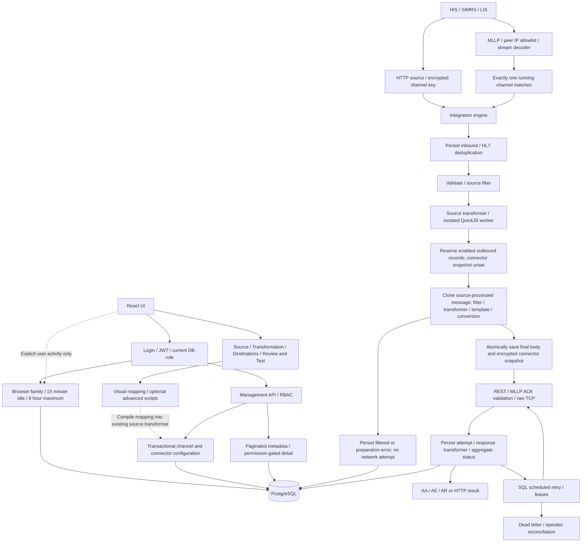
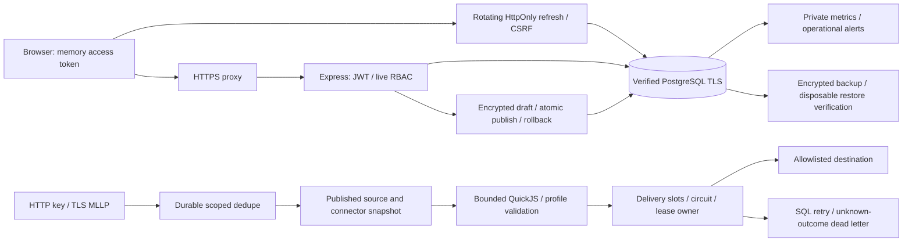

# Architecture

Existing React UI and Express/PostgreSQL architecture are preserved. Root environment is validated once. Shared middleware enforces authentication, current database role, permissions, safe error responses and request trace IDs.

## Code organization and contribution rules

`services/messageProcessor.services.ts` coordinates inbound processing and preserves the existing public entry points. Its `engine/` modules separate pure retry/status rules (`policy.ts`), bounded format conversion (`conversion.ts`), final-payload verification and preparation diagnostics (`preparation.ts`), delivery and response scripts (`delivery.ts`), and preparation/attempt persistence (`repository.ts`). Network delivery remains outside database transactions. The worker imports the same public entry points.

Monitor HTTP handlers stay in `services/message.services.ts`; `monitor/query.ts` validates filters, `monitor/repository.ts` contains PostgreSQL reads, and `monitor/mapping.ts` controls response and payload projection. Payload authorization and audit remain in the HTTP handler. Repository modules do not depend on Express request/response objects.

Frontend domain types have one definition in `client/src/types/`, exported through the existing `types.ts` entry point. API calls belong in `services/`; page components own UI state. The channel wizard delegates destination fields to `DestinationEditor` and draft defaults to `channelDraft`; message details delegate payload rendering to `PayloadViewer`. Add new connector or conversion behavior to the corresponding engine module instead of enlarging page components or orchestration code.

`TransformationEditor` uses the pure `utils/fieldMapping.ts` compiler shared with the server. Versioned mapping metadata lives in the existing source or destination transformer script, so export/import and revision snapshots retain it. Custom scripts require explicit replacement. `preview-transformation` runs the same processing pipeline with connection validation disabled and no network operations; full dry-run and explicit destination probes retain their own validation. See [Lite UI behavior and limits](MIRTH_LITE_UI.md).

V1 mapping bytes remain unchanged. V2 mappings add explicit TEXT/NUMBER/BOOLEAN and calendar-date conversions, indexed output arrays and optional curated HL7 configuration. `fieldMappingV2.ts` validates the configuration and compiles the fixed JavaScript text in `fieldMappingRuntimeV2.ts` for the existing QuickJS interpreter. Fixed runtime text avoids module-import aliases and browser minifier renaming crossing the worker boundary; host JavaScript never evaluates user field paths. Generated V2 scripts are recognized canonically, normalize XML/HL7 input through bounded existing parsers, and return a controlled result envelope. Altered or noncanonical reserved V2 metadata/body fails with `FIELD_MAPPING_CONFIG_INVALID` before sandbox execution or delivery. Only allowlisted mapping/profile failure codes and configured field paths become user guidance. Existing V1 and advanced scripts retain their original input and sandbox behavior. Older binaries cannot interpret the V2 result envelope; publish a compatible V1 or custom-script revision before downgrading.

Step 2 edits mapping and optional scripts only. Source owns the input format; each destination owns its output format independently. Review and Test owns synthetic input, all previews and optional connection probes. Test errors and cached previews clear when the operator leaves Review or changes configuration/input/permission. Missing required fields in an intact generated mapping produce safe target-field guidance through a bounded diagnostic replay; custom exception text is never returned. The destination preparation safeguards below reuse the existing pipeline and database columns.

The simplified wizard no longer calls field discovery or presents a Source sample panel. Test input lives only in Review & Test. `POST /api/channel/discover-fields` remains an authenticated `channel:write` operation for synthetic samples. It reuses runtime JSON/XML/HL7 parsing and optional source transformation, returning field paths/types/labels without sample values. The source and processed trees are bounded to 512 nodes and 12 path levels. The response is withheld until the metadata-only `DISCOVER_MESSAGE_FIELDS` audit succeeds; no channel/message is saved and no destination is contacted. JSON arrays, XML attributes under `$`, text under `_`, and indexed HL7 repetitions share the same explorer contract. Field discovery does not replace channel validation or prove a destination accepts the sample.

Review results add a JSON `parsedInput` for XML/HL7 input, separate from the original input and source-processed payload. Its entire payload is `[REDACTED]` by default: numeric HL7/XML paths must not bypass format-specific privacy controls. Actual parsed values require the existing ADMIN raw permission and audited explicit request. Successful routed HL7 outputs also expose a bounded `fieldTree` containing paths/types and descriptions, never values. There is no live-send action hidden inside discovery or dry-run.

`utils/simpleCondition.ts` compiles the Field/Operator/Value builder into the existing source or destination filter script, with canonical versioned metadata. It uses bounded own-property paths and data literals, without evaluation of field/value expressions. The retained-filter helpers in `utils/sourceFilter.ts` preserve inactive source and destination rules in their existing script columns without executing them. Destination enabled and filter enabled remain independent: a disabled destination is excluded from runtime jobs; an enabled destination with its filter off bypasses that filter. Destination conditions read the source-processed message before destination transformation. Only intact generated mapping/filter scripts receive bounded XML normalization; legacy scripts retain their original input. Exact Boolean legacy expressions, including `false`, retain their Boolean meaning. `validationProfile.basicSyntax` selects format-appropriate basic validation; legacy JSON-object presets and custom profiles remain readable. These UI features reuse the existing pipeline stages.

Use TypeScript strict checking, separate `import type` statements, and explicit `_` prefixes for intentionally unused handler parameters. Unused variables/parameters and explicit `any` fail checks. Prettier supplies the repository's formatting rules. Run `npm run format` for formatting, and `npm run typecheck`, `npm run lint`, `npm run format:check`, `npm test`, `npm run build`, and `npm run test:e2e` before submitting changes. Real PostgreSQL verification uses only a newly created `mirth_test_*` schema via `npm run test:sql`.

## Message reliability

Receive checks current RUNNING state. Persist inbound before source validation. HL7 sender application/facility/control ID is deduplicated per channel via a unique partial PostgreSQL index and transaction-scoped advisory lock. Reserve all destination records before transport side effects. Source and destination failures remain visible in SQL.

Each enabled destination receives an independent clone of the source-processed message. Its pipeline is filter → transformer → optional retained template script → outbound conversion. Template scripts consume the transformer result and can replace the final body; there is no template catalog or second rendering engine. A mismatch records FILTERED only for that destination. A preparation failure records OUT-ERROR with a safe stage/code diagnostic. Both leave the connector snapshot unset and create no delivery slot, transport attempt log or automatic retry. Other destinations continue independently. Disabled destinations create no outbound job and run no filter or script.

The engine reserves outbound records with `transport_config=NULL`. Only successful preparation atomically stores the final serialized body and encrypted connector snapshot under the delivery lease. The encrypted snapshot includes `preparation_version:1`. Retries reuse that final body and snapshot without repeating filters, transformers, templates or conversion. Retry and manual resend verify preparation first: a historical connector snapshot alone is insufficient when preparation failed or a crash left the outcome unproven. Legacy queued work or recorded transport/admission evidence provides a compatibility path; otherwise the operation is rejected for reconciliation. No migration or new persisted status is required.

Queue claims use PostgreSQL FOR UPDATE SKIP LOCKED with UPDATE RETURNING; lease recovery marks uncertain delivery as dead letter. Heartbeat extends leases during active inbound work. Permanent HTTP 4xx responses other than 408/429 stop automatic retry; 408/429 and 5xx follow the configured bounded retry policy. Ambiguous transport outcomes remain dead letters. Network operations are not held inside SQL transactions.

Atomic DB operations: channel + related destinations + audit; outbound attempt status + log; token revocation + logout audit. An ACK is generated only after required persistence finishes. Exactly-once delivery across independent databases/transports is not promised: downstream needs HL7 control-ID deduplication or REST Idempotency-Key support.

Migration 007 adds nullable integer `MessageDestinationLog.request_duration_ms`. The engine records actual transport duration before response scripts and result persistence; admission waits have no transport duration. Monitor `durationMs` exposes this value, while `attemptCount` counts recorded transport attempts over the complete outbound history. Known filtering/preparation/admission events count as zero attempts; ambiguous historical events remain unknown. HTTP status also comes from the captured response. Historical values are never inferred from timestamps or retry counters.

Message detail adds `destinationOutcomes` separately from paginated `destinationLogs`. Outcomes report enabled/filter/transformation/template/conversion/delivery decisions from the captured connector or channel revision and saved processing state; disabled entries can be reconstructed only when the immutable revision contains them. Missing historical evidence stays UNKNOWN. Logs add `eventKind`, `networkAttempted` and `occurredAt`; `sentAt` is returned only for a recorded network event. Admission waits remain operational log events without becoming successful delivery attempts. Payload permission, redaction and raw-access audit remain in the handler.

## State compatibility

Channel status keeps RUNNING/STOPPED/ERROR; PAUSED is added. Legacy IN/OUT direction and OUT-SENT/OUT-ERROR remain. Inbound final state: RECEIVED, SUCCESS, PARTIAL, FAILED, FILTERED, QUEUED or IN-ERROR. Outbound work: PROCESSING, OUT-SENT, OUT-ERROR, FILTERED, QUEUED, RETRYING, DEAD_LETTER.

Removed destinations are retired, their foreign keys/history remain, and queued jobs become dead letters. Historical channel deletion is refused until messages are resolved/retained successfully and purged. Failure history is not silently erased to make updates succeed.

Current startup and restore verification require migrations 001–007. Existing filter/transformer/response scripts, validation profiles, routing and multiple destinations remain in runtime tables and encrypted revisions. Draft saves classify changed source/transformation/destination/name areas into action-only audit events inside the existing transaction; active configuration changes only on publish. Binary rollback requires a compatible published configuration, particularly for generated XML conditions that require the new normalizer. Preserve the additive schema, data, keys and history; see [upgrade compatibility](MIRTH_LITE_UI.md#database-upgrade-dan-compatibility).

## Security boundaries

Management JWT and external source API keys are separate. Source keys/endpoints/snapshots use AES-256-GCM. Endpoint credentials never appear in channel-list responses. Script configuration is returned only to ADMIN/DEVELOPER. PHI is absent from metadata listing and structured application logs; raw detail requires permission and is audited.

QuickJS runs interpreted JavaScript in a WebAssembly interpreter inside a Node worker. It receives only serialized data and pure helper source. No host callbacks/module loader/Node globals/network helpers are exposed. Interpreter memory/stack/CPU, worker heap, wall-clock and concurrency are bounded. The whole engine still needs deployment resource limits and defense against dependency/runtime vulnerabilities.

HTTP destination requests validate exact host allowlist, pin DNS addresses, reject link-local/metadata destinations and redirects, and cap body/response and request time. PostgreSQL is encrypted with certificate verification in production. MLLP supports optional native TLS/mTLS with certificate/hostname verification; production plaintext requires an explicitly approved isolated-network exception. Deployed certificates, renewal and network controls need runtime verification.

Optional `deliveryPolicy.http` configures POST/PUT/PATCH, a format-compatible Content-Type, NONE/BEARER/BASIC authentication and at most ten named environment-backed headers. Configuration holds slot references only. Actual values resolve during delivery from `MIRTH_DESTINATION_<destination-id>_<slot>`; Bearer and Basic use their fixed slots. Per-destination IDs prevent one connector from reading another connector's credentials. Explicit environment authentication overrides legacy URL userinfo; NONE preserves legacy URL Basic behavior. Missing, oversized or newline-bearing credentials fail before a request, with no transport timing or automatic retry. These non-network DELIVERY_REJECTION events remain distinguishable from attempts. Secrets do not enter configuration exports, preview responses or audit details.

Outbound XML is parsed before transport, including raw XML returned by advanced scripts. XML-to-JSON conversion uses the same bounded parser: DTD/entity declarations, malformed documents, payload-limit violations, more than 20,000 nodes or depth above 64 are rejected without sending. Conversion failure remains distinct from filter failure and cannot make the original JSON a fallback outbound body.

## Curated HL7 mapping boundary

New visual HL7 generation supports v2.5 ADT^A04/ADT^A01, one-order ORU^R01 and ORM^O01 profiles. Configuration seeds headers and supported segments, then mappings populate the structured intermediate representation before the existing serializer escapes data and emits CR-separated segments. MSH-1/2/9/11/12 remain header-controlled; MSH-9 includes the configured message structure. Optional missing date/time and control ID use a runtime UTC timestamp with `+0000` and generated ID. Timestamp overrides accept calendar-valid `YYYYMMDDHHmmss` with an optional `±HHMM` offset up to 14:00; a missing offset means sender-local time. Literal overrides and explicit date conversions remain available. Template checks cover selected required fields, full calendar dates, supported codes and order/observation identifiers. Repeated OBX output uses explicit indexes; complete hospital message groups, all v2 versions and facility conformance are not implemented by these presets.

Metadata references are HL7 International's [message maps](https://hl7.org/fhir/uv/v2mappings/STU1/message_maps.html) for the ADT_A01, ORM_O01 and ORU_R01 structure families and [table 0001](https://hl7.org/fhir/R4/v2/0001/index.html) for administrative sex codes. These references explain the curated choices; they do not certify the application or replace facility-specific profiles. Existing raw HL7 parsing/pass-through still preserves supported custom delimiters, escapes, field repetitions and repeated segments.

## Operational boundaries

One engine instance owns its shared MLLP bind address. SQL retry claims support competing workers, but multi-instance routing, load balancing and HA have not been qualified. Start/stop prevents new receive; already accepted work finishes. Graceful shutdown stops accepting traffic, drains active work, stops scheduler and closes the pool, with a bounded deadline.

Retention uses bounded batches of resolved messages and independent audit retention. Unresolved failure/dead-letter records require operator reconciliation. UTC is used for new SQL writes and timestamps; old localized timestamps need a separately reviewed conversion.

## Verification boundaries

The mapping-only follow-up passed 345 unit/API tests in 28 suites and 57 browser scenarios with synthetic fixtures. Coverage was 82.09% statements, 78.80% branches, 83.84% functions and 83.12% lines. Typecheck, lint, formatting and client/server build passed. API tests mock database sessions; REST/MLLP tests use real loopback sockets.

Before this follow-up, `npm run test:sql` passed 19 native PostgreSQL 18.4 scenarios for `1734591` on a newly created `mirth_test_*` schema, including repeat migrations through schema 7, the requested Siti Aminah JSON→XML fixture delivered to a real local HTTP receiver, persisted inbound/source/outbound payloads, actual HTTP/timing metadata and valid ORM filtering without delivery. Compiled runtime startup, health/readiness, protected metrics and SIGTERM during active work also passed then on disposable PostgreSQL. SQL/runtime checks were not repeated for this UI/preview-only change. A fresh schema-7 native backup/restore drill was not run because `pg_dump`/`pg_restore` were unavailable. Docker image, hospital-specific HL7 profiles, load and disaster recovery still require deployment validation.

## V2 runtime boundaries

Runtime source/destination tables remain materialized for compatibility. Revisions and keyring preserve configuration history; raw credentials never enter revision diff, logs or metrics. See ADR_CHANNEL_VERSIONING for intentional update/delete behavior changes.

## Versioned source message validation

The existing validation_profile column and encrypted revision snapshot retain the active mode (NONE/FIELDS/CUSTOM/LEGACY) and inactive rules. HTTP parsing precedes durable inbound acceptance; the processor applies shared input validation → source filter → source transformation → outbound reservation → destination pipeline. FIELDS evaluates bounded own-property JSON paths without executing field/value data. Custom JSON Schema, bounded XML/HL7 rules and existing sandbox scripts remain format-specific. MLLP retains its existing listener routing-filter step before selecting a channel, then uses the same processor.

Dry-run calls the same validator and returns safe per-rule decisions without transport or database side effects. Rejection stores IN-ERROR with bounded field/code diagnostics in last_error, not payload values. Monitor list exposes the error code; detail exposes curated field reasons. Logs keep codes/IDs only, and preview/raw payload permissions remain unchanged. No new schema/table/status enum is required. New envelopes must not be run by older binaries that ignore their semantics; restore a compatible published configuration before downgrade.

### Compact HL7 destination editor — 21 October 2026

The four wizard steps are unchanged. Shared Transformation remains optional; HL7-specific mapping is inline in its destination, with one shared metadata-backed field picker and collapsed header/script settings. Each destination still runs its existing independent pipeline. PID-7 selection chooses the existing V2 date conversion rather than changing serializer behavior; existing canonical V1/V2 script bytes and stored configuration contracts remain unchanged. Blank UI rows never create stored mappings. Review still calls the real dry-run engine; collapsed diagnostics and copying an already-authorized preview change presentation only. No new database migration is required for this UI update.

### Channel wizard presentation cleanup — 21 October 2026

Source's former transformer shortcut and Step 2 edited the same processingScript, not separate stages. Step 2 is now the sole UI owner; its No transformation/Modify fields choice is local presentation state inferred from saved configuration, with confirmation before clearing existing work. Each destination still owns a single TransformationEditor instance: a layout hook places HL7 mapping inline or non-HL7 mapping within the primary Advanced section without remounting unfinished drafts. Authentication references, processing/filter/legacy output and delivery controls are grouped by purpose. The destinationSettings adapter delegates header checks to the shared HTTP contract and applies the API's numeric delivery bounds; it does not resolve or accept secret values. The channel-only modal layout has one scrolling content body and fixed navigation/footer; standalone script and other dialogs retain their layout. No backend, persistence contract or database migration changed in this cleanup.
