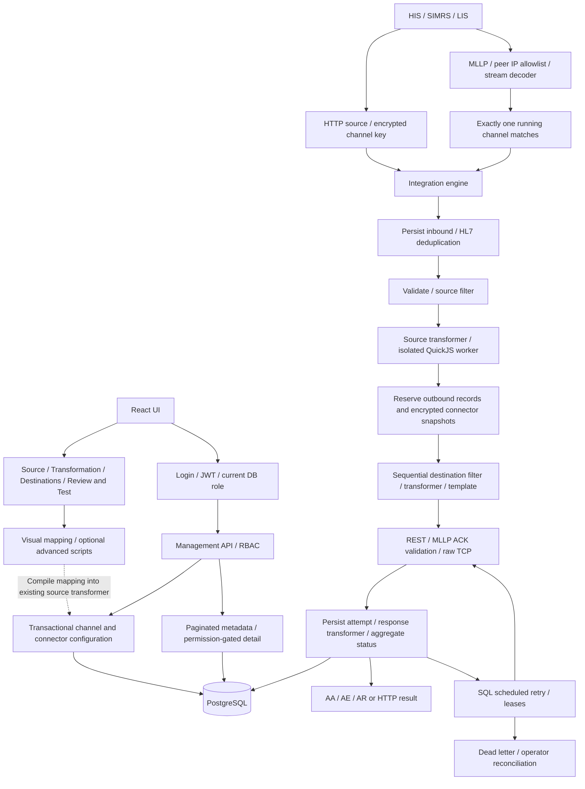
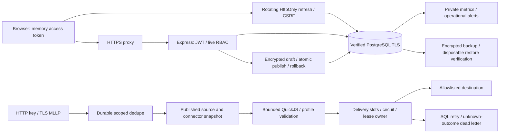

# Architecture

Existing React UI and Express/PostgreSQL architecture are preserved. Root environment is validated once. Shared middleware enforces authentication, current database role, permissions, safe error responses and request trace IDs.

## Code organization and contribution rules

`services/messageProcessor.services.ts` coordinates inbound processing and preserves the existing public entry points. Its `engine/` modules separate pure retry/status rules (`policy.ts`), format conversion (`conversion.ts`), delivery and response scripts (`delivery.ts`), and transactional attempt persistence (`repository.ts`). Network delivery remains outside database transactions. The worker imports the same public entry points.

Monitor HTTP handlers stay in `services/message.services.ts`; `monitor/query.ts` validates filters, `monitor/repository.ts` contains PostgreSQL reads, and `monitor/mapping.ts` controls response and payload projection. Payload authorization and audit remain in the HTTP handler. Repository modules do not depend on Express request/response objects.

Frontend domain types have one definition in `client/src/types/`, exported through the existing `types.ts` entry point. API calls belong in `services/`; page components own UI state. The channel wizard delegates destination fields to `DestinationEditor` and draft defaults to `channelDraft`; message details delegate payload rendering to `PayloadViewer`. Add new connector or conversion behavior to the corresponding engine module instead of enlarging page components or orchestration code.

`TransformationEditor` uses the pure `utils/fieldMapping.ts` compiler shared with the server. Versioned mapping metadata lives in the existing source-transformer script, so export/import and revision snapshots retain it. Custom scripts require explicit replacement. `preview-transformation` runs the same processing pipeline with connection validation disabled and no network operations; full dry-run and explicit destination probes retain their own validation. See [Lite UI behavior and limits](MIRTH_LITE_UI.md).

Step 2 edits mapping and optional scripts only. Source owns the input format; each destination owns its output format independently. Review and Test owns synthetic input, all previews and optional connection probes. Test errors and cached previews clear when the operator leaves Review or changes configuration/input/permission. Missing required fields in an intact generated mapping produce safe target-field guidance through a bounded diagnostic replay; custom exception text is never returned. No runtime pipeline or database migration is added by this UI follow-up.

`utils/simpleCondition.ts` compiles the Field/Operator/Value builder into the existing source or destination filter script, with canonical versioned metadata. It uses bounded own-property paths and data literals, without evaluation of field/value expressions. Only intact generated mapping/filter scripts receive bounded XML normalization; legacy scripts retain their original input. `validationProfile.basicSyntax` selects format-appropriate basic validation; legacy JSON-object presets and custom profiles remain readable. These UI features reuse the existing pipeline stages.

Use TypeScript strict checking, separate `import type` statements, and explicit `_` prefixes for intentionally unused handler parameters. Unused variables/parameters and explicit `any` fail checks. Prettier supplies the repository's formatting rules. Run `npm run format` for formatting, and `npm run typecheck`, `npm run lint`, `npm run format:check`, `npm test`, `npm run build`, and `npm run test:e2e` before submitting changes. Real PostgreSQL verification uses only a newly created `mirth_test_*` schema via `npm run test:sql`.

## Message reliability

Receive checks current RUNNING state. Persist inbound before source validation. HL7 sender application/facility/control ID is deduplicated per channel via a unique partial PostgreSQL index and transaction-scoped advisory lock. Reserve all destination records before transport side effects. Source and destination failures remain visible in SQL.

Each outbound record stores a final serialized payload and encrypted connector snapshot. Retries reuse that final payload without repeating transforms. Queue claims use PostgreSQL FOR UPDATE SKIP LOCKED with UPDATE RETURNING; lease recovery marks uncertain delivery as dead letter. Heartbeat extends leases during active inbound work. Network operations are not held inside SQL transactions.

Atomic DB operations: channel + related destinations + audit; outbound attempt status + log; token revocation + logout audit. An ACK is generated only after required persistence finishes. Exactly-once delivery across independent databases/transports is not promised: downstream needs HL7 control-ID deduplication or REST Idempotency-Key support.

Migration 007 adds nullable integer `MessageDestinationLog.request_duration_ms`. The engine records actual transport duration before response scripts and result persistence; admission waits have no transport duration. Monitor `durationMs` exposes this value, while `attemptCount` counts recorded attempts over the complete outbound history and remains unknown if legacy timing is incomplete. HTTP status also comes from the captured response. Historical values are never inferred from timestamps or retry counters.

## State compatibility

Channel status keeps RUNNING/STOPPED/ERROR; PAUSED is added. Legacy IN/OUT direction and OUT-SENT/OUT-ERROR remain. Inbound final state: RECEIVED, SUCCESS, PARTIAL, FAILED, FILTERED, QUEUED or IN-ERROR. Outbound work: PROCESSING, OUT-SENT, OUT-ERROR, FILTERED, QUEUED, RETRYING, DEAD_LETTER.

Removed destinations are retired, their foreign keys/history remain, and queued jobs become dead letters. Historical channel deletion is refused until messages are resolved/retained successfully and purged. Failure history is not silently erased to make updates succeed.

Current startup and restore verification require migrations 001–007. Existing filter/transformer/response scripts, validation profiles, routing and multiple destinations remain in runtime tables and encrypted revisions. Draft saves classify changed source/transformation/destination/name areas into action-only audit events inside the existing transaction; active configuration changes only on publish. Binary rollback requires a compatible published configuration, particularly for generated XML conditions that require the new normalizer. Preserve the additive schema, data, keys and history; see [upgrade compatibility](MIRTH_LITE_UI.md#database-upgrade-dan-compatibility).

## Security boundaries

Management JWT and external source API keys are separate. Source keys/endpoints/snapshots use AES-256-GCM. Endpoint credentials never appear in channel-list responses. Script configuration is returned only to ADMIN/DEVELOPER. PHI is absent from metadata listing and structured application logs; raw detail requires permission and is audited.

QuickJS runs interpreted JavaScript in a WebAssembly interpreter inside a Node worker. It receives only serialized data and pure helper source. No host callbacks/module loader/Node globals/network helpers are exposed. Interpreter memory/stack/CPU, worker heap, wall-clock and concurrency are bounded. The whole engine still needs deployment resource limits and defense against dependency/runtime vulnerabilities.

HTTP destination requests validate exact host allowlist, pin DNS addresses, reject link-local/metadata destinations and redirects, and cap body/response and request time. PostgreSQL is encrypted with certificate verification in production. MLLP supports optional native TLS/mTLS with certificate/hostname verification; production plaintext requires an explicitly approved isolated-network exception. Deployed certificates, renewal and network controls need runtime verification.

## Operational boundaries

One engine instance owns its shared MLLP bind address. SQL retry claims support competing workers, but multi-instance routing, load balancing and HA have not been qualified. Start/stop prevents new receive; already accepted work finishes. Graceful shutdown stops accepting traffic, drains active work, stops scheduler and closes the pool, with a bounded deadline.

Retention uses bounded batches of resolved messages and independent audit retention. Unresolved failure/dead-letter records require operator reconciliation. UTC is used for new SQL writes and timestamps; old localized timestamps need a separately reviewed conversion.

## Verification boundaries

The mapping-only follow-up passed 345 unit/API tests in 28 suites and 57 browser scenarios with synthetic fixtures. Coverage was 82.09% statements, 78.80% branches, 83.84% functions and 83.12% lines. Typecheck, lint, formatting and client/server build passed. API tests mock database sessions; REST/MLLP tests use real loopback sockets.

Before this follow-up, `npm run test:sql` passed 19 native PostgreSQL 18.4 scenarios for `1734591` on a newly created `mirth_test_*` schema, including repeat migrations through schema 7, the requested Siti Aminah JSON→XML fixture delivered to a real local HTTP receiver, persisted inbound/source/outbound payloads, actual HTTP/timing metadata and valid ORM filtering without delivery. Compiled runtime startup, health/readiness, protected metrics and SIGTERM during active work also passed then on disposable PostgreSQL. SQL/runtime checks were not repeated for this UI/preview-only change. A fresh schema-7 native backup/restore drill was not run because `pg_dump`/`pg_restore` were unavailable. Docker image, hospital-specific HL7 profiles, load and disaster recovery still require deployment validation.

## V2 runtime boundaries

Runtime source/destination tables remain materialized for compatibility. Revisions and keyring preserve configuration history; raw credentials never enter revision diff, logs or metrics. See ADR_CHANNEL_VERSIONING for intentional update/delete behavior changes.
