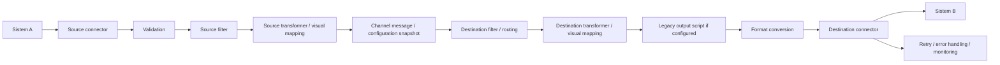

# Mirth Connect Lite UI

## Konsep dan navigasi

Latest security behavior: [Browser session timeout](#browser-session-timeout--21-october-2026). Field discovery/mapping guidance: [V2 mapping and HL7](#field-discovery-v2-mapping-and-hl7--18-october-2026). Earlier dated sections retain the verification applicable to those releases.

Wizard mengikuti **Source → Transformation → Destinations → Review & Test**. User membuat integrasi Sistem A → Mirth-Connect → Sistem B melalui format, mapping dan endpoint. Filter, scripting dan pengaturan delivery tersedia melalui Advanced. Kemampuan inti engine tetap dipertahankan.



Navigasi utama terdiri dari Overview, Channels, Messages dan Settings. Start/Stop tetap berada pada Channels; resend, reconciliation dan attempt history tetap tersedia pada Messages sesuai permission. Penyederhanaan ini tidak menghapus worker, retry, circuit breaker, dead letter, routing atau snapshot konfigurasi.

| Kemampuan | Lokasi UI |
| --- | --- |
| Source connector, inbound format | Source |
| API key dan endpoint aktual | Source untuk channel tersimpan; Channel saved setelah Save |
| Validation, source filter | Advanced source settings |
| Source transformer bersama | Step 2 → Transformation |
| Mapping dua kolom Source Field / Target Field, Add Mapping | Transformation → Modify fields |
| Required/default | Mapping options per baris, awalnya tertutup |
| Script transformasi kompleks | Advanced Custom Transformation Script |
| Input data uji sintetis | Review & Test saja; tidak disimpan pada channel |
| Preview, Run Test, connection probe | Review & Test |
| Nama, connector, outbound format, endpoint destination | Destinations |
| Destination filter / transformer / template | Advanced destination settings |
| Retry, timeout, capacity dan circuit protection | Advanced destination settings → Delivery settings |
| Multiple destinations | Add Destination; default satu destination |
| Draft, publish, rollback dan revision history | Revisions |
| Inbound, source processed, outbound dan delivery result | Messages |

## Dropdown

Dropdown pada filter, Source, Destinations, Messages dan Settings memakai ukuran/padding yang seragam, indikator pilihan aktif dan focus keyboard yang terlihat. Menu mengikuti lebar field, membatasi tinggi daftar dengan scroll, dan menjaga label panjang di dalam viewport. Search/filter pada mobile mempunyai ruang terpisah. Escape menutup menu pilihan terlebih dahulu; tekan kembali untuk menutup dialog.

Semantik select native, label, value, permission dan keyboard navigation tetap digunakan. Browser yang mendukung `appearance: base-select` mendapat menu bergaya aplikasi; browser lain tetap memakai picker sistem dengan field yang ditata konsisten.

Contoh sintetis: [filter Channels](screenshots/usability/dropdown-channels.png), [dropdown form](screenshots/usability/dropdown-source.png), [mobile](screenshots/usability/dropdown-mobile.png).

Verifikasi dropdown: client build, workspace typecheck, lint, format dan 57 browser test lulus. Pemeriksaan sintetis Chrome 155 pada desktop, modal dan mobile 390px mencakup ukuran menu, daftar panjang/scroll, keyboard, Escape serta label panjang. Pemeriksaan awal menemukan horizontal overflow dan Escape yang menutup dialog; keduanya diperbaiki lalu diperiksa ulang. Unit/backend, database dan dependency tidak berubah atau diuji ulang khusus perubahan tampilan ini.

## 1. Source

Source channel baru hanya menampilkan nama channel, connector, inbound format dan Advanced source settings yang tertutup. Endpoint dan kontrol API key baru ditampilkan setelah Save, langsung pada Channel saved; channel tersimpan juga menampilkannya di Source. Endpoint HTTP berasal dari backend melalui konfigurasi `PUBLIC_BASE_URL` dan `INBOUND_PATH`; frontend tidak menebak hostname production. Contoh development `http://localhost:9000` dan production `https://connect.bulmar.tech` merupakan nilai konfigurasi, bukan alamat tetap pada UI. Channel baru tidak menampilkan URL `{channelId}`. Setelah Save, endpoint aktual tersedia dengan **Copy Endpoint**; hostname tetap berasal dari konfigurasi backend.

API key digunakan oleh sistem sumber untuk mengirim data ke channel. Key hanya tampil sekali setelah generate/rotate; rotasi membatalkan key sebelumnya. Menutup editor atau berpindah langkah menghapus key dari tampilan. Key tidak ditampilkan kembali pada list atau audit plaintext. Tombol **Copy API key** tetap tersedia pada tampilan sekali tersebut. Copy Endpoint tersedia untuk channel tersimpan. Tombol curl, Postman dan request examples tetap tidak ditampilkan. Kegagalan clipboard menyediakan pesan untuk menyalin alamat secara manual.

**Advanced source settings** berurutan:

1. **Validation**: menentukan apakah pesan valid.
2. **Filter**: menentukan apakah pesan valid tersebut diproses. Status Off / Needs configuration / Configured mengikuti kondisi aktual, bukan checkbox saja. Bantuan path tersedia melalui Field path help. Pada MLLP, pesan harus cocok dengan tepat satu channel HL7 yang berjalan karena listener dipakai bersama.
Source Transformer diedit hanya melalui **Step 2 → Transformation**, karena kedua akses lama mengubah `processingScript` yang sama. Stage backend tetap tersedia dan hanya dieksekusi sekali.

Source response editor tidak ditampilkan. Channel existing yang memakainya menampilkan **Legacy custom source response is active.** hanya pada Review & Test → View details → Source processing, sehingga Advanced Source hanya berisi Validation dan Filter. Script tetap disimpan dan dijalankan backend. Response HTTP standar memiliki `success`, `messageId`, `status` serta `result` existing untuk compatibility; response error dan HL7 ACK mengikuti kontrak backend yang berlaku.

Hasil processing gagal yang sudah tercatat mengembalikan HTTP 502 dengan code `MESSAGE_PROCESSING_FAILED`, pesan aman, requestId dan details kosong. `result` dan custom response legacy tetap dipertahankan. FILTERED tetap HTTP 200 dan QUEUED tetap HTTP 202 tanpa error fields.

### 8.3 Message Validation

Buka **Source → Advanced source settings → Validation**. Validation memeriksa pesan masuk; Source Filter memilih pesan valid yang perlu diproses; Transformation mengubah pesan untuk destination. Contoh: validation mewajibkan `patient_id`, filter memilih `department = LAB`, lalu mapping mengubah `patient_id` menjadi `PatientID`. Field required pada mapping tidak otomatis menjadi aturan input.

| Mode | Perilaku |
| --- | --- |
| No additional validation | Parsing/pengamanan format, authentication dan batas ukuran tetap berjalan; tidak ada aturan field tambahan. |
| Field validation | Khusus JSON; tentukan Field, Type dan Required. Semua aturan harus lulus sebelum filter/transformation. |
| Custom validation schema | Masukkan schema/rules sesuai bahasa yang dijelaskan editor; Save/Test memeriksanya di backend. |
| Keep legacy validation | Hanya untuk konfigurasi lama yang mempunyai Basic syntax atau JSON-object check; perilaku aslinya dipertahankan. |

Basic lama `{ "basicSyntax": true }` memeriksa serializability/batas JSON, bukan field wajib. XML/HL7 sudah diperiksa parsing minimumnya tanpa mode tersebut. Basic lama `{ "jsonSchema": { "type": "object" } }` juga mewajibkan object JSON; array/scalar ditolak oleh aturan bentuk object, bukan karena sintaks JSON salah. Membuka/menyimpan channel lama tidak mengonversinya. Memilih mode baru adalah perubahan eksplisit.

**Field validation**

Pilih Field validation, isi baris pertama, lalu **Add validation rule** bila perlu. Placeholder abu-abu bukan aturan. Required berarti wajib diisi: missing, null, string kosong dan hanya spasi gagal; angka `0` serta boolean `false` tetap valid sesuai tipe. Optional yang missing dilewati, tetapi null/tipe salah tetap gagal. Validation tidak mengonversi `"123"` menjadi angka atau `"false"` menjadi boolean.

| Field contoh | Type | Required | More rules |
| --- | --- | --- | --- |
| patient_id | Text | Yes | — |
| name | Text | Yes | — |
| gender | Text | No | Allowed values, satu per baris: M / F / U |
| date_of_birth | Date (YYYY-MM-DD) | No | — |

Ini contoh channel, bukan field wajib global. Gunakan nama field dari input aktual. Text/Number/Boolean memeriksa tipe JSON asli. Date memeriksa kalender, termasuk leap year: `2000-01-01` valid, `2025-02-30` gagal. More rules menyediakan allowed text values, minimum/maximum text length, serta minimum/maximum number. Allowed values case-sensitive dan tidak memangkas nilai payload. Length mengikuti panjang string JavaScript (UTF-16). Field tambahan tetap diperbolehkan.

Path `patient_id` berbeda dari `patient.id`. Path bertingkat menggunakan titik; array memakai index mulai 0, misalnya `patients.0.id` atau `0.id` pada root array. Tidak ada wildcard/bracket syntax atau akses prototype. Maksimum 50 aturan unik, path 256 karakter/12 bagian; allowed values maksimum 50 nilai nonkosong, masing-masing 300 karakter. Nilai berisi spasi dipertahankan persis; baris kosong pada editor berarti tidak menambah nilai. Satu allowed value tidak boleh berisi CR/LF karena setiap baris mewakili satu nilai. Semua aturan aktif harus lulus; ini bukan AND/OR routing. JSON literal/scalar tetap JSON valid, tetapi tidak menyediakan struktur object/array yang dibutuhkan mode field rules.

Input sintetis yang valid untuk contoh tersebut:

```json
{"patient_id":"RM-000123","name":"Pasien Uji","gender":"F","date_of_birth":"2000-01-01"}
```

Input sintetis invalid karena `patient_id` hilang dan tanggal tidak mungkin:

```json
{"name":"Pasien Uji","gender":"F","date_of_birth":"2025-02-30"}
```

**Custom examples**

Editor menjelaskan bahasa aktif. Buka **Example configuration**, tinjau contoh, lalu klik **Use example**. Konfirmasi diperlukan sebelum menimpa konfigurasi nonkosong. Contoh tidak otomatis dijalankan atau disimpan. JSON-only legacy profile ditampilkan sebagai schema langsung, tetapi wrapper internalnya tetap utuh saat Save tanpa perubahan. Profile mixed/script lama tetap memakai full profile editor agar tidak kehilangan aturan.

Untuk JSON, editor menerima JSON Schema langsung, bukan wrapper internal:

```json
{"type":"object","properties":{"patient_id":{"type":"string","minLength":1}},"required":["patient_id"],"additionalProperties":true}
```

JSON Schema memakai AJV strict dengan batas 16 KiB. Keyword mahal/referensi seperti `pattern`, `patternProperties`, `format`, `$ref`, `$async` dan `uniqueItems` tidak didukung. Jangan memakai `format: date`; gunakan tipe Date pada Field validation. Schema `{}` valid tetapi tidak membatasi field; UI menjelaskannya dan tidak memberi badge Configured hanya karena radio dipilih. Semantik `required` JSON Schema legacy tidak diubah menjadi semantik Required builder yang lebih ketat terhadap null/spasi.

Untuk XML, editor menerima bounded XML rules, **bukan XSD/XPath**:

```json
{"root":"Order","requiredPaths":["Order.ID"],"values":[{"path":"Order.Status","allowed":["NEW","UPDATED"]}]}
```

Parser mempertahankan root dan repeated elements sebagai array internal. Path rules menyertakan root dan menelusuri repeated elements tanpa index; requiredPaths membutuhkan setidaknya satu nilai teks nonkosong. Allowed-value rule memeriksa seluruh elemen yang cocok. Namespace prefix adalah nama literal (misalnya `ns:Order.ns:ID`), tidak ada namespace expansion, attribute selector atau arbitrary XPath. Entity/DOCTYPE ditolak; depth/node/size tetap dibatasi.

Untuk HL7, editor menerima profil terbatas, bukan implementasi penuh standard profile:

```json
{"messageTypes":["ADT^A01"],"versions":["2.5"],"requiredFields":["MSH.10","PID.3"]}
```

Message type memakai nilai field MSH-9 lengkap; version memakai MSH-12. Required field memakai `SEGMENT.number` dan memeriksa minimal satu segmen dengan isi field tersebut. Component/subcomponent/index pada profil validation ini belum tersedia; source filter/mapping mempunyai konteks parser tersendiri. Profil tiap rumah sakit dapat berbeda. Field validation builder tidak tersedia untuk XML/HL7/TEXT; TEXT dapat mempertahankan custom sandbox profile yang didukung dan diuji, tanpa mengklaim JSON field validation.

**Save, mode switching, dan melihat kegagalan**

Konfigurasi baru menyimpan envelope versi 1 pada `validationProfile` existing: mode aktif, fieldRules, custom profile dan legacy profile bila ada. Saat mode diganti, aturan lengkap yang tidak aktif tetap tersimpan tetapi tidak dievaluasi. Input custom JSON yang belum valid hanya tersimpan lokal selama form dibuka; aturan valid sebelumnya dipertahankan saat menyimpan mode lain. Baris field yang belum lengkap menghalangi Continue/Save/Test bila mode FIELDS aktif. Badge/ringkasan menunjukkan aturan aktif yang lengkap; custom baru diperiksa server saat Save/Test. Tidak ada migrasi schema database atau reset channel.

Pengujian tetap di **Review & Test** melalui Test Transformation. Hasil menampilkan setiap rule Passed/Failed/Skipped tanpa nilai payload. Bila input gagal: Validation Failed, Source Filter/Transformation Not run, Network delivery NOT SENT. Preview selalu mengikuti redaction; label synthetic tidak membebaskan permission/audit raw access.

Pada inbound aktual, kegagalan field menghasilkan HTTP 422 `FIELD_VALIDATION_FAILED`, details berisi field/tipe/alasan yang aman, dan message **IN-ERROR**. Tidak dibuat outbound job, destination attempt atau delivery retry. Buka **Messages → pilih pesan → Input validation failed** untuk alasan yang ditangkap saat pemrosesan; tidak dihitung ulang menggunakan konfigurasi terbaru. Konfigurasi salah menghasilkan 400 `INVALID_FIELD_RULES` / `INVALID_VALIDATION_PROFILE` / `VALIDATION_FORMAT_UNSUPPORTED`; internal error tetap 500 melalui kontrak aman. JSON malformed dapat ditolak 400 sebelum row Messages dibuat. FILTERED tetap keputusan filter, bukan error validation.

MLLP mempertahankan routing filter sebelum pemilihan channel (perilaku existing). Sesudah channel dipilih, validation berjalan sebelum transformation/delivery; penolakan validation menghasilkan ACK AE dengan control ID yang sesuai. No-match/ambiguous routing tetap AR. Dry-run tidak melakukan routing listener global; uji listener diperlukan untuk penerimaan rumah sakit.

Envelope baru memerlukan binary yang memahami versi tersebut. Sebelum downgrade ke binary lama, publish konfigurasi legacy yang kompatibel dan tinjau seluruh channel/revision yang akan dijalankan. Binary lama dapat mengabaikan envelope baru; jangan menganggap downgrade langsung tetap menegakkan aturan baru. Tidak ada penghapusan data/revision/audit saat rollback.

Screenshot sintetis: [sebelum](screenshots/validation/before-basic.png), [Field validation](screenshots/validation/after-fields.png), [Custom example](screenshots/validation/after-custom.png). Screenshot membuktikan tampilan; keputusan runtime dibuktikan oleh automated integration tests.

### Filter tanpa script

**Source Filter** hanya memiliki checkbox **Enable source filter** dan builder **Simple condition** (Field / Operator / Value). Channel baru default OFF. Saat OFF, pesan melewati source filtering; validation tetap berjalan. Saat ON, kondisi diperiksa terhadap setiap pesan sebelum transformation dan destination. Tidak ada dropdown accept/reject/custom atau editor script untuk source. Destination Filter kini memakai checkbox dan builder yang sama, dengan konteks evaluasi tersendiri setelah Source Transformer (lihat bagian Destinations).

Field adalah path pada payload aktual, bukan metadata yang dibuat otomatis: JSON `patient.id`; XML `Patient.ID`; HL7 `MSH.9` (nilai message type lengkap, misalnya `ADT^A01`) atau `MSH.10` (control ID). `message_type` hanya berlaku jika pengirim benar-benar mengirim properti JSON tersebut. Dot path mendukung index array mulai 0; maksimum 12 bagian/256 karakter, Value 1.024 karakter; prototype keys ditolak. Konten harus terstruktur JSON/XML/HL7; teks bebas tidak mendukung pemilihan field dan menghasilkan error filter.

Operator: Equals, Not equals, Contains, Is empty, Is not empty, Starts with, Exists, Does not exist, dan pembanding numerik. Perbandingan case-sensitive; scalar angka/boolean dibandingkan sebagai string (`0`, `false`). Field hilang/null/objek/array tidak cocok dengan pembanding biasa, termasuk Not equals. Is empty menerima field hilang, null atau string kosong; Is not empty menerima scalar selain null/string kosong. Spasi tidak di-trim pada nilai pesan. Exists memeriksa keberadaan, termasuk null/kosong. Operator tanpa nilai menyembunyikan input Value; pembanding numerik menolak angka tidak finite, boolean dan string kosong. Satu kondisi per source sesuai model existing; gabungan AND/OR tidak ditambahkan.

Builder menyimpan metadata versi 1 dan script canonical pada `filterScript` existing. Nama field/nilai adalah data, bukan ekspresi JavaScript. Evaluasi tetap memakai QuickJS terisolasi dengan batas waktu, memory, concurrency dan payload; tidak ada evaluator arbitrary baru. JSON, HL7 dan XML menggunakan normalisasi existing. Compiler mempertahankan byte canonical operator lama agar filter XML/HL7 tersimpan tetap dikenali.

Saat dimatikan, aturan valid terakhir disimpan persis dalam wrapper `MIRTH_SOURCE_FILTER_DISABLED_V1` di kolom `filter_script`, bukan dibuang. Wrapper memiliki body no-op `return true;` untuk kompatibilitas runtime sebelumnya dan diperiksa integritasnya oleh runtime baru. Setelah Save/reopen, checkbox tetap OFF dan aturan dapat dipakai kembali. Wrapper maksimum 65.536 karakter; aturan besar yang tidak muat ditolak dengan pesan jelas, bukan dipotong. Input lokal yang belum valid tidak menjadi konfigurasi tersimpan; Save/Test/perpindahan langkah diblokir ketika filter ON. OFF dapat menyimpan aturan valid terakhir; saat diaktifkan kembali pada form yang sama, input lokal yang belum selesai tetap harus diperbaiki.

Filter legacy (literal boolean, accept/reject atau custom script) tetap aktif dengan perilaku aslinya dan notice **Legacy source filter retained**. Tidak dimigrasikan/reset otomatis. User dapat mematikannya atau memilih **Replace with simple condition**, lalu wajib melengkapi kondisi sebelum Save. Editor source script tidak ditampilkan. Legacy script tetap menggunakan sandbox existing. API tetap menerima legacy script untuk compatibility; UI sederhana hanya membuat kondisi canonical.

Kondisi tidak cocok menghasilkan status inbound **FILTERED**, tanpa transformation atau outbound reservation/delivery. Konfigurasi reserved metadata rusak ditolak API; bila ditemukan saat runtime, status **IN-ERROR** dengan kode `FILTER_CONFIG_INVALID`, tanpa delivery. Input yang tidak bisa dibaca kondisi canonical menghasilkan `FILTER_INPUT_INVALID`; tidak fallback accept-all. Error tracking/log hanya memuat kode aman/ID, bukan payload atau nilai kondisi. Dry-run di Review mengikuti pipeline yang sama tanpa network delivery. Publish/rollback, snapshot pesan, RBAC dan audit tetap berlaku; Save channel existing tetap membuat draft. Sebelum downgrade binary, pilih konfigurasi published yang kompatibel: operator Is empty/Is not empty baru belum dikenali sebagai visual canonical oleh runtime lama (khususnya normalisasi XML). Wrapper OFF sendiri tetap no-op pada runtime sebelumnya.

## 2. Transformation

Transformation untuk channel baru default **No transformation**, tanpa editor mapping/script atau baris kosong. Pilih **Modify fields** untuk membuka mapping **Source Field / Target Field**, tombol **Add Mapping**, dan **Advanced Custom Transformation Script** yang awalnya tertutup. Channel existing membuka mapping/script yang tersimpan, bukan menggantinya dengan default. Beralih ke No transformation meminta konfirmasi sebelum menghapus konfigurasi aktif; Cancel mempertahankannya. Pilihan mode ditampilkan ringkas dalam satu baris bila ruang cukup. Mapping menampilkan satu header Source Field / Target Field untuk semua baris, dengan label aksesibilitas unik per input. Helper menjelaskan bahwa mapping ini dipakai semua destination dan field yang tidak dipetakan tidak ikut output. Source menentukan inbound format; outbound format dipilih pada masing-masing destination. Tidak ada format selector, sample, example, preview, Test, privacy checkbox atau banner hasil pengujian pada langkah ini.

Dialog custom script memakai editor JavaScript selebar konten dengan footer Cancel / Save Script yang tetap terlihat. Script help tertutup secara default; placeholder singkat hanya contoh dan tidak otomatis diterapkan. Tombol **Use template** mengisi editor dengan contoh sesuai jenis script dan meminta konfirmasi sebelum mengganti kode yang sudah ditulis. Tombol ini tidak menjalankan script atau menyimpan channel. Save Script memperbarui form tanpa submit/berpindah langkah; Save Channel tetap diperlukan. Cancel membuang perubahan di dialog dan mengembalikan fokus. Batas sandbox serta konfirmasi penggantian mapping/script tetap berlaku.

Contoh mapping yang dapat ditambahkan sendiri:

| Source field | Target field |
| --- | --- |
| patient_id | PatientID |
| name | PatientName |
| gender | Gender |
| date_of_birth | BirthDate |

**Options** per baris awalnya tertutup dan mempertahankan Required, default value serta Type conversion. Tombol Add Mapping berukuran sesuai isinya, bukan selebar form. `Required` menolak nilai wajib yang hilang. Default digunakan ketika nilai tidak ada, null atau kosong; `0` dan `false` dipertahankan. Default UI berupa string. Field yang tidak dipetakan tidak ikut output. Tanpa mapping/script, field asli diteruskan ke converter.

Tidak ada input XML root pada UI. Metadata `rootElement` dari mapping existing tetap utuh saat baris diedit. Mapping baru tidak menambahkan wrapper `Patient` otomatis; wrapper khusus per destination dapat dibuat melalui Advanced destination transformer. Pipeline dan converter tidak diubah.

Dot paths membaca object bertingkat dan indeks array pada input; target bertingkat dibuat sebagai object. Maksimum 100 baris dan 12 tingkat; target duplikat/tumpang tindih serta prototype keys ditolak. Mapping tidak melakukan array expansion atau konversi tipe otomatis. HL7 menggunakan struktur parser existing, misalnya `PID.3` untuk identifier scalar dan `PID.5.2` untuk component yang tersedia. Profile/repetition berbeda tetap memerlukan path yang sesuai.

Mapping visual disimpan pada **source transformer yang sama**, yaitu `processingScript`, dan dijalankan QuickJS existing. Akses Source transformer lama di Advanced sudah digabung ke Step 2; tidak ada editor kedua atau stage tambahan. Script custom tidak diganti menjadi mapping tanpa konfirmasi eksplisit. Export/import channel XML tetap membawa script beserta metadata mapping/filter.

XML untuk mapping dan simple filter dinormalisasi sebelum masuk worker; script custom lama tetap menerima input aslinya. DTD/entity ditolak, parser dibatasi 20.000 nodes/kedalaman 65, serta tunduk pada batas payload dan sandbox. Error tidak mengembalikan plaintext pasien atau stack internal. Mapping yang belum lengkap menghalangi Continue/Save dan tetap tersedia ketika kembali ke langkah tersebut.

## 3. Destinations

Default satu destination; **Add Destination** tetap tersedia untuk routing ke banyak sistem. Field utama: nama, connector, outbound format dan endpoint. Setiap destination memiliki outbound format sendiri; perubahan format satu destination tidak diterapkan otomatis pada destination lain. Tidak ada selector output format global pada Transformation.

Satu **Advanced destination settings**, tertutup secara default, berisi disclosure **Transformation**, **Filter**, **Delivery**, serta **HL7 settings** bila profil HL7 aktif. Semua subsection tertutup pada awalnya. Membuka Advanced tidak langsung membuka seluruh form. Transformation memiliki mapping dan custom script yang sama untuk semua format; Filter default Off; Delivery berisi timeout, retry serta override HTTP method/Content-Type. Batas concurrency/circuit tetap ditegakkan backend; kontrol rinci berada di **Delivery → Expert delivery settings**. Error konfigurasi membuka subsection terkait agar dapat diperbaiki.

Connector hanya menawarkan **HTTP sender**, **MLLP sender**, dan **TCP sender** (pilihan lanjutan). Backend/API tetap memakai enum existing: REST, HL7, MLLP, TCP, RAW. HL7 ditampilkan sebagai MLLP, RAW sebagai TCP, tetapi membuka/menyimpan konfigurasi lama tidak menulis ulang enum, endpoint, TLS, outbound format atau retry policy. Endpoint/host/port ditampilkan sesuai transport. Header **Destination 1**, **Destination 2**, dan seterusnya menghindari judul berulang. Toggle Enabled tersedia untuk destination tersimpan atau konfigurasi disabled existing; perubahannya tetap mengikuti Save draft/publish, bukan bypass lifecycle. Add Destination tetap tersedia.

Kontrol Authentication, Custom headers, Add Header dan environment slot tetap tidak ditampilkan. Konfigurasi authentication/header tersimpan dipertahankan ketika mengedit/menyimpan; backend tetap memvalidasi, membaca secret server dan menegakkannya. Source API key/rotasi, destination SSRF, TLS/certificate validation dan sandbox tidak diubah. Legacy output/response scripts tetap aktif bila tersimpan; legacy output editor hanya tersedia pada Transformation, bukan tombol baru untuk setiap destination.

### Destination filter, transformation dan legacy output script — 18 October 2026

**Destination enabled** berada pada header destination tersimpan; perubahan tetap disimpan sebagai draft sebelum publish. OFF menonaktifkan destination: tidak ada filter, transformasi, delivery atau retry baru. **Enable destination filter** mempunyai fungsi berbeda: OFF melewati pemeriksaan kondisi untuk destination yang aktif, ON membuka Simple condition secara langsung. Dropdown Deliver/Skip/Custom serta editor filter script tidak tersedia untuk konfigurasi baru. Checkbox dan badge Customized berasal dari konfigurasi aktual; Field dan Value yang belum lengkap memblokir Continue/Save/Test. Is empty/Is not empty/Exists/Does not exist tidak memerlukan Value. Kondisi lama yang sengaja membandingkan string kosong tetap valid tanpa diedit; gunakan Is empty untuk aturan baru.

Destination Filter membaca **Source Processed Message**, setelah Source Transformer dan sebelum Destination Transformer. Misalnya jika source mengubah `department` menjadi `routing.department`, pakai path yang baru. Semantik operator/path sama dengan Source Filter di atas. Source Filter menentukan kelanjutan seluruh pesan; Destination Filter hanya memilih satu tujuan. A tanpa filter tetap menerima pesan saat B dengan department=LAB tidak cocok; ketidakcocokan B tidak menggagalkan A.

OFF menyimpan aturan persis dalam wrapper no-op `MIRTH_DESTINATION_FILTER_DISABLED_V1` pada kolom `filter_script` yang sama; tidak ada flag enabled tambahan atau migration. Save/reopen/publish/snapshot/import/export mempertahankannya. Batas wrapper 65.536 karakter dan integrity check sama dengan Source Filter. Script legacy tetap read-only dengan notice dan pilihan **Replace with simple condition** yang eksplisit; toggle OFF/ON tidak mengubah script menjadi accept-all. `return false;` tetap memfilter. Bug lama pada literal polos `false` diperbaiki: nilai tersebut sekarang menghasilkan keputusan false, bukan jatuh ke default true. Audit konfigurasi literal tersebut sebelum upgrade bila pernah mengandalkan perilaku bug.

**Mapping destination** (Advanced destination settings → Transformation, untuk semua format) memetakan field Source Processed Message ke struktur destination, memakai compiler, Required/default, path validation dan sandbox existing. Setiap destination memiliki salinan pesan sendiri. Mapping A tidak mengubah input B. Tidak ada converter atau format selector global baru. JSON/XML/HL7 mengikuti dukungan converter existing; mapping bukan XSD atau FHIR validator. Mapping belum selesai tetap tersedia setelah editor inline ditutup dan menghalangi penyimpanan sampai diperbaiki/dihapus.

Audit menemukan **Advanced Template adalah script QuickJS kedua**, bukan library template. Script menerima `msg` hasil Destination Transformer; nilai return mengganti payload sebelum format conversion. Script lama tidak dihapus, digabung otomatis atau dijalankan dua kali. Notice dan **Legacy output script · Active → Edit legacy output script** tersedia di Advanced destination settings → Transformation. Review & Test menampilkan hasil akhirnya. Mengedit script ini membuka editor terpisah, lalu kembali ke Destinations; Disclosure Transformation membuka kembali mapping yang tetap tersimpan.

Urutan aktual: validation → Source Filter → Source Transformer → salinan per destination → Destination Filter → Destination Transformer → legacy output script → converter → sender. Format destination menentukan Content-Type. JSON→XML dan XML→JSON diuji dengan receiver lokal; output XML harus well-formed, maksimal batas payload/20.000 nodes/65 kedalaman dan tanpa DTD/entity. XML valid yang sudah berupa string tetap mempertahankan bytes-nya.

**FILTERED** disimpan sebagai OUT record untuk destination aktif yang tidak cocok, tanpa network attempt atau retry. Disabled tidak membuat OUT record. Kegagalan filter/transformation/template/conversion menghasilkan OUT-ERROR dengan kode tahap yang aman, tanpa delivery attempt atau retry. Payload final dan encrypted connector snapshot bertanda `preparation_version:1` disimpan atomik hanya setelah preparation berhasil. Retry/resend memakai payload final tersebut, tanpa mengulang transformasi. Penolakan endpoint/host/address sebelum koneksi mempunyai zero network attempt, diagnostic DELIVERY_REJECTION, dan tidak otomatis di-retry. HTTP 4xx selain 408/429 tidak otomatis di-retry; 408/429/5xx tetap mengikuti policy, sementara outcome timeout yang ambigu dikarantina untuk reconciliation.

Manual resend menolak payload belum dipersiapkan. Historical failure tanpa bukti preparation/network/admission yang memadai menghasilkan `DESTINATION_NOT_PREPARED` (409). Perbaiki/publish channel dan submit pesan baru dengan idempotency key yang baru setelah reconciliation terhadap penerima; jangan mengedit snapshot/payload di database untuk memaksa resend. QUEUED lama mempertahankan payload finalnya. Ini pengamanan konservatif, bukan penghapusan history.

Messages menampilkan **Destination processing**: enabled/filter/transformation/delivery, kode aman, timestamp dan jumlah network attempt. Legacy metadata yang tidak dapat dibuktikan ditandai Not recorded. Baris filter/preparation/admission lama tetap dipertahankan sebagai event history; tidak dilabeli delivery sukses atau attempt jaringan baru. Disabled hanya dapat ditampilkan bila captured revision menyediakan metadata. Detail mengambil satu query outcome berbatas, bukan query per destination. ADMIN langsung melihat payload lengkap dengan audit raw access; role lain tetap mengikuti permission dan masking backend.

Review menampilkan Disabled/Matched/Not matched/Not run dan **Not sent (dry-run)** per destination; filter mismatch tidak menghasilkan preview transformation sukses. Dry-run tidak mengirim, membuat message history atau retry queue, dan tidak melakukan DNS. Connection check tetap aksi terpisah yang eksplisit.

Screenshot sintetis: [sebelum](screenshots/destination/before.png), [filter sesudah](screenshots/destination/after-filter.png), [mapping dan legacy script](screenshots/destination/after-mapping.png). Rincian perubahan, bukti pengujian dan batas verifikasi ada pada [audit Destination](UI_SIMPLIFICATION_AUDIT.md#destination-audit-and-implementation--2026-10-18).

## 4. Review & Test

Review & Test menggabungkan ringkasan **Source**, **Source processing**, **Transformation**, **Destination**, **Delivery** dan flow **HTTP / JSON → 4 field mappings → REST / XML** untuk contoh empat mapping. Setiap destination memiliki cabang connector/format/nama sendiri; flow tidak memakai output format global. Status validation/filter/transformer berasal dari konfigurasi. Mapping dilabeli sebagai konfigurasi pada Transformation untuk menjelaskan stage engine yang sama. Setiap destination menampilkan format, endpoint, retry efektif dan timeout.

Seluruh pengujian berada di sini: **Test input**, **Test Transformation** dan generated output. Error pengujian muncul pada tahap ini dengan pesan aman dan tindakan yang relevan; tidak menampilkan SQL, stack trace atau payload sensitif dalam error. Perubahan konfigurasi atau kondisi yang belum valid membatalkan hasil lama. Mapping yang belum lengkap tetap menggunakan validasi inline pada langkah Transformation.

**Test Transformation** menggunakan payload sintetis dan `POST /api/channel/preview-transformation`. UI mengarahkan pengguna melengkapi konfigurasi sebelum pengujian. API preview tetap menerima konfigurasi destination yang belum lengkap demi compatibility, dan menjalankan validation, source filter/transformer, destination filter/transformer/template serta converter existing tanpa memeriksa koneksi. Tidak ada DNS lookup, network delivery atau probe.

Hasil menampilkan Validation, Source filter, Source transformation, format/output destination dan **Network delivery: NOT SENT**. Processing details menyediakan payload tiap tahap dan warning. ADMIN langsung melihat preview lengkap, termasuk XML/text, melalui akses raw yang diaudit. Tidak ada checkbox unmask. Role lain tetap menerima preview sesuai permission dan masking backend.

**Test connection** pada Review & Test merupakan aksi terpisah setelah konfigurasi destination lengkap. Tindakan ini melakukan DNS dan handshake TCP/TLS tanpa payload aplikasi. Hasil koneksi tidak membuktikan destination menerima pesan.

| Tindakan | Lokasi / efek |
| --- | --- |
| Test transformation | Review & Test; pipeline tanpa DNS/pengiriman |
| API `/api/channel/dry-run` | Pipeline tanpa pengiriman, dengan pemeriksaan konfigurasi koneksi lengkap |
| Test connection | Review & Test; DNS dan handshake TCP/TLS, tanpa payload aplikasi |
| Send synthetic message | Setelah Save, channel Running dan konfirmasi; pengiriman aktual |

Save Channel menyimpan konfigurasi. Navigasi Back tetap tersedia; Test tidak menjalankan pengiriman sungguhan. Pengiriman sintetis setelah Save tetap memerlukan konfirmasi karena benar-benar dapat mencapai destination.

Create/edit tidak meminta change summary. Backend menghasilkan summary dan audit area `SOURCE_UPDATED`, `TRANSFORMATION_UPDATED`, `DESTINATION_UPDATED` atau `CHANNEL_UPDATED` sesuai perubahan. Audit ini menyatakan perubahan draft, bukan bahwa konfigurasi sudah aktif. Save existing channel membuat draft; publish/rollback melalui Revisions menentukan perubahan running dan memiliki audit tersendiri. Pesan existing tetap menggunakan configuration snapshot yang diterima sebelumnya.

### Revision, publish, rollback dan lifecycle channel — 17 October 2026

Sesudah Save pada channel existing, klik **Review and publish draft** pada notifikasi. Alternatif: **Channels → ⋯ → Revisions**. Pilih **Version** untuk melihat ringkasan satu revision. Draft terbaru dipilih otomatis; bila tidak ada draft, revision aktif ditampilkan. Badge membedakan Active, Draft, Previous version dan Archived.

Ringkasan source, transformation, destination, retry dan timeout otomatis muncul di area berukuran tetap tanpa memindahkan scroll/fokus. Respons lama yang terlambat tidak boleh menggantikan versi yang baru dipilih. Loading dan error berada di area yang sama; gunakan **Retry review** bila gagal. Tombol utama hanya **Edit draft**, **Publish** atau **Rollback** sesuai versi dan permission, serta **Done**.

Buka **Advanced options** untuk catatan opsional, **Configuration details (sanitized)**, **Compare versions**, **Test with synthetic data** dan **Destination connection tests**. ADMIN langsung memperoleh preview test lengkap, tanpa checkbox raw; akses tetap memerlukan permission dan audit. Endpoint/credential dan script mengikuti sanitasi backend. Memilih versi hanya mengambil konfigurasi tersanitasi; pengujian script atau koneksi berjalan setelah tombol test diklik.

Jika ada pending draft, tombol **Review draft N** juga tersedia langsung di baris channel. Edit channel membuka konfigurasi aktif, sehingga UI meminta konfirmasi sebelum memulai edit yang nantinya akan menggantikan pending draft. Batalkan dan pilih Review draft untuk memeriksa perubahan yang sudah disimpan; edit draft di panel tetap mempertahankan script/credential server dan menyediakan subset field operasional yang aman.

Publish draft memerlukan konfirmasi dan berlaku untuk pesan baru. Save berikutnya membuat draft terbaru dan menandai draft sebelumnya superseded/archived; konfigurasi aktif tetap utuh sampai publish. Pada database lama dengan beberapa draft, hanya draft paling baru yang boleh dipublish. Refresh revisions mengambil revision aktif terbaru; jika pengguna lain sudah publish, request lama ditolak 409 sehingga konfigurasi tidak tertimpa diam-diam.

Rollback tersedia untuk revision PUBLISHED sebelumnya, bukan revision yang sedang aktif atau draft yang telah diarsipkan. Konfirmasi rollback membuat revision PUBLISHED baru dari konfigurasi lama, tidak menghapus history, tidak mengembalikan source API key lama dan tidak mengganti snapshot pekerjaan yang sudah diterima. Pending draft diarsipkan saat aktivasi. Snapshot published merekam ID destination yang benar agar rollback bolak-balik tidak membuat connector baru berulang.

ADMIN dapat Delete channel STOPPED tanpa riwayat pesan yang masih disimpan, termasuk duplikat baru dengan Revision 1. Revision/configuration milik channel tersebut ikut dihapus secara transaksional; channel asal dan audit tidak dihapus. Jika ada pesan, gunakan **⋯ → Archive channel** setelah Stop dan menyelesaikan antrean/retry/proses aktif. Archive tidak menghapus pesan, revision atau audit. Pilih filter status **Archived** untuk melihatnya; channel archive tidak bisa langsung Start/edit/publish. Buat duplikat baru yang ditinjau jika membutuhkan pengganti. Pemeriksaan delete menggunakan evidence yang masih tersimpan, bukan penanda permanen pernah digunakan setelah retention resmi menghapus seluruh pesan. Jangan membersihkan evidence manual untuk memaksa Delete.

Menu **⋯ → Delete channel** tetap terlihat bagi ADMIN pada channel yang belum diarsipkan. Jika tidak dapat dihapus, tombol dinonaktifkan dan alasan terlihat di bawahnya: **Has message history. Use Archive.** atau **Stop the channel before deleting.** Alasan juga terhubung ke tombol untuk screen reader. Channel archived dan role tanpa permission delete tetap tidak menampilkan tombol tersebut. Perubahan tampilan ini tidak melonggarkan pemeriksaan backend atau menghapus data.

Tidak ada migration baru: archive memakai nilai `ARCHIVED` pada kolom status yang sudah ada. Schema tetap 1–7. Jalankan binary/API/frontend yang sesuai bersama-sama; perubahan lokal ini tidak otomatis memperbarui server deployment.

Binary sebelum perbaikan ini belum melindungi status ARCHIVED dari aktivasi. Jangan menjalankannya bersamaan atau downgrade tanpa review akses dan pengamanan channel yang telah diarsipkan. Untuk revision legacy tanpa ID destination, rollback memakai ulang connector dengan konfigurasi yang cocok di channel yang sama dan mencatat ID yang benar pada snapshot published baru, tanpa menulis ulang history lama.

## Messages, Overview dan Settings

Messages menampilkan **Inbound Message**, **Source Processed Message**, **Outbound Message**, dan **Delivery Result**. Summary menunjukkan format, status dan destination; Payload/History mempertahankan detail per tahap/attempt, pencarian, copy, Pretty/Raw dan HL7 Tree sesuai permission. Menutup drawer mempertahankan filter dan halaman.

HTTP status berasal dari transport aktual, termasuk 201/204/4xx/5xx. Timeout, koneksi gagal, MLLP dan record lama tidak ditebak sebagai HTTP 200. Durasi merupakan waktu request connector aktual dalam milidetik, terpisah dari antrean dan response script. `durationMs` dan `attemptCount` yang tidak tercatat ditampilkan **Not recorded**. Jumlah attempt dihitung dari riwayat delivery yang dapat dipastikan; admission wait/queue bukan network attempt. Riwayat legacy yang tidak cukup untuk menghitung jumlah pasti tetap unknown, bukan angka dari retryCount atau nomor halaman.

ADMIN langsung memperoleh payload lengkap dengan audit, tanpa tombol View raw / Show redacted; copy mengikuti isi yang terlihat. Role lain tetap mengikuti permission dan masking backend. Jika ADMIN kehilangan izin raw saat drawer terbuka, cached raw langsung disembunyikan dan versi redacted diminta ulang. Kehilangan izin payload menyembunyikan payload termasuk history/resend. Resend tetap memerlukan konfirmasi, permission backend serta pemeriksaan status/snapshot; delivery yang tidak pasti perlu rekonsiliasi operator.

Overview menampilkan enam angka dari database dan **Recent Failures**, tanpa chart dummy:

| Angka | Makna |
| --- | --- |
| Running Channels | Channel berstatus RUNNING |
| Stopped Channels | Channel berstatus STOPPED |
| Messages Today | Inbound sejak tengah malam lokal browser yang dikirim sebagai timestamp ke API |
| Successful | Inbound SUCCESS pada retained history |
| Failed | Inbound FAILED, PARTIAL atau IN-ERROR pada retained history |
| Retrying | Outbound QUEUED/RETRYING saat ini |

Successful/Failed tidak diklaim sebagai angka hari ini. Data yang belum tersedia ditampilkan sebagai `—`. Recent Failures menggunakan pesan inbound gagal/partial dan membuka Messages dengan filter terkait.

Settings memiliki **System information, Roles, Users, Audit log**; Users/Audit mengikuti permission ADMIN. Roles menjelaskan kemampuan RBAC aktual. System information menampilkan account, koneksi, versi runtime/encryption, TLS dan retention dengan label; raw JSON runtime tidak memenuhi halaman utama. Sessions, alerts dan diagnostic download tetap tersedia melalui Operational tools sesuai permission. Database credential dan nilai encryption key tidak ditampilkan.

## Database upgrade dan compatibility

Follow-up berbasis `1734591` yang memindahkan test ke Review tidak menambah migration atau mengubah data pada saat itu. **Build saat ini memerlukan migration 1–8**. Migration 006/007 menambah nullable HTTP status/durasi transport; record lama tetap NULL. Migration **008_browser_session_policy.sql** menambahkan family sesi dan mewajibkan login ulang sesi lama sekali, tanpa menghapus user/channel/pesan/audit. Migrator, startup guard, disposable reset helpers, restore verification dan runtime smoke kini memerlukan versi 8. Migration dan deployment baru ini belum diterapkan ke database/server aplikasi pada sesi pengerjaan source.

Untuk upgrade environment existing, verifikasi target dan backup/keyring sesuai runbook sebelum menjalankan command:

```bash
npm run db:migrate -- --dry-run
npm run db:migrate
npm run build
npm run start
```

Production memerlukan konfirmasi backup `MIGRATION_BACKUP_CONFIRMED=true` sesuai runbook migrasi. Verifikasi `/health`, `/ready` dan synthetic channel yang berizin setelah restart. Startup tidak melakukan automatic migration; schema yang belum cukup menghasilkan `MIGRATION_REQUIRED` beserta instruksi migrasi.

Pada implementasi sebelumnya yang tercakup dalam `1734591`, migration additive 007 benar-benar diterapkan pada development `MiniMirthDev` setelah preflight. Schema terverifikasi 1–7; counts tetap 1 user, 1 channel, 1 destination, 2 messages dan 1 delivery log. Tidak ada reset atau perubahan production. Compiled development backend diuji pada loopback port sementara dengan `/health` dan `/ready` HTTP 200, tanpa mengirim payload; proses diakhiri melalui SIGTERM dengan exit 0. `.env` dan key existing tidak diubah.

Semua source/destination filter, transformer, response script, validation profile, idempotency mode, multiple destinations dan credential existing tetap dipertahankan pada data/API/runtime/import-export. Response editor yang disembunyikan tidak menghapus script legacy. Source HTTP response mempertahankan result envelope lama sambil menambahkan alias messageId/status.

Rollback source dapat mempertahankan kolom nullable baru. Jangan drop kolom, data atau migration history; pertahankan keyring dan backup. Binary lama belum menormalisasi XML untuk generated simple conditions/mapping versi baru: pilih revision channel yang kompatibel sebelum downgrade, kemudian verifikasi sintetis. Rollback revision channel tidak menghapus history. Untuk backup schema lama, restore ke target disposable, apply migration sampai 7 menggunakan keyring yang benar, lalu jalankan verifier terbaru. Native backup/restore drill untuk schema 7 belum dilakukan karena `pg_dump`/`pg_restore` tidak tersedia pada environment sesi ini.

## Validasi dan batas verifikasi

Bagian tabel berikut adalah bukti historis mapping-only; verifikasi Destination terbaru tersedia pada audit Destination yang ditautkan di atas. Follow-up mapping-only / Review & Test berbasis branch `development`, commit `1734591`. Verifikasi baru memakai fixture sintetis. Browser menggunakan API fixture untuk UX/permission dan tidak mengklaim pengiriman ke rumah sakit atau webhook eksternal.

| Command / pemeriksaan | Hasil follow-up terbaru |
| --- | --- |
| `npm run typecheck` | PASS |
| `npm run lint` | PASS |
| `npm run format:check` | PASS |
| `npm run test:coverage` | PASS — 28 suites, 345 tests |
| `npm run build` | PASS — client dan server |
| `npm run test:e2e` | PASS — 57 tests, termasuk mapping-only, Review & Test, compatibility, permissions, keyboard/mobile dan Axe accessibility |
| Capture ulang screenshot Review | PASS — 1 kasus khusus screenshot; bukan tambahan pada angka 57 suite penuh |
| `npm run docs:check` | PASS — 46 paths, 50 operations |
| `npm run secrets:scan` | PASS — findings kosong pada targeted-pattern scanner; bukan sertifikasi history/rotasi secret |
| Pemeriksaan tautan Markdown lokal | PASS — 56 tautan |
| `git diff --check` | PASS |

Coverage meningkat dari baseline `1734591`: statements **81.90 → 82.09%**, branches **78.61 → 78.80%**, functions **83.63 → 83.84%**, lines **82.96 → 83.12%**.

Regresi mencakup pemisahan format Source/destination, dua kolom mapping dengan opsi tertutup, field/metadata legacy yang dipertahankan, preview tanpa network, pengujian pada Review, error aman, raw permission yang diaudit, serta connection probe yang dipilih secara eksplisit. Run browser awal memerlukan penyesuaian selector accessible name dan asumsi flow lama; selector diperbaiki dan suite penuh terakhir lulus. Capture Review diulang dengan viewport lebih tinggi agar flow, input dan XML terlihat bersama.

Bukti runtime berikut tetap **historis dari `1734591`**, bukan run ulang untuk follow-up ini:

| Pemeriksaan sebelumnya | Bukti / batas |
| --- | --- |
| Native PostgreSQL integration | 19 tests PASS pada PostgreSQL 18.4 disposable; mencakup schema 1–7 berulang, routing/multi-destination, required rejection, HTTP status serta duration/attempt metadata |
| Fixture JSON → Patient XML | Input sintetis RM-000123 / Siti Aminah / F / 1993-08-17 dibandingkan dengan body HTTP aktual pada receiver loopback |
| Compiled runtime smoke | Startup, health/readiness, metrics authorization dan SIGTERM ketika delivery aktif PASS pada database terisolasi |
| Development migration 007 / rebuilt health | Preflight, additive migration, counts business data tetap dan health/readiness 200 diverifikasi sebelumnya; follow-up ini tidak mengubah database |

Runtime engine, converter dan schema tetap; perubahan backend follow-up terbatas pada panduan error preview yang aman. Tidak ada klaim fresh native SQL/runtime, `npm ci` atau dependency audit. Native backup/restore schema 7 belum diuji karena pg_dump/pg_restore tidak tersedia pada verifikasi sebelumnya. Docker, hospital UAT, load test dan disaster recovery qualification tidak dijalankan pada follow-up ini. Tidak ada klaim production-ready atau hospital acceptance; readiness matrix tetap berlaku untuk verifikasi eksternal.

## Screenshot UI final

Enam screenshot berikut diambil ulang dari browser test dengan data sintetis. Transformation menampilkan mapping-only; Review & Test memperlihatkan flow, test input dan generated output:

- [Source dan Advanced settings](screenshots/usability/lite-source.png)
- [Transformation](screenshots/usability/lite-transformation.png)
- [Destinations dan Advanced settings](screenshots/usability/lite-destinations.png)
- [Review & Test](screenshots/usability/lite-review.png)
- [Overview](screenshots/usability/lite-overview.png)
- [Settings](screenshots/usability/lite-settings.png)

Audit KEEP / REMOVE / ADVANCED / LEGACY dan before/after yang dibuat sebelum coding tersedia pada [UI simplification audit](UI_SIMPLIFICATION_AUDIT.md).

## Field discovery, V2 mapping and HL7 — 18 October 2026

The wizard remains **Source → Transformation → Destinations → Review & Test**. Input format belongs to Source; output format and HL7 configuration belong to each destination. Step 2 changes the shared internal message, so leave it on No transformation when mappings should differ between destinations. Executing a transformation test still happens only in Step 4.

### Field paths and test input

The Source sample panel, Analyze fields action and destination Refresh fields action have been removed from the wizard. Enter source/target paths directly when mapping; the HL7 destination target picker still provides searchable template fields. No sample is required to create or edit a channel. All synthetic test input and Load sample are available only in **Review & Test**; input remains in form memory and is excluded from saved channels, revisions and exports.

Examples of input paths are `patient.name.first`, `observations.0.code`, XML `Patient.$.id` (attribute) or `Patient.name.first`, and HL7 `PID.5.2` / alias `PID-5.2`. Use explicit indices for repeated structures. Own-property/prototype and overlapping-target protections remain enforced. The protected `/api/channel/discover-fields` endpoint remains available for API clients with its existing bounded parsing, metadata-only response and audit enforcement; the wizard no longer invokes it.

### Mapping and conversion

Add rows, select source/target fields, and expand **Mapping options** for Required, default value and conversion. Completely empty untouched rows are ignored; partially completed rows show a specific error beside the input and block Continue/Save. Placeholders are examples, not configured values. Required is checked after applying a configured default. Defaults apply to missing, null or empty-string values; numeric zero and Boolean false remain real values. Conversion options are strict text, finite number, Boolean, calendar `YYYY-MM-DD → YYYYMMDD` and the reverse. Invalid dates/types fail before delivery with a safe row/path explanation, without echoing the value.

Use **No transformation** for compatible structured input when no shared mapping is needed; destination serialization still runs. Changing a mapped/scripted configuration to No transformation requires confirmation. The mapping table is the editing view; use Review to execute it and inspect actual output. A JSON/XML business object needs an appropriate HL7 mapping/template before it can become a clinical message.

V1 canonical mapping scripts retain their exact generated bytes and remain editable. New conversion/HL7 mappings use V2 metadata in the existing `processing_script`, not a second mapping engine or a new database column. Both run inside the existing bounded QuickJS pipeline. V2 metadata and generated script must agree; tampering is rejected. To replace V2 mappings with an arbitrary script, confirm **Replace with custom script**, then write a complete script in the blank editor. Cancel retains the mapping; generated V2 internals are not offered as a script starter.

### Destination-specific HL7

Select **HL7 v2** at a destination (API value remains `HL7V2`). The main connection form stays compact. Open **Advanced destination settings → Transformation** for message type, version and the mapping table, without another dialog. Step 2 remains optional shared processing. Empty mapping rows are ignored. HTTP method and Content-Type live in Delivery settings; authentication/header editing is available through the protected API, with saved settings retained by the UI. The supported visual version is **2.5**, with four curated templates:

| Template | Supported structure / scope |
| --- | --- |
| ADT^A04 registration | MSH → EVN → PID → PV1; message structure ADT_A01 |
| ADT^A01 admission | MSH → EVN → PID → PV1; message structure ADT_A01 |
| ORU^R01 result | MSH → PID → OBR → OBX; one order, explicit repeated observations |
| ORM^O01 order | MSH → PID → ORC → OBR; new observation order |

The table has **JSON field | HL7 field** (source column follows the actual inbound format). Target labels combine code and meaning; the separate Description column is removed. Each row has full-width closed Options below its inputs, so opening Required/default/conversion does not expand a narrow description column. Enter a source path or choose an analyzed sample field. Click the HL7 field to open a searchable dropdown; branches expand on demand, selection closes the dropdown and restores focus, and Escape closes it without closing the channel. Search supports names/codes. The description comes from the same metadata as the backend. For explicit indexed targets, open **Advanced field path** inside the dropdown. Required/default/conversion stay under each row's **Mapping options**.

For the synthetic input below, leave Step 2 empty and add these four destination mappings:

```json
{"patient_id":"RM001","name":"Budi Santoso","birth_date":"1990-05-20","gender":"M"}
```

| JSON field | HL7 field | Behavior |
| --- | --- | --- |
| patient_id | PID-3.1 | Identifier value; authority/type retain profile defaults |
| name | PID-5 | Whole text in the first component; no guessed family/given split |
| birth_date | PID-7 | New selection defaults to strict YYYY-MM-DD → YYYYMMDD |
| gender | PID-8 | Administrative sex, checked by the selected profile |

Already-HL7 source dates retain their type. If a JSON/XML source already supplies `YYYYMMDD`, choose **Keep original type** in that row's Mapping options. Existing saved conversions are preserved. To split names, explicitly map `last_name → PID-5.1` and `first_name → PID-5.2`, or use an intentional sandboxed script. Selecting `PID-5` with scalar text serializes the complete text into component 1; it does not infer cultural naming semantics. The builder configuration is stored with complete mapping rows. With no mappings, compatible messages use pass-through; template fields do not override their existing headers. Default MSH timestamp/control ID need no manual configuration for testing. Processing ID defaults to **T**, not a production clinical setting.

The target picker lists only fields supported by the selected template. Components and supported subcomponents can be expanded. Required identifiers, order/result constraints, patient/observation codes, dates and target conflicts are checked. This is a tested subset, not full HL7 conformance, XSD validation or a facility-specific profile. Use the existing configurable source validation for inbound message types/versions/required fields; hospital-specific rules and UAT remain necessary. Changing template retains mappings and exposes incompatible targets as errors rather than deleting them silently.

**HL7 settings**, a separate closed subsection, contains sender/receiver applications/facilities, processing ID, patient class and identifier authority/type. Manual date/time and control-ID inputs are removed from normal configuration. Backend generation of UTC time and a per-message UUID is unchanged; mapped values/retained fixed overrides retain their established precedence, and retry uses the prepared snapshot. A generic notice identifies retained fixed overrides without displaying their values. **Use generated time and ID** explicitly clears only those fixed overrides in the form; Save/publish is still required, mappings remain intact and mapped values can still override defaults. Existing overrides are never silently removed.

The default Processing ID remains **T**, and header/facility/identifier defaults are examples, not an organization-approved production profile. No automatic T→P conversion or patient-class change is introduced by this UI cleanup.

### HTTP and MLLP delivery

REST exposes **POST, PUT, PATCH**, an endpoint and compatible Content-Type. Defaults are JSON `application/json`, XML `application/xml`, HL7 `application/hl7-v2`, and text `text/plain`; HL7 also supports `text/plain`. The text default corrects the previous JSON media-type fallback. GET/DELETE and arbitrary incompatible media types are not offered. Authentication and up to ten custom header references remain supported by the protected channel API; their UI editors have been removed. Header names/slots are validated and managed protocol/security headers cannot be overridden.

Credentials are provisioned only on the server, after saving and obtaining the destination ID:

| Setting | Environment reference (ID 42 is illustrative) |
| --- | --- |
| Bearer | `MIRTH_DESTINATION_42_BEARER_TOKEN` |
| Basic | `MIRTH_DESTINATION_42_BASIC_USERNAME`, `MIRTH_DESTINATION_42_BASIC_PASSWORD` |
| Header `X-API-Key`, slot `API_KEY` | `MIRTH_DESTINATION_42_API_KEY` |

The UI edits method/type and preserves existing auth mode/header slot metadata under `delivery_policy.http`; it never stores or fetches secret values. Configure auth mode/header references through the permission-protected channel API. Use the protected deployment secret/environment mechanism and restart the managed process after provisioning. Missing/invalid/newline credentials fail closed before transport, without a fake attempt or automatic retry. Explicit environment Authorization overrides legacy URL userinfo. Authentication None preserves legacy URL authentication compatibility. New duplicated/imported destinations have new IDs and need their own provisioned secrets. Dry-run neither resolves nor displays credentials. SSRF policy, DNS pinning, redirects disabled, timeout, retry and request/response limits remain enforced.

MLLP uses **Host**, **Port**, optional **Use TLS**, configured timeout and ACK handling; it does not ask for an HTTP URL. Existing `tcp:`/`mllp:` plaintext aliases and `mllps:` TLS remain compatible. Standard MLLP framing is fixed; response success requires a complete correlated AA ACK. AE, mismatched control ID or timeout are not marked successful. TLS certificate/hostname checks and production isolated-network restrictions remain in force. No live-send action runs on changing connector or editing settings.

### Review, privacy and manual QA

Review shows the channel name and a compact Source → Transformation → Destination flow, stacking vertically on mobile. **View details** stays closed and contains source validation/filter/transformation, endpoint, destination-specific profile, HTTP method, retry and timeout without repeating the shared transformation summary. Clicking Continue or a later wizard tab checks the channel name; entering Review also checks every configured destination's name, endpoint and output format. Missing fields return to their editing step. Receive-only channels remain supported.

**Test configuration — Optional** is closed by default. Open it, paste fictional input and click **Run Test**. **Input help → Load sample** provides a format-specific starting example that may need changes for your own validation/mapping. No sample or test is required to save. Test data stays in form memory, outside saved configuration. No empty result heading is shown before execution. After a test, show status, generated output for each destination and actionable errors. Output comes from the actual runtime pipeline; Network delivery stays **NOT SENT**. A successful preview does not prove message delivery or receiver authentication. **Copy Output** copies only the displayed preview, retaining the authorized displayed content and original CR bytes. Each HL7 output supports Raw lines and a searchable Tree.

Preview does not require a revision change summary. The wizard omits an empty summary; preview/full dry-run also normalize a bounded blank summary from older clients to absent. Invalid summary types/lengths and invalid generated/shared scripts still fail with safe setting-specific messages. Saving channel/revision changes retains its existing schema. A `400` preview response is a configuration/request rejection; inspect the safe message before changing payload fields or testing delivery.

**Advanced test options → Processing details** consolidates original input, parsed XML/HL7 JSON, source-processed output, validation and per-stage diagnostics. Advanced also retains optional TCP/TLS connection checks, which perform network handshakes without sending messages; a reachable endpoint is not proof of application delivery. ADMIN previews automatically request full input, parsed XML/HL7, source output and destination output under the existing raw permission, with an audit entry before the response. There is no unmask checkbox. Other roles retain backend masking; value-free tree metadata remains unchanged. Cached raw content follows current permissions. Editing input/configuration or changing permissions clears stale output; no test reruns automatically. Synthetic samples do not bypass permission checks or audit logging.

Manual QA with fictional data:

1. Sign in as ADMIN/DEVELOPER and create an HTTP/JSON channel. Verify Source has no Sample message, Analyze fields or test input. In Step 2 choose Modify fields and enter source/target paths directly. A partial row blocks Continue while an untouched blank row does not; Back/Continue retains mappings. Enter fictional test data only in Review & Test.
2. Leave the shared transformation on No transformation. Add a REST destination with an approved test receiver, outbound HL7 v2, then open Advanced destination settings → Transformation and select ADT^A04. Map `patient_id → PID.3.1`, `last_name → PID.5.1`, `first_name → PID.5.2`, `dob → PID.7` with date conversion, and `gender → PID.8`. Open Advanced destination settings → HL7 settings when changing identifier authority/type; defaults are TEST/MR. Add a second destination with JSON output and a different mapping.
3. Review the flow, open Test configuration and click Run Test. Confirm each destination has its own output and no receiver request occurs. ADMIN sees the actual fictional values immediately; no unmask action is required. Invalid date or missing required path must produce an actionable error. Return to editing; test errors must not appear while editing an otherwise valid row.
4. Save and reopen the draft; verify mappings, HL7 headers, HTTP settings and inactive legacy scripts remain. Publish through Revisions when editing an existing channel. Starting/stopping is explicit. Provision any destination environment references using the newly saved ID.
5. Only against an approved synthetic receiver: Start, explicitly confirm Send synthetic message, then inspect Messages → Inbound / Source Processed / Outbound / Delivery Result. Check actual receiver bytes, HTTP status or correlated ACK, correlation ID and absence of patient/credential logging. A Review test or connection handshake alone is not delivery proof.
6. Repeat with XML/HL7 Source using explicit input paths, and with an MLLP test receiver. Change format/back/forward without losing retained settings. Recheck VIEWER/OPERATOR cannot access script/admin/raw actions. Never use a real patient or production receiver for this procedure.

### Storage, rollout and verification limits

No schema migration, dependency, database reset or live configuration rewrite was needed. Schema **001–007**, encryption/keyring, revision snapshots, XML import/export, routing, multiple destinations and stored final retry bodies remain. Credential values stay outside the new configuration; existing encryption is unchanged. A V2 publish/export includes the canonical mapping metadata. The SQL suite includes V2 draft/publish/export/import/rollback and real delivery, but its latest 24 tests have **NOT TESTED** status locally. Run it in disposable PostgreSQL before rollout.

Prefer a channel revision rollback on the current guarded binary. Before binary downgrade, stop/drain/reconcile jobs and select a published configuration compatible with the older compiler: old binaries cannot unwrap the V2 result envelope or enforce the new preparation guards. Keep data, migration history and encryption keys; never delete messages to roll back a UI change.

Verification: **656 unit/API/integration tests across 42 files**, **94 browser tests**, typecheck/lint/format/production build pass. Actual loopback HTTP receivers prove all eight JSON/XML/HL7 format pairs and heterogeneous destinations; actual MLLP sockets prove framed AA/AE/mismatch/timeout behavior. Database persistence is a stateful fixture in those tests. The browser suite uses API fixtures to prove UI behavior and is not deployed-server evidence. Full commands, failures corrected and remaining limits: [implementation audit](UI_SIMPLIFICATION_AUDIT.md#field-explorer-hl7-and-format-integration--2026-10-18). Synthetic screenshots: [source explorer](screenshots/hl7/source-explorer.png), [destination mapping](screenshots/hl7/destination-mapping.png).

Real PostgreSQL, deployed HTTPS/startup, production credentials, hospital UAT, full HL7 profiles, load/security qualification, backup/restore and DR are **NOT TESTED for this change**. No production-readiness claim is made.

## Browser session timeout — 21 October 2026

The workspace now defaults to **15 minutes of inactivity**, a **one-minute warning**, and a maximum **eight hours since sign-in**, even when actively used. Short access tokens still last five minutes and stay in memory. Background polling, role checks, opening/focusing a tab and automatic token refresh do not count as user activity. Backend enforcement protects API access even if the browser timer is paused or altered.

Before expiry, **Session expiring** appears above open editors with **Continue session** and **Sign out**. Continue explicitly renews the idle deadline after server verification; it cannot extend the eight-hour maximum. Closing the browser is not a reliable logout mechanism. On resume or after three days away, an expired session requires fresh sign-in. An expired or revoked family cannot be restored by refresh.

Clicking **Sign out**, including from Session expiring, first asks **Are you sure you want to log out?** Choose **Cancel** to keep working or **Log out** to confirm. Cancel/Escape does not revoke the session. Automatic session expiry/revocation still signs out without waiting for confirmation, including when the dialog is open.

Confirmed logout clears the authenticated workspace immediately and synchronizes other tabs. While its request is pending, the initiating tab shows neutral **Signing out…** progress and disables sign-in until the request finishes. A live pending logout is not presented as a failed revocation, including in other tabs. A refresh response that arrives late cannot sign the user back in. If server revocation fails, the login page says **Sign out could not be confirmed** and offers **Retry sign out**. The warning also remains when a previously pending logout is found after reload, since that operation may have been interrupted. Retrying replaces the old warning with progress while the new request runs. A credential-free logout-intent marker prevents silent restoration after reload; no token or payload is persisted. If normal browser storage is unavailable, automatic restoration is disabled and explicit sign-in remains available. An offline browser cannot confirm server revocation until the request succeeds, so the warning must not be treated as completed logout. The backend's deadlines still apply.

**Settings → Operational tools → Browser sessions** lists expiry using the earlier idle/absolute deadline, with Revoke session available for own sessions. Source channel API keys and Bearer automation retain their separate authentication. Session controls affect dashboard access; engine delivery continues independently.

The deployment-owned `.env.example` documents `UI_ACCESS_TOKEN_SECONDS=300`, `REFRESH_TOKEN_SECONDS=28800`, `SESSION_ABSOLUTE_SECONDS=28800`, `SESSION_IDLE_SECONDS=900`, and `SESSION_WARNING_SECONDS=60`. A legacy seven-day refresh setting is capped by the eight-hour absolute policy. Values and constraints: [operational session policy](OPERATIONAL_CONTROLS.md#browser-session-policy--21-october-2026). Changing only `JWT_EXPIRES_IN` does not implement browser inactivity protection.

**Migration 008 is required before starting this backend.** It preserves user/channel/message/audit history and existing encrypted credentials, revokes legacy browser sessions once, and leaves newly created families alone on repeat migration. Review preflight/backup, apply the whole chain, build and restart matching frontend/backend, then sign in again. No migration or production environment change was performed during source implementation. Never downgrade to the old authentication artifact as a way to revive sessions; keep schema history/keyring and review downgrade security first.

Manual QA with a synthetic account and disposable environment:

1. Sign in, use the workspace, then leave it untouched. At minute 14, verify the warning is keyboard accessible above any editor. Continue should renew idle time after a successful request. Scrolling/clicking elsewhere while warning is open must not silently dismiss it.
2. Leave it untouched for 15 minutes and verify sensitive workspace content disappears and sign-in is required. Polling/refresh requests must not keep it alive. Reopen an expired cookie session and confirm it cannot restore login.
3. Open two tabs and sign out in one; the other must lose authenticated UI. Simulate an unreachable logout endpoint, verify the warning/Retry action, and reload; it must stay signed out locally instead of silently refreshing. Retry after reconnection must revoke the server family.
4. Exercise a session over the absolute boundary with continuing activity in a disposable test; eight hours still requires reauthentication. Check Settings expiry, role changes and manual revocation. Use automated virtual-time tests for these time boundaries rather than real patient work.

Verification commands, concrete failures corrected and limits are recorded in the [session implementation audit](UI_SIMPLIFICATION_AUDIT.md#browser-session-hardening--2026-10-21). Browser tests use synthetic API fixtures; stateful backend tests verify policy/authorization separately. The latest native PostgreSQL suite, actual deployment and migration8/restore drill still require disposable/staging verification.


## Imported HL7 JSON with @ehr/hl7-v2 — 27 October 2026

Use **Source: HTTP receiver / JSON → Transformation: No transformation → Destination: HTTP/MLLP sender / HL7 v2**. Leave destination field mappings and custom scripts empty when the input already describes HL7 segments. Review & Test can accept the complete document JSON. A standard flat patient JSON still needs the existing destination mapping to build its HL7 fields. An existing ADT/ORU/ORM mapping is never silently replaced; remove/adjust it explicitly, save a draft and publish before live testing. The visual mapping templates remain the existing v2.5 profiles; importing a structured MDM v2.3 message does not require adding a new clinical template.

Destination JSON conversion uses pinned **@ehr/hl7-v2 1.0.1**. The package's Generator writes messages/segments through a per-call flat compatibility schema. Its default grouped schemas would require groups/segments absent from imported or legacy flat objects. The adapter retains the existing tested field escape writer to preserve already encoded sequences, custom delimiters, numeric zero/false, and CR/LF injection protection; there is no global package mutation or schema merge from user input. The raw HL7 parser and QuickJS-local helpers retain their previous implementation/interface; no Node module/host callback is exposed inside the sandbox. Already serialized HL7 strings retain their bytes.

Accepted input forms:

- Canonical numeric positions, for example `{ "MSH": { "9": { "1": "MDM", "2": "T02" }, "10": "SYNTHETIC-ID", "11": "T", "12": "2.3" } }`.
- An optional single `HL7Message` wrapper and matching prefixed positions (`MSH.9`, `MSH.9.1`, `PID.5.1`). Segment and field repetitions remain arrays. Duplicate numeric/prefixed aliases, mismatched prefixes, malformed segment names/indices and ambiguous wrappers are rejected.
- Imported strings decode one layer of the named XML entities amp/lt/gt/quot/apos. Canonical strings retain literal entities. No XML parser, DTD, remote schema lookup or external entity is involved.
- An exact terminal `{{CR13}}` leaf (or its single-component wrapper) denotes the imported segment boundary. It is omitted and the package emits one real CR. Nonterminal boundary markers fail; literal text containing the marker is preserved. Canonical markers remain literal data.

Only imported representations receive a generated UTC **MSH.7** and UUID **MSH.10** when those values are empty. Supplied values remain unchanged. MSH.9, MSH.11 and MSH.12 remain required; the adapter preserves v2.3 instead of forcing v2.5. Numeric/null/boolean leaves become their appropriate wire strings/empty values. Original input objects are not mutated. Input/output bytes obey the configured payload bound, and normalization has depth, node and expanded-position limits. Failures return safe diagnostic codes without input values. Delivery retains the existing prepared payload/snapshot for retries.

ADMIN sees complete test/message payloads under existing audited raw access. Generic JSON masking is unsafe for numeric/prefixed HL7 keys: non-raw responses therefore hide the complete structured HL7 object. MDM wire documents are also fully masked outside raw access because default ADT/ORU paths do not cover arbitrary TXA/visit/custom document data. Other existing HL7 masking rules remain. Copy follows the authorized displayed content, and logs/audit detail never store this image or the patient payload.

The exact provided image document was verified locally through the preview API (no DNS/send), HTTP reception with HL7 Content-Type, and MLLP with a correlated AA ACK, using isolated database fixtures. Encoded image bytes are compared by SHA-256 and remain unchanged. Only a sanitized small image fixture is committed. Optional local reproduction with the original file:

```sh
MIRTH_HL7_SAMPLE_PATH='/absolute/path/to/synthetic-message.json' npx vitest run server/test/format-matrix-runtime.test.ts server/test/transformation-preview.test.ts
```

Successful serialization and a local ACK do not establish clinical conformance or deployed receiver acceptance. The supplied document omits EVN and leaves TXA.2 empty; the v2.3 MDM_T02 specification includes EVN and defines TXA.2 as required ([HL7 v2.3 document management](https://www.hl7.eu/HL7v2x/v23/std23/ch9.htm)). It also uses a slash-separated PID.7 date and inconsistent image metadata: the embedded bytes have a PNG signature while the ED fields say jpeg, including the encoding component. The encoding vocabulary includes Base64 ([HL7 v2.3 control/data types](https://www.hl7.eu/HL7v2x/v23/std23/ch2.htm)). These source values are preserved; the engine does not invent clinical/document types, relabel media or guess date conventions. Agree the correct fields/format with the receiver and apply an explicit mapping/profile. Hospital UAT and receiver-specific validation remain required.

No database migration, existing channel update, source-key change, live database write, process restart or production deployment is performed by installing/building this change. For an existing deployment, install dependencies, build and restart its backend using its existing service manager. No migration command is needed for this converter change.
