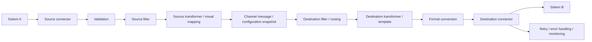

# Mirth Connect Lite UI — 16 Oktober 2026

## Konsep dan navigasi

Wizard mengikuti **Source → Transformation → Destinations → Review**. User membuat integrasi Sistem A → Mirth-Connect → Sistem B melalui format, mapping dan endpoint. Filter, scripting dan pengaturan delivery tersedia melalui Advanced. Kemampuan inti engine tetap dipertahankan.



Navigasi utama terdiri dari Overview, Channels, Messages dan Settings. Start/Stop tetap berada pada Channels; resend, reconciliation dan attempt history tetap tersedia pada Messages sesuai permission. Penyederhanaan ini tidak menghapus worker, retry, circuit breaker, dead letter, routing atau snapshot konfigurasi.

| Kemampuan | Lokasi UI |
| --- | --- |
| Source connector, inbound format, API key, endpoint | Source |
| Validation, source filter, source transformer | Advanced source settings |
| Mapping, required/default, format output, preview | Transformation |
| Script transformasi kompleks | Advanced transformation script |
| Nama, connector, outbound format, endpoint destination | Destinations |
| Destination filter / transformer / template | Advanced destination settings |
| Retry, timeout, capacity dan circuit protection | Advanced destination settings → Delivery settings |
| Multiple destinations | Add Destination; default satu destination |
| Draft, publish, rollback dan revision history | Revisions |
| Inbound, source processed, outbound dan delivery result | Messages |

## 1. Source

Source langsung menampilkan nama channel, connector, inbound format, source endpoint dan source API key. Endpoint HTTP berasal dari backend melalui konfigurasi `PUBLIC_BASE_URL` dan `INBOUND_PATH`; frontend tidak menebak hostname production. Contoh development `http://localhost:9000` dan production `https://connect.bulmar.tech` merupakan nilai konfigurasi, bukan alamat tetap pada UI. Channel baru menampilkan `{channelId}` sampai disimpan.

API key digunakan oleh sistem sumber untuk mengirim data ke channel. Key hanya tampil sekali setelah generate/rotate; rotasi membatalkan key sebelumnya. Menutup editor atau berpindah langkah menghapus key dari tampilan. Key tidak ditampilkan kembali pada list atau audit plaintext. Tombol **Copy API key** tetap tersedia pada tampilan sekali tersebut. Tombol Copy endpoint, curl, Postman dan request examples sudah dihapus; alamat endpoint masih dapat dipilih/disalin manual.

**Advanced source settings** berurutan:

1. **Validation**: menentukan apakah pesan valid.
2. **Source filter**: menentukan apakah pesan valid tersebut diproses.
3. **Source transformer**: menunjukkan status dan tombol Configure transformation untuk normalisasi lanjutan.

Source response editor tidak ditampilkan. Channel existing yang memakainya hanya menampilkan **Legacy custom source response is active.** Script tetap disimpan dan dijalankan backend. Response HTTP standar memiliki `success`, `messageId`, `status` serta `result` existing untuk compatibility; response error dan HL7 ACK mengikuti kontrak backend yang berlaku.

Hasil processing gagal yang sudah tercatat mengembalikan HTTP 502 dengan code `MESSAGE_PROCESSING_FAILED`, pesan aman, requestId dan details kosong. `result` dan custom response legacy tetap dipertahankan. FILTERED tetap HTTP 200 dan QUEUED tetap HTTP 202 tanpa error fields.

### Validation

- **No additional validation**: parsing dasar tetap berlaku.
- **Basic validation**: syntax sesuai JSON/XML/HL7; preset disimpan sebagai `{ "basicSyntax": true }`. JSON yang sudah diparse tidak diparse ulang sebagai string; scalar JSON yang valid tetap diperbolehkan.
- **Custom validation schema**: editor baru muncul ketika dipilih. Backend tetap mendukung JSON Schema, XML rules, HL7 profile dan validation script sesuai batas konfigurasi existing.

Profile lama `{ "jsonSchema": { "type": "object" } }` dikenali sebagai preset Basic existing dan tidak diganti hanya karena editor dibuka/disimpan. Profile custom juga dipertahankan. Memilih preset baru merupakan perubahan eksplisit.

Validation dan filter berbeda: JSON valid dengan `message_type = ORM` dapat berstatus FILTERED jika filter hanya menerima ADT. Field Required pada mapping diperiksa saat transformer dijalankan, sesudah source filter; pesan yang sengaja difilter tidak menjadi error karena mapping wajib.

### Filter tanpa script

Aktifkan **Enable source filter**, lalu pilih **Simple condition** untuk builder **Field / Operator / Value**. Contoh `message_type` / Equals / `ADT`. Destination menggunakan builder yang sama, misalnya `department` / Equals / `LAB`.

Operator tersedia: Equals, Does not equal, Contains, Starts with, Exists, Does not exist, Greater than, Greater than or equal, Less than, Less than or equal. Operator presence menyembunyikan Value; operator numerik menggunakan input angka dan menolak nilai tidak finite. Perbandingan teks menggunakan nilai scalar string; angka `0` dan boolean `false` tidak dianggap hilang. Field yang tidak ada tidak cocok dengan Does not equal. Exists memeriksa keberadaan field, termasuk nilai null/kosong.

Field mendukung dot paths dengan maksimum 12 bagian/256 karakter; Value maksimum 1.024 karakter. Prototype keys ditolak. Builder menghasilkan script boolean canonical di `filterScript` existing; field/value diperlakukan sebagai data, bukan JavaScript yang dieksekusi langsung. JSON, HL7 dan XML memakai parser/normalisasi terkontrol. Metadata versi 1 hanya dikenali jika seluruh script masih cocok dengan hasil compiler.

Preset **Accept all messages / Filter all messages** dan **Deliver to this destination / Skip this destination** tetap tersedia. **Custom condition (advanced)** membuka editor script. Filter OFF menyembunyikan editor dan menerima semua pesan valid. Script kosong memiliki perilaku accept all; channel baru tidak diberi default `false`. Script custom/literal lama tidak ditulis ulang otomatis.

Kondisi yang belum lengkap tetap tersimpan sebagai input lokal, ditandai sebagai perubahan dan menghalangi Save, Test serta perpindahan langkah. Mematikan source filter secara eksplisit memperbolehkan melanjutkan; mengaktifkannya kembali mengembalikan input lokal. Menghapus satu destination tidak memindahkan kondisi yang belum valid ke destination lain.

## 2. Transformation

Pilih output format, tambahkan mapping atau gunakan **Use patient example**:

| Source field | Target field |
| --- | --- |
| patient_id | PatientID |
| name | PatientName |
| gender | Gender |
| date_of_birth | BirthDate |

`Required` menolak nilai wajib yang hilang. Default digunakan ketika nilai tidak ada, null atau kosong; `0` dan `false` dipertahankan. Default UI berupa string. Field yang tidak dipetakan tidak ikut output. Tanpa mapping/script, field asli diteruskan ke converter. Untuk XML, isi root `Patient` bila diperlukan.

Dot paths membaca object bertingkat dan indeks array pada input; target bertingkat dibuat sebagai object. Maksimum 100 baris dan 12 tingkat; target duplikat/tumpang tindih serta prototype keys ditolak. Mapping tidak melakukan array expansion atau konversi tipe otomatis. HL7 menggunakan struktur parser existing, misalnya `PID.3` untuk identifier scalar dan `PID.5.2` untuk component yang tersedia. Profile/repetition berbeda tetap memerlukan path yang sesuai.

Mapping visual disimpan pada **source transformer yang sama**, yaitu `processingScript`, dan dijalankan QuickJS existing. Source transformer pada Advanced dan halaman Transformation adalah dua tampilan dari stage tersebut. Keduanya tidak menciptakan dua transformasi berurutan. Script custom tidak diganti menjadi mapping tanpa konfirmasi eksplisit. Export/import channel XML tetap membawa script beserta metadata mapping/filter.

XML untuk mapping dan simple filter dinormalisasi sebelum masuk worker; script custom lama tetap menerima input aslinya. DTD/entity ditolak, parser dibatasi 20.000 nodes/kedalaman 65, serta tunduk pada batas payload dan sandbox. Error tidak mengembalikan plaintext pasien atau stack internal. Mapping yang belum lengkap menghalangi Continue/Save dan tetap tersedia ketika kembali ke langkah tersebut.

### Test transformation dan pengiriman

**Test transformation** menjalankan `POST /api/channel/preview-transformation` menggunakan payload sintetis. Nama/endpoint destination boleh belum diisi. Preview menjalankan validation, source filter/transformer, destination filter/transformer/template dan converter yang sama seperti runtime, sambil melewati pemeriksaan koneksi. Tidak ada DNS lookup, network delivery atau probe.

Di samping Preview output, ringkasan langsung menunjukkan **Validation**, **Source filter**, **Source transformation** dan **Network delivery: NOT SENT**. Processing details menyediakan payload tiap tahap dan warning. Preview default redacted; ADMIN dapat memilih **Show unmasked preview (access is audited)**. XML/text dapat tersembunyi penuh sesuai privacy settings. Perubahan konfigurasi atau kondisi yang belum valid membatalkan hasil preview lama.

| Tindakan | Efek |
| --- | --- |
| Test transformation | Menjalankan pipeline tanpa pengiriman |
| API `/api/channel/dry-run` | Pipeline tanpa pengiriman, dengan pemeriksaan konfigurasi koneksi lengkap |
| Test connection | DNS dan handshake TCP/TLS; tanpa payload aplikasi |
| Send synthetic message | Pengiriman aktual setelah channel Running dan konfirmasi |

Preview atau handshake tidak membuktikan destination sudah menerima data.

## 3. Destinations dan 4. Review

Default satu destination; **Add Destination** tetap tersedia untuk routing ke banyak sistem. Field utama: nama, connector, outbound format dan endpoint. Pilihan output format di Transformation diterapkan ke seluruh destination hanya saat dipilih pengguna; override per destination tetap tersedia.

Advanced berisi tepat tiga kelompok: **Destination filter**, **Destination transformer**, **Delivery settings**. Template berada di disclosure lanjutan pada transformer. Automatic retry menampilkan jumlah retry dan interval ketika aktif; request timeout menggunakan detik. Capacity dan circuit protection tetap berada pada disclosure tambahan. Destination response editor dihapus; responseScript existing tetap aktif dengan notice legacy kecil.

Review menampilkan flow sumber → channel → konversi format → destination, kemudian **Source processing** dengan status validation/filter/transformer yang berasal dari konfigurasi. Mapping dilabeli sebagai konfigurasi pada Transformation untuk menjelaskan stage yang sama. Setiap destination menampilkan endpoint, retry efektif dan timeout. Tombol akhir **Back / Test / Save Channel** tetap tersedia.

Create/edit tidak meminta change summary. Backend menghasilkan summary dan audit area `SOURCE_UPDATED`, `TRANSFORMATION_UPDATED`, `DESTINATION_UPDATED` atau `CHANNEL_UPDATED` sesuai perubahan. Audit ini menyatakan perubahan draft, bukan bahwa konfigurasi sudah aktif. Save existing channel membuat draft; publish/rollback melalui Revisions menentukan perubahan running dan memiliki audit tersendiri. Pesan existing tetap menggunakan configuration snapshot yang diterima sebelumnya.

## Messages, Overview dan Settings

Messages menampilkan **Inbound Message**, **Source Processed Message**, **Outbound Message**, dan **Delivery Result**. Summary menunjukkan format, status dan destination; Payload/History mempertahankan detail per tahap/attempt, pencarian, copy, Pretty/Raw dan HL7 Tree sesuai permission. Menutup drawer mempertahankan filter dan halaman.

HTTP status berasal dari transport aktual, termasuk 201/204/4xx/5xx. Timeout, koneksi gagal, MLLP dan record lama tidak ditebak sebagai HTTP 200. Durasi merupakan waktu request connector aktual dalam milidetik, terpisah dari antrean dan response script. `durationMs` dan `attemptCount` yang tidak tercatat ditampilkan **Not recorded**. Jumlah attempt dihitung dari riwayat delivery yang dapat dipastikan; admission wait/queue bukan network attempt. Riwayat legacy yang tidak cukup untuk menghitung jumlah pasti tetap unknown, bukan angka dari retryCount atau nomor halaman.

Redacted view adalah default. **View raw (audited)** memerlukan permission dan dicatat pada audit; copy mengikuti isi yang terlihat. Jika ADMIN kehilangan izin raw saat drawer terbuka, cached raw langsung disembunyikan dan versi redacted diminta ulang. Kehilangan izin payload menyembunyikan payload termasuk history/resend. Resend tetap memerlukan konfirmasi, permission backend serta pemeriksaan status/snapshot; delivery yang tidak pasti perlu rekonsiliasi operator.

Overview menampilkan enam angka dari database dan **Recent Failures**, tanpa chart dummy:

| Angka | Makna |
| --- | --- |
| Running Channels | Channel berstatus RUNNING |
| Stopped Channels | Channel berstatus STOPPED |
| Messages Today | Inbound sejak tengah malam lokal browser yang dikirim sebagai timestamp ke API |
| Successful | Inbound SUCCESS pada retained history |
| Failed | Inbound FAILED, PARTIAL atau IN-ERROR pada retained history |
| Retrying | Outbound QUEUED/RETRYING saat ini |

Successful/Failed tidak diklaim sebagai angka hari ini. Data yang belum tersedia ditampilkan sebagai `—`. Recent Failures menggunakan pesan inbound gagal/partial dan membuka Messages dengan filter terkait.

Settings memiliki **System information, Roles, Users, Audit log**; Users/Audit mengikuti permission ADMIN. Roles menjelaskan kemampuan RBAC aktual. System information menampilkan account, koneksi, versi runtime/encryption, TLS dan retention dengan label; raw JSON runtime tidak memenuhi halaman utama. Sessions, alerts dan diagnostic download tetap tersedia melalui Operational tools sesuai permission. Database credential dan nilai encryption key tidak ditampilkan.

## Database upgrade dan compatibility

Build terbaru memerlukan migration **1–7**. Migration `006_delivery_http_status.sql` menambahkan nullable integer `MessageDestinationLog.http_status` (100–599). Migration `007_delivery_timing.sql` menambahkan nullable integer `request_duration_ms` (minimal 0). Record lama tetap NULL. Keduanya additive, transactional/repeatable dan tidak menghapus business data. Migrator, startup guard, disposable reset helpers, restore verification dan runtime smoke menggunakan versi 7.

Untuk upgrade environment existing, verifikasi target dan backup/keyring sesuai runbook sebelum menjalankan command:

```bash
npm run db:migrate -- --dry-run
npm run db:migrate
npm run build
npm run start
```

Production memerlukan konfirmasi backup `MIGRATION_BACKUP_CONFIRMED=true` sesuai runbook migrasi. Verifikasi `/health`, `/ready` dan synthetic channel yang berizin setelah restart. Startup tidak melakukan automatic migration; schema yang belum cukup menghasilkan `MIGRATION_REQUIRED` beserta instruksi migrasi.

Pada development `MiniMirthDev`, migration additive 007 benar-benar diterapkan setelah preflight. Schema terverifikasi 1–7; counts tetap 1 user, 1 channel, 1 destination, 2 messages dan 1 delivery log. Tidak ada reset atau perubahan production. Compiled development backend diuji pada loopback port sementara dengan `/health` dan `/ready` HTTP 200, tanpa mengirim payload; proses diakhiri melalui SIGTERM dengan exit 0. `.env` dan key existing tidak diubah.

Semua source/destination filter, transformer, response script, validation profile, idempotency mode, multiple destinations dan credential existing tetap dipertahankan pada data/API/runtime/import-export. Response editor yang disembunyikan tidak menghapus script legacy. Source HTTP response mempertahankan result envelope lama sambil menambahkan alias messageId/status.

Rollback source dapat mempertahankan kolom nullable baru. Jangan drop kolom, data atau migration history; pertahankan keyring dan backup. Binary lama belum menormalisasi XML untuk generated simple conditions/mapping versi baru: pilih revision channel yang kompatibel sebelum downgrade, kemudian verifikasi sintetis. Rollback revision channel tidak menghapus history. Untuk backup schema lama, restore ke target disposable, apply migration sampai 7 menggunakan keyring yang benar, lalu jalankan verifier terbaru. Native backup/restore drill untuk schema 7 belum dilakukan karena `pg_dump`/`pg_restore` tidak tersedia pada environment sesi ini.

## Validasi dan batas verifikasi

Baseline perubahan final: branch `development`, commit `a43c693`. Test menggunakan fixture sintetis dan PostgreSQL 18.4 disposable pada loopback dengan environment terisolasi. Browser memakai API fixture untuk UX/permission; pengiriman aktual dibuktikan terpisah melalui native SQL/runtime test.

Native SQL mencakup input sintetis RM-000123 / Siti Aminah / F / 1993-08-17 dan perbandingan output Patient XML dengan body HTTP yang benar-benar diterima destination loopback. Test juga mencakup routing/multiple destinations, required rejection, HTTP status, duration/attempt metadata dan repeat migrations. Tidak ada pengiriman ke sistem rumah sakit/webhook eksternal dalam verifikasi ini.

| Command / pemeriksaan | Hasil akhir |
| --- | --- |
| `npm run typecheck` | PASS |
| `npm run lint` | PASS |
| `npm run format:check` | PASS |
| `npm run test:coverage` | PASS — 28 suites, 332 tests |
| `npm run build` | PASS — client dan server |
| `npm run test:e2e` | PASS — 53 tests, termasuk keyboard/mobile, permission, compatibility dan Axe accessibility |
| `npm run test:sql` dengan PostgreSQL disposable | PASS — 19 tests |
| `npm run test:runtime` dengan PostgreSQL disposable | PASS — compiled startup, health/readiness, metrics authorization, SIGTERM saat delivery aktif |
| `npm run docs:check` | PASS |
| `npm run secrets:scan` | PASS — targeted-pattern scanner; bukan sertifikasi history/rotasi secret |
| Development additive migration 007 dan compiled health/readiness | PASS — counts business data tetap, tanpa payload baru |
| Native backup/restore drill schema 7 | NOT TESTED — pg_dump/pg_restore tidak tersedia |
| Docker, hospital UAT, load test dan disaster recovery qualification | NOT TESTED untuk perubahan ini |

Coverage meningkat dari baseline final: statements **81.11 → 81.90%**, branches **76.82 → 78.61%**, functions **82.75 → 83.63%**, lines **82.25 → 82.96%**.

Kegagalan sementara dicatat dan diperbaiki sebelum hasil final: selector baru tidak sesuai accessible name pada browser, dan smoke guard awal mengasumsikan PG_SCHEMA eksplisit walaupun konfigurasi memakai default public. Selector/label serta guard diperbaiki dan run akhir lulus. Tidak ada klaim production-ready atau hospital acceptance berdasarkan hasil UI ini; readiness matrix tetap berlaku untuk verifikasi eksternal.

## Screenshot UI final

Seluruh screenshot memakai data sintetis dari browser test:

- [Source dan Advanced settings](screenshots/usability/lite-source.png)
- [Transformation dan preview](screenshots/usability/lite-transformation.png)
- [Destinations dan Advanced settings](screenshots/usability/lite-destinations.png)
- [Review](screenshots/usability/lite-review.png)
- [Overview](screenshots/usability/lite-overview.png)
- [Settings](screenshots/usability/lite-settings.png)

Audit KEEP / REMOVE / ADVANCED / LEGACY dan before/after yang dibuat sebelum coding tersedia pada [UI simplification audit](UI_SIMPLIFICATION_AUDIT.md).
