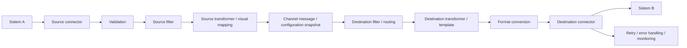

# Mirth Connect Lite UI — 16 Oktober 2026

## Konsep dan navigasi

Wizard mengikuti **Source → Transformation → Destinations → Review & Test**. User membuat integrasi Sistem A → Mirth-Connect → Sistem B melalui format, mapping dan endpoint. Filter, scripting dan pengaturan delivery tersedia melalui Advanced. Kemampuan inti engine tetap dipertahankan.



Navigasi utama terdiri dari Overview, Channels, Messages dan Settings. Start/Stop tetap berada pada Channels; resend, reconciliation dan attempt history tetap tersedia pada Messages sesuai permission. Penyederhanaan ini tidak menghapus worker, retry, circuit breaker, dead letter, routing atau snapshot konfigurasi.

| Kemampuan | Lokasi UI |
| --- | --- |
| Source connector, inbound format, API key, endpoint | Source |
| Validation, source filter, source transformer | Advanced source settings |
| Mapping dua kolom Source Field / Target Field, Add Mapping | Transformation |
| Required/default | Mapping options per baris, awalnya tertutup |
| Script transformasi kompleks | Advanced Custom Transformation Script |
| Sample, preview, test transformation, connection probe | Review & Test |
| Nama, connector, outbound format, endpoint destination | Destinations |
| Destination filter / transformer / template | Advanced destination settings |
| Retry, timeout, capacity dan circuit protection | Advanced destination settings → Delivery settings |
| Multiple destinations | Add Destination; default satu destination |
| Draft, publish, rollback dan revision history | Revisions |
| Inbound, source processed, outbound dan delivery result | Messages |

## Dropdown

Dropdown pada filter, Source, Destinations, Messages dan Settings memakai ukuran/padding yang seragam, indikator pilihan aktif dan focus keyboard yang terlihat. Menu mengikuti lebar field, membatasi tinggi daftar dengan scroll, dan menjaga label panjang di dalam viewport. Search/filter pada mobile mempunyai ruang terpisah. Escape menutup menu pilihan terlebih dahulu; tekan kembali untuk menutup dialog.

Semantik select native, label, value, permission dan keyboard navigation tetap digunakan. Browser yang mendukung `appearance: base-select` mendapat menu bergaya aplikasi; browser lain tetap memakai picker sistem dengan field yang ditata konsisten.

Contoh sintetis: [filter Channels](screenshots/usability/dropdown-channels.png), [dropdown form](screenshots/usability/dropdown-source.png), [mobile](screenshots/usability/dropdown-mobile.png).

Verifikasi dropdown: client build, workspace typecheck, lint, format dan 57 browser test lulus. Pemeriksaan sintetis Chrome 155 pada desktop, modal dan mobile 390px mencakup ukuran menu, daftar panjang/scroll, keyboard, Escape serta label panjang. Pemeriksaan awal menemukan horizontal overflow dan Escape yang menutup dialog; keduanya diperbaiki lalu diperiksa ulang. Unit/backend, database dan dependency tidak berubah atau diuji ulang khusus perubahan tampilan ini.

## 1. Source

Source langsung menampilkan nama channel, connector, inbound format, source endpoint dan source API key. Endpoint HTTP berasal dari backend melalui konfigurasi `PUBLIC_BASE_URL` dan `INBOUND_PATH`; frontend tidak menebak hostname production. Contoh development `http://localhost:9000` dan production `https://connect.bulmar.tech` merupakan nilai konfigurasi, bukan alamat tetap pada UI. Channel baru menampilkan `{channelId}` sampai disimpan.

API key digunakan oleh sistem sumber untuk mengirim data ke channel. Key hanya tampil sekali setelah generate/rotate; rotasi membatalkan key sebelumnya. Menutup editor atau berpindah langkah menghapus key dari tampilan. Key tidak ditampilkan kembali pada list atau audit plaintext. Tombol **Copy API key** tetap tersedia pada tampilan sekali tersebut. Tombol Copy endpoint, curl, Postman dan request examples sudah dihapus; alamat endpoint masih dapat dipilih/disalin manual.

**Advanced source settings** berurutan:

1. **Validation**: menentukan apakah pesan valid.
2. **Source filter**: menentukan apakah pesan valid tersebut diproses.
3. **Source transformer**: menunjukkan status dan tombol Configure transformation untuk normalisasi lanjutan.

Source response editor tidak ditampilkan. Channel existing yang memakainya hanya menampilkan **Legacy custom source response is active.** Script tetap disimpan dan dijalankan backend. Response HTTP standar memiliki `success`, `messageId`, `status` serta `result` existing untuk compatibility; response error dan HL7 ACK mengikuti kontrak backend yang berlaku.

Hasil processing gagal yang sudah tercatat mengembalikan HTTP 502 dengan code `MESSAGE_PROCESSING_FAILED`, pesan aman, requestId dan details kosong. `result` dan custom response legacy tetap dipertahankan. FILTERED tetap HTTP 200 dan QUEUED tetap HTTP 202 tanpa error fields.

### Validation

- **No additional validation**: parsing dasar tetap berlaku.
- **Basic validation**: syntax sesuai JSON/XML/HL7; preset disimpan sebagai `{ "basicSyntax": true }`. JSON yang sudah diparse tidak diparse ulang sebagai string; scalar JSON yang valid tetap diperbolehkan.
- **Custom validation schema**: editor baru muncul ketika dipilih. Backend tetap mendukung JSON Schema, XML rules, HL7 profile dan validation script sesuai batas konfigurasi existing.

Profile lama `{ "jsonSchema": { "type": "object" } }` dikenali sebagai preset Basic existing dan tidak diganti hanya karena editor dibuka/disimpan. Profile custom juga dipertahankan. Memilih preset baru merupakan perubahan eksplisit.

Validation dan filter berbeda: JSON valid dengan `message_type = ORM` dapat berstatus FILTERED jika filter hanya menerima ADT. Field Required pada mapping diperiksa saat transformer dijalankan, sesudah source filter; pesan yang sengaja difilter tidak menjadi error karena mapping wajib.

### Filter tanpa script

Aktifkan **Enable source filter**, lalu pilih **Simple condition** untuk builder **Field / Operator / Value**. Contoh `message_type` / Equals / `ADT`. Destination menggunakan builder yang sama, misalnya `department` / Equals / `LAB`.

Operator tersedia: Equals, Does not equal, Contains, Starts with, Exists, Does not exist, Greater than, Greater than or equal, Less than, Less than or equal. Operator presence menyembunyikan Value; operator numerik menggunakan input angka dan menolak nilai tidak finite. Perbandingan teks menggunakan nilai scalar string; angka `0` dan boolean `false` tidak dianggap hilang. Field yang tidak ada tidak cocok dengan Does not equal. Exists memeriksa keberadaan field, termasuk nilai null/kosong.

Field mendukung dot paths dengan maksimum 12 bagian/256 karakter; Value maksimum 1.024 karakter. Prototype keys ditolak. Builder menghasilkan script boolean canonical di `filterScript` existing; field/value diperlakukan sebagai data, bukan JavaScript yang dieksekusi langsung. JSON, HL7 dan XML memakai parser/normalisasi terkontrol. Metadata versi 1 hanya dikenali jika seluruh script masih cocok dengan hasil compiler.

Preset **Accept all messages / Filter all messages** dan **Deliver to this destination / Skip this destination** tetap tersedia. **Custom condition (advanced)** membuka editor script. Filter OFF menyembunyikan editor dan menerima semua pesan valid. Script kosong memiliki perilaku accept all; channel baru tidak diberi default `false`. Script custom/literal lama tidak ditulis ulang otomatis.

Kondisi yang belum lengkap tetap tersimpan sebagai input lokal, ditandai sebagai perubahan dan menghalangi Save, Test serta perpindahan langkah. Mematikan source filter secara eksplisit memperbolehkan melanjutkan; mengaktifkannya kembali mengembalikan input lokal. Menghapus satu destination tidak memindahkan kondisi yang belum valid ke destination lain.

## 2. Transformation

Transformation hanya menampilkan mapping **Source Field / Target Field**, tombol **Add Mapping** dan bagian opsional **Advanced Custom Transformation Script**. Helper: “Map incoming fields to the fields required by the destination.” Source menentukan inbound format; outbound format dipilih pada masing-masing destination. Tidak ada format selector, sample, example, preview, Test, privacy checkbox atau banner hasil pengujian pada langkah ini.

Contoh mapping yang dapat ditambahkan sendiri:

| Source field | Target field |
| --- | --- |
| patient_id | PatientID |
| name | PatientName |
| gender | Gender |
| date_of_birth | BirthDate |

**Mapping options** per baris awalnya tertutup dan mempertahankan Required serta default value. `Required` menolak nilai wajib yang hilang. Default digunakan ketika nilai tidak ada, null atau kosong; `0` dan `false` dipertahankan. Default UI berupa string. Field yang tidak dipetakan tidak ikut output. Tanpa mapping/script, field asli diteruskan ke converter.

Tidak ada input XML root pada UI. Metadata `rootElement` dari mapping existing tetap utuh saat baris diedit. Mapping baru tidak menambahkan wrapper `Patient` otomatis; wrapper khusus per destination dapat dibuat melalui Advanced destination transformer. Pipeline dan converter tidak diubah.

Dot paths membaca object bertingkat dan indeks array pada input; target bertingkat dibuat sebagai object. Maksimum 100 baris dan 12 tingkat; target duplikat/tumpang tindih serta prototype keys ditolak. Mapping tidak melakukan array expansion atau konversi tipe otomatis. HL7 menggunakan struktur parser existing, misalnya `PID.3` untuk identifier scalar dan `PID.5.2` untuk component yang tersedia. Profile/repetition berbeda tetap memerlukan path yang sesuai.

Mapping visual disimpan pada **source transformer yang sama**, yaitu `processingScript`, dan dijalankan QuickJS existing. Source transformer pada Advanced dan halaman Transformation adalah dua tampilan dari stage tersebut. Keduanya tidak menciptakan dua transformasi berurutan. Script custom tidak diganti menjadi mapping tanpa konfirmasi eksplisit. Export/import channel XML tetap membawa script beserta metadata mapping/filter.

XML untuk mapping dan simple filter dinormalisasi sebelum masuk worker; script custom lama tetap menerima input aslinya. DTD/entity ditolak, parser dibatasi 20.000 nodes/kedalaman 65, serta tunduk pada batas payload dan sandbox. Error tidak mengembalikan plaintext pasien atau stack internal. Mapping yang belum lengkap menghalangi Continue/Save dan tetap tersedia ketika kembali ke langkah tersebut.

## 3. Destinations

Default satu destination; **Add Destination** tetap tersedia untuk routing ke banyak sistem. Field utama: nama, connector, outbound format dan endpoint. Setiap destination memiliki outbound format sendiri; perubahan format satu destination tidak diterapkan otomatis pada destination lain. Tidak ada selector output format global pada Transformation.

Advanced berisi tepat tiga kelompok: **Destination filter**, **Destination transformer**, **Delivery settings**. Template berada di disclosure lanjutan pada transformer. Automatic retry menampilkan jumlah retry dan interval ketika aktif; request timeout menggunakan detik. Capacity dan circuit protection tetap berada pada disclosure tambahan. Destination response editor dihapus; responseScript existing tetap aktif dengan notice legacy kecil. Connection test tersedia sesudah konfigurasi lengkap melalui Review & Test.

## 4. Review & Test

Review & Test menggabungkan ringkasan **Source**, **Source processing**, **Transformation**, **Destination**, **Delivery** dan flow **HTTP / JSON → 4 field mappings → REST / XML** untuk contoh empat mapping. Setiap destination memiliki cabang connector/format/nama sendiri; flow tidak memakai output format global. Status validation/filter/transformer berasal dari konfigurasi. Mapping dilabeli sebagai konfigurasi pada Transformation untuk menjelaskan stage engine yang sama. Setiap destination menampilkan format, endpoint, retry efektif dan timeout.

Seluruh pengujian berada di sini: **Test input**, **Test Transformation** dan generated output. Error pengujian muncul pada tahap ini dengan pesan aman dan tindakan yang relevan; tidak menampilkan SQL, stack trace atau payload sensitif dalam error. Perubahan konfigurasi atau kondisi yang belum valid membatalkan hasil lama. Mapping yang belum lengkap tetap menggunakan validasi inline pada langkah Transformation.

**Test Transformation** menggunakan payload sintetis dan `POST /api/channel/preview-transformation`. UI mengarahkan pengguna melengkapi konfigurasi sebelum pengujian. API preview tetap menerima konfigurasi destination yang belum lengkap demi compatibility, dan menjalankan validation, source filter/transformer, destination filter/transformer/template serta converter existing tanpa memeriksa koneksi. Tidak ada DNS lookup, network delivery atau probe.

Hasil menampilkan Validation, Source filter, Source transformation, format/output destination dan **Network delivery: NOT SENT**. Processing details menyediakan payload tiap tahap dan warning. Preview default redacted. **Advanced test options** menyimpan pilihan **Show unmasked preview (access is audited)** untuk ADMIN; raw tetap opsional, memerlukan permission dan audit. XML/text dapat tersembunyi penuh sesuai privacy settings.

**Test connection** pada Review & Test merupakan aksi terpisah setelah konfigurasi destination lengkap. Tindakan ini melakukan DNS dan handshake TCP/TLS tanpa payload aplikasi. Hasil koneksi tidak membuktikan destination menerima pesan.

| Tindakan | Lokasi / efek |
| --- | --- |
| Test transformation | Review & Test; pipeline tanpa DNS/pengiriman |
| API `/api/channel/dry-run` | Pipeline tanpa pengiriman, dengan pemeriksaan konfigurasi koneksi lengkap |
| Test connection | Review & Test; DNS dan handshake TCP/TLS, tanpa payload aplikasi |
| Send synthetic message | Setelah Save, channel Running dan konfirmasi; pengiriman aktual |

Save Channel menyimpan konfigurasi. Navigasi Back tetap tersedia; Test tidak menjalankan pengiriman sungguhan. Pengiriman sintetis setelah Save tetap memerlukan konfirmasi karena benar-benar dapat mencapai destination.

Create/edit tidak meminta change summary. Backend menghasilkan summary dan audit area `SOURCE_UPDATED`, `TRANSFORMATION_UPDATED`, `DESTINATION_UPDATED` atau `CHANNEL_UPDATED` sesuai perubahan. Audit ini menyatakan perubahan draft, bukan bahwa konfigurasi sudah aktif. Save existing channel membuat draft; publish/rollback melalui Revisions menentukan perubahan running dan memiliki audit tersendiri. Pesan existing tetap menggunakan configuration snapshot yang diterima sebelumnya.

### Revision, publish, rollback dan lifecycle channel — 17 October 2026

Sesudah Save pada channel existing, klik **Review and publish draft** pada notifikasi. Alternatif: **Channels → ⋯ → Revisions**. Pilih **Version** untuk melihat ringkasan satu revision. Draft terbaru dipilih otomatis; bila tidak ada draft, revision aktif ditampilkan. Badge membedakan Active, Draft, Previous version dan Archived.

Ringkasan source, transformation, destination, retry dan timeout otomatis muncul di area berukuran tetap tanpa memindahkan scroll/fokus. Respons lama yang terlambat tidak boleh menggantikan versi yang baru dipilih. Loading dan error berada di area yang sama; gunakan **Retry review** bila gagal. Tombol utama hanya **Edit draft**, **Publish** atau **Rollback** sesuai versi dan permission, serta **Done**.

Buka **Advanced options** untuk catatan opsional, **Configuration details (sanitized)**, **Compare versions**, **Test with synthetic data** dan **Destination connection tests**. Preview raw tetap memerlukan permission dan audit. Endpoint/credential dan script mengikuti sanitasi backend. Memilih versi hanya mengambil konfigurasi tersanitasi; pengujian script atau koneksi berjalan setelah tombol test diklik.

Jika ada pending draft, tombol **Review draft N** juga tersedia langsung di baris channel. Edit channel membuka konfigurasi aktif, sehingga UI meminta konfirmasi sebelum memulai edit yang nantinya akan menggantikan pending draft. Batalkan dan pilih Review draft untuk memeriksa perubahan yang sudah disimpan; edit draft di panel tetap mempertahankan script/credential server dan menyediakan subset field operasional yang aman.

Publish draft memerlukan konfirmasi dan berlaku untuk pesan baru. Save berikutnya membuat draft terbaru dan menandai draft sebelumnya superseded/archived; konfigurasi aktif tetap utuh sampai publish. Pada database lama dengan beberapa draft, hanya draft paling baru yang boleh dipublish. Refresh revisions mengambil revision aktif terbaru; jika pengguna lain sudah publish, request lama ditolak 409 sehingga konfigurasi tidak tertimpa diam-diam.

Rollback tersedia untuk revision PUBLISHED sebelumnya, bukan revision yang sedang aktif atau draft yang telah diarsipkan. Konfirmasi rollback membuat revision PUBLISHED baru dari konfigurasi lama, tidak menghapus history, tidak mengembalikan source API key lama dan tidak mengganti snapshot pekerjaan yang sudah diterima. Pending draft diarsipkan saat aktivasi. Snapshot published merekam ID destination yang benar agar rollback bolak-balik tidak membuat connector baru berulang.

ADMIN dapat Delete channel STOPPED tanpa riwayat pesan yang masih disimpan, termasuk duplikat baru dengan Revision 1. Revision/configuration milik channel tersebut ikut dihapus secara transaksional; channel asal dan audit tidak dihapus. Jika ada pesan, gunakan **⋯ → Archive channel** setelah Stop dan menyelesaikan antrean/retry/proses aktif. Archive tidak menghapus pesan, revision atau audit. Pilih filter status **Archived** untuk melihatnya; channel archive tidak bisa langsung Start/edit/publish. Buat duplikat baru yang ditinjau jika membutuhkan pengganti. Pemeriksaan delete menggunakan evidence yang masih tersimpan, bukan penanda permanen pernah digunakan setelah retention resmi menghapus seluruh pesan. Jangan membersihkan evidence manual untuk memaksa Delete.

Tidak ada migration baru: archive memakai nilai `ARCHIVED` pada kolom status yang sudah ada. Schema tetap 1–7. Jalankan binary/API/frontend yang sesuai bersama-sama; perubahan lokal ini tidak otomatis memperbarui server deployment.

Binary sebelum perbaikan ini belum melindungi status ARCHIVED dari aktivasi. Jangan menjalankannya bersamaan atau downgrade tanpa review akses dan pengamanan channel yang telah diarsipkan. Untuk revision legacy tanpa ID destination, rollback memakai ulang connector dengan konfigurasi yang cocok di channel yang sama dan mencatat ID yang benar pada snapshot published baru, tanpa menulis ulang history lama.

## Messages, Overview dan Settings

Messages menampilkan **Inbound Message**, **Source Processed Message**, **Outbound Message**, dan **Delivery Result**. Summary menunjukkan format, status dan destination; Payload/History mempertahankan detail per tahap/attempt, pencarian, copy, Pretty/Raw dan HL7 Tree sesuai permission. Menutup drawer mempertahankan filter dan halaman.

HTTP status berasal dari transport aktual, termasuk 201/204/4xx/5xx. Timeout, koneksi gagal, MLLP dan record lama tidak ditebak sebagai HTTP 200. Durasi merupakan waktu request connector aktual dalam milidetik, terpisah dari antrean dan response script. `durationMs` dan `attemptCount` yang tidak tercatat ditampilkan **Not recorded**. Jumlah attempt dihitung dari riwayat delivery yang dapat dipastikan; admission wait/queue bukan network attempt. Riwayat legacy yang tidak cukup untuk menghitung jumlah pasti tetap unknown, bukan angka dari retryCount atau nomor halaman.

Redacted view adalah default. **View raw (audited)** memerlukan permission dan dicatat pada audit; copy mengikuti isi yang terlihat. Jika ADMIN kehilangan izin raw saat drawer terbuka, cached raw langsung disembunyikan dan versi redacted diminta ulang. Kehilangan izin payload menyembunyikan payload termasuk history/resend. Resend tetap memerlukan konfirmasi, permission backend serta pemeriksaan status/snapshot; delivery yang tidak pasti perlu rekonsiliasi operator.

Overview menampilkan enam angka dari database dan **Recent Failures**, tanpa chart dummy:

| Angka | Makna |
| --- | --- |
| Running Channels | Channel berstatus RUNNING |
| Stopped Channels | Channel berstatus STOPPED |
| Messages Today | Inbound sejak tengah malam lokal browser yang dikirim sebagai timestamp ke API |
| Successful | Inbound SUCCESS pada retained history |
| Failed | Inbound FAILED, PARTIAL atau IN-ERROR pada retained history |
| Retrying | Outbound QUEUED/RETRYING saat ini |

Successful/Failed tidak diklaim sebagai angka hari ini. Data yang belum tersedia ditampilkan sebagai `—`. Recent Failures menggunakan pesan inbound gagal/partial dan membuka Messages dengan filter terkait.

Settings memiliki **System information, Roles, Users, Audit log**; Users/Audit mengikuti permission ADMIN. Roles menjelaskan kemampuan RBAC aktual. System information menampilkan account, koneksi, versi runtime/encryption, TLS dan retention dengan label; raw JSON runtime tidak memenuhi halaman utama. Sessions, alerts dan diagnostic download tetap tersedia melalui Operational tools sesuai permission. Database credential dan nilai encryption key tidak ditampilkan.

## Database upgrade dan compatibility

Follow-up berbasis `1734591` yang memindahkan test ke Review tidak menambah migration atau mengubah data. Build terbaru tetap memerlukan migration **1–7**. Migration `006_delivery_http_status.sql` menambahkan nullable integer `MessageDestinationLog.http_status` (100–599). Migration `007_delivery_timing.sql` menambahkan nullable integer `request_duration_ms` (minimal 0). Record lama tetap NULL. Keduanya additive, transactional/repeatable dan tidak menghapus business data. Migrator, startup guard, disposable reset helpers, restore verification dan runtime smoke menggunakan versi 7.

Untuk upgrade environment existing, verifikasi target dan backup/keyring sesuai runbook sebelum menjalankan command:

```bash
npm run db:migrate -- --dry-run
npm run db:migrate
npm run build
npm run start
```

Production memerlukan konfirmasi backup `MIGRATION_BACKUP_CONFIRMED=true` sesuai runbook migrasi. Verifikasi `/health`, `/ready` dan synthetic channel yang berizin setelah restart. Startup tidak melakukan automatic migration; schema yang belum cukup menghasilkan `MIGRATION_REQUIRED` beserta instruksi migrasi.

Pada implementasi sebelumnya yang tercakup dalam `1734591`, migration additive 007 benar-benar diterapkan pada development `MiniMirthDev` setelah preflight. Schema terverifikasi 1–7; counts tetap 1 user, 1 channel, 1 destination, 2 messages dan 1 delivery log. Tidak ada reset atau perubahan production. Compiled development backend diuji pada loopback port sementara dengan `/health` dan `/ready` HTTP 200, tanpa mengirim payload; proses diakhiri melalui SIGTERM dengan exit 0. `.env` dan key existing tidak diubah.

Semua source/destination filter, transformer, response script, validation profile, idempotency mode, multiple destinations dan credential existing tetap dipertahankan pada data/API/runtime/import-export. Response editor yang disembunyikan tidak menghapus script legacy. Source HTTP response mempertahankan result envelope lama sambil menambahkan alias messageId/status.

Rollback source dapat mempertahankan kolom nullable baru. Jangan drop kolom, data atau migration history; pertahankan keyring dan backup. Binary lama belum menormalisasi XML untuk generated simple conditions/mapping versi baru: pilih revision channel yang kompatibel sebelum downgrade, kemudian verifikasi sintetis. Rollback revision channel tidak menghapus history. Untuk backup schema lama, restore ke target disposable, apply migration sampai 7 menggunakan keyring yang benar, lalu jalankan verifier terbaru. Native backup/restore drill untuk schema 7 belum dilakukan karena `pg_dump`/`pg_restore` tidak tersedia pada environment sesi ini.

## Validasi dan batas verifikasi

Follow-up mapping-only / Review & Test berbasis branch `development`, commit `1734591`. Verifikasi baru memakai fixture sintetis. Browser menggunakan API fixture untuk UX/permission dan tidak mengklaim pengiriman ke rumah sakit atau webhook eksternal.

| Command / pemeriksaan | Hasil follow-up terbaru |
| --- | --- |
| `npm run typecheck` | PASS |
| `npm run lint` | PASS |
| `npm run format:check` | PASS |
| `npm run test:coverage` | PASS — 28 suites, 345 tests |
| `npm run build` | PASS — client dan server |
| `npm run test:e2e` | PASS — 57 tests, termasuk mapping-only, Review & Test, compatibility, permissions, keyboard/mobile dan Axe accessibility |
| Capture ulang screenshot Review | PASS — 1 kasus khusus screenshot; bukan tambahan pada angka 57 suite penuh |
| `npm run docs:check` | PASS — 46 paths, 50 operations |
| `npm run secrets:scan` | PASS — findings kosong pada targeted-pattern scanner; bukan sertifikasi history/rotasi secret |
| Pemeriksaan tautan Markdown lokal | PASS — 56 tautan |
| `git diff --check` | PASS |

Coverage meningkat dari baseline `1734591`: statements **81.90 → 82.09%**, branches **78.61 → 78.80%**, functions **83.63 → 83.84%**, lines **82.96 → 83.12%**.

Regresi mencakup pemisahan format Source/destination, dua kolom mapping dengan opsi tertutup, field/metadata legacy yang dipertahankan, preview tanpa network, pengujian pada Review, error aman, raw permission yang diaudit, serta connection probe yang dipilih secara eksplisit. Run browser awal memerlukan penyesuaian selector accessible name dan asumsi flow lama; selector diperbaiki dan suite penuh terakhir lulus. Capture Review diulang dengan viewport lebih tinggi agar flow, input dan XML terlihat bersama.

Bukti runtime berikut tetap **historis dari `1734591`**, bukan run ulang untuk follow-up ini:

| Pemeriksaan sebelumnya | Bukti / batas |
| --- | --- |
| Native PostgreSQL integration | 19 tests PASS pada PostgreSQL 18.4 disposable; mencakup schema 1–7 berulang, routing/multi-destination, required rejection, HTTP status serta duration/attempt metadata |
| Fixture JSON → Patient XML | Input sintetis RM-000123 / Siti Aminah / F / 1993-08-17 dibandingkan dengan body HTTP aktual pada receiver loopback |
| Compiled runtime smoke | Startup, health/readiness, metrics authorization dan SIGTERM ketika delivery aktif PASS pada database terisolasi |
| Development migration 007 / rebuilt health | Preflight, additive migration, counts business data tetap dan health/readiness 200 diverifikasi sebelumnya; follow-up ini tidak mengubah database |

Runtime engine, converter dan schema tetap; perubahan backend follow-up terbatas pada panduan error preview yang aman. Tidak ada klaim fresh native SQL/runtime, `npm ci` atau dependency audit. Native backup/restore schema 7 belum diuji karena pg_dump/pg_restore tidak tersedia pada verifikasi sebelumnya. Docker, hospital UAT, load test dan disaster recovery qualification tidak dijalankan pada follow-up ini. Tidak ada klaim production-ready atau hospital acceptance; readiness matrix tetap berlaku untuk verifikasi eksternal.

## Screenshot UI final

Enam screenshot berikut diambil ulang dari browser test dengan data sintetis. Transformation menampilkan mapping-only; Review & Test memperlihatkan flow, test input dan generated output:

- [Source dan Advanced settings](screenshots/usability/lite-source.png)
- [Transformation](screenshots/usability/lite-transformation.png)
- [Destinations dan Advanced settings](screenshots/usability/lite-destinations.png)
- [Review & Test](screenshots/usability/lite-review.png)
- [Overview](screenshots/usability/lite-overview.png)
- [Settings](screenshots/usability/lite-settings.png)

Audit KEEP / REMOVE / ADVANCED / LEGACY dan before/after yang dibuat sebelum coding tersedia pada [UI simplification audit](UI_SIMPLIFICATION_AUDIT.md).
