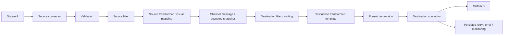

# Final UI simplification audit — 16 Oktober 2026

## Follow-up: mapping saja pada Step 2

Baseline follow-up: `development`, commit `1734591`, working tree bersih. Instruksi terbaru memisahkan konfigurasi mapping dari testing; hasil bagian ini adalah verifikasi terbaru. Catatan audit dan daftar 60 file pada bagian implementasi sebelumnya di bawah tetap disimpan sebagai riwayat pekerjaan sampai `1734591`. Screenshot ditimpa dengan tampilan follow-up terbaru.

Alur sekarang: **Source (inbound format) → Transformation (mapping) → Destinations (outbound format per destination) → Review & Test**.

| Area | Perubahan follow-up |
| --- | --- |
| Step 2 | Hanya Field Mapping dua kolom Source Field / Target Field, Add Mapping dan Advanced Custom Transformation Script |
| Mapping options | Required/default tersedia dalam disclosure per baris; property rootElement existing tetap dipertahankan tanpa field format/root baru |
| Dihapus dari Step 2 | Input/output format, patient example, sample editor, preview, testing, raw/privacy controls dan error testing |
| Destination | Masing-masing memilih format sendiri; tidak ada apply-to-all dari mapping atau penyalinan format destination pertama ke destination berikutnya |
| Review & Test | Source/transformation/destination summaries, flow, input sintetis, Test Transformation dan generated output per destination |
| Advanced test options | Audited raw preview dan optional TCP/TLS connection checks; seluruhnya hanya pada Review |
| Error | JSON tidak valid ditolak sebelum API call; konfigurasi yang belum lengkap menyebut setting yang perlu dilengkapi; target wajib yang hilang mendapat pesan spesifik |
| Compatibility | Pipeline runtime, pass-through, canonical mappings/required/default/root, custom scripts, multi-destination, routing dan delivery tidak dihapus atau diubah |

Error test mempunyai state terpisah dan hanya dirender pada Review. Berpindah langkah atau mengubah konfigurasi/input/permission membatalkan cached/in-flight preview; mengedit mapping tidak otomatis mengirim request preview. Required field tetap diperiksa setelah source filter, agar pesan valid yang sengaja difilter tidak menjadi error mapping. Diagnostic required-target hanya menjalankan ulang mapping canonical dengan check required dimatikan di sandbox/parser berbatas yang sama; tidak menjalankan ulang script custom atau network. Tidak ada exception/patient value pada pesan bantuan.

| Command / pemeriksaan follow-up | Hasil sebenarnya |
| --- | --- |
| `npm run test:coverage` | PASS — 345 tests / 28 suites |
| `npm run test:e2e` | PASS — 57 tests, synthetic API fixtures |
| Targeted browser screenshot capture | PASS — 1 test; Review dicapture dengan viewport lebih tinggi agar flow/input/output terlihat lengkap |
| `npm run typecheck` / `npm run lint` / `npm run format:check` | PASS |
| `npm run build` | PASS — client dan server |
| `npm run docs:check` | PASS — 46 paths / 50 operations; safe message metadata terdokumentasi |
| `npm run secrets:scan` | PASS — targeted scanner, findings kosong |
| Pemeriksaan local Markdown links | PASS — 56 links, termasuk anchor dan screenshot |
| `git diff --check` | PASS |
| Native SQL / compiled runtime / development migration | NOT RERUN — tidak ada perubahan database atau runtime delivery; hasil 19 SQL dan runtime pada bagian sebelumnya adalah bukti sebelum follow-up |
| Fresh install, dependency audit, Docker, hospital UAT, production load/DR | NOT RERUN / NOT TESTED pada follow-up ini |

Coverage meningkat dari `1734591`: statements **81.90 → 82.09%**, branches **78.61 → 78.80%**, functions **83.63 → 83.84%**, lines **82.96 → 83.12%**.

Kegagalan investigasi tidak disembunyikan: combined typecheck pertama milik backend berjalan saat props frontend masih dipindahkan dan gagal pada props lama TransformationEditor; setelah handoff, typecheck workspace PASS. Browser run awal gagal karena accessible label input turut memuat helper text, lalu assertion lama masih mengharapkan format gabungan pada flow. Locator/expectation diperbarui terhadap UI aktual; final full suite 57/57 PASS. Pembacaan awal usability.services.ts dan glob usability* gagal karena nama file tidak ada; rg menemukan handler aktual di transformationPreview.services.ts. Tidak ada kegagalan aplikasi tersisa pada skenario tersebut.

Screenshot: [Step 2 mapping](screenshots/usability/lite-transformation.png), [Review & Test](screenshots/usability/lite-review.png), [Destination](screenshots/usability/lite-destinations.png). Manual: [MIRTH_LITE_UI.md](MIRTH_LITE_UI.md). Tidak ada migration, reset database, perubahan environment/key atau data production dalam follow-up ini. Binary build terbaru cukup direstart dengan `npm run start` pada development yang sudah memiliki schema 7. Rollback kode dapat memakai artifact `1734591`, dengan konfigurasi/data/keyring tetap dipertahankan.

Daftar file follow-up dicatat di bagian akhir dokumen.

## Catatan implementasi sebelumnya — sampai 1734591

## Audit sebelum coding

Baseline: development, commit `a43c693`, working tree bersih; Node 24.18.1, npm 11.16.0, macOS arm64. Dokumen ini dibuat setelah pemeriksaan source dan sebelum perubahan implementasi untuk prompt final. Baseline coverage lulus 301 test / 26 suites; typecheck, lint, format dan build juga lulus. Coverage awal: statements 81.11%, branches 76.82%, functions 82.75%, lines 82.25%.

Actual usage di sini berarti jalur komponen, route, konfigurasi dan test yang benar-benar tersedia dalam repository. Tidak ada analytics frekuensi penggunaan dari pengguna; keputusan tidak mengklaim suatu fitur jarang dipakai berdasarkan statistik yang tidak tersedia.

| Area | Klasifikasi | Source / pemakaian aktual | Keputusan |
| --- | --- | --- | --- |
| Channel, Start/Stop, source/destination connectors | KEEP | ChannelForm, ChannelTable, channel.services, messageProcessor | Pertahankan engine, routing dan operasi |
| Wizard empat langkah | KEEP | ChannelForm: Source → Transformation → Destinations → Review | Pertahankan urutan dan dirty/discard guard |
| Endpoint source | KEEP | SourceEndpoint menampilkan endpoint backend; PUBLIC_BASE_URL dan INBOUND_PATH divalidasi backend | Tanpa hostname browser/hardcode production; copy/example tetap dihapus |
| Source API key | KEEP | rotateSourceCredential, ChannelForm, onboarding, encrypted DB | Sekali tampil, rotasi invalidasi key lama, tidak menambah exposure |
| Source validation | ADVANCED | channelDraft preset hanya JSON object; backend XML/HL7 sudah syntax-checked | Basic untuk format yang didukung; custom schema hanya setelah dipilih; profile existing dipertahankan |
| Source filter | ADVANCED | FilterEditor accept/reject/custom; filterScript dijalankan QuickJS | Tambahkan builder Field / Operator / Value tanpa eval; validasi dipisahkan dari keputusan routing |
| Source transformer | ADVANCED | processingScript juga menyimpan mapping visual | Tampilkan status dan Configure; satu stage engine, bukan dua transformasi fiktif |
| Mapping / preview | KEEP | TransformationEditor, fieldMapping compiler, preview-transformation | Required/default/preview tetap; custom script tidak ditimpa tanpa pilihan eksplisit |
| Source response | LEGACY | responseScript masih dibaca, dieksekusi dan diekspor | Standard response untuk channel baru; hanya notice kecil untuk channel legacy |
| Destination filter / transformer | ADVANCED | DestinationEditor saat ini menggabungkan keduanya dalam Message processing | Pisahkan menjadi Destination filter dan Destination transformer |
| Destination response editor | REMOVE dari UI baru / LEGACY di backend | Editor Response processing masih tersedia saat membuat channel | Hapus editornya; pertahankan responseScript existing, runtime dan import/export |
| Retry / timeout / multi destination | KEEP / ADVANCED | Delivery settings, Add Destination, worker, circuit/lease/snapshot | Pertahankan, unit seconds dan kontrol lanjutan tetap tersedia |
| Review | KEEP / SIMPLIFY | Flow visual, Source, Transformation dan retry/timeout sudah ada | Tambahkan Source processing: Validation / Filter / Transformer dari konfigurasi nyata |
| Change summary | REMOVE dari flow biasa | UI memberi summary otomatis, backend tetap menyimpan audit/revision | Pertahankan otomatis; field administrasi opsional tetap dapat tersedia |
| Messages / redaction / resend | KEEP | LogDetailModal, monitor queries, raw permission/audit, attempt history | Label tahap sudah benar; pertahankan payload/snapshot/permission dan konfirmasi resend |
| Delivery duration / attempts | KEEP / COMPLETE | HTTP status sudah tersimpan; latency hanya histogram process, bukan record attempt | Tambah nullable metadata durasi aktual; jumlah attempt dari history tersimpan, tidak ditebak dari retryCount |
| Dashboard | SIMPLIFY | Empat kartu, health, Needs attention, Channel activity dan banner umum | Running / Stopped / Messages today / Successful / Failed / Retrying / Recent failures; pakai data SQL, tanpa chart dummy |
| Settings | KEEP / ADVANCED | Account, Users, Audit, sessions/alerts/runtime JSON | Users/Roles/Audit/System information; sessions/alerts/diagnostics dilipat sebagai operational tools |
| Raw JSON runtime settings / helper berulang | REMOVE dari tampilan utama | RuntimeSettingsPanel menampilkan JSON; helper lama sudah sebagian dihapus | Ringkasan informasi berlabel, detail hanya bila memberi nilai operasional |

## Before / after flow

Engine before dan after tetap:



Main UI before: Source dengan filter/script sebelum validation; Transformation dengan mapping; Destinations dengan Message processing / Delivery / Response; Review tanpa ringkasan Source processing. Overview memiliki kartu dan panel operasional yang berulang. Settings mencampur account, kontrol operasi dan runtime JSON.

Main UI after: Source menampilkan nama / connector / format / key / endpoint; Advanced hanya Validation → Source Filter → Source Transformer. Transformation tetap mapping tunggal dengan preview. Destinations default satu, dengan Advanced Filter → Transformer → Delivery. Review merangkum source processing, mapping, destination dan delivery. Overview fokus enam angka nyata dan recent failures. Settings memisahkan Users / Roles / Audit / System information, dengan kontrol operasi melalui disclosure.

## Compatibility dan implementasi

- Semua script/profile/response legacy tetap disimpan dan diproses; tidak drop column, tidak menghapus channel/payload/revision.
- Builder filter menghasilkan script boolean canonical dalam filterScript existing; script custom hanya dikenali bila metadata dan isi compiler utuh. Input tidak menjadi JavaScript mentah. Kondisi tidak valid menghalangi Save dan preview.
- Basic syntax validation memakai metadata profile opsional; profile JSON-object legacy tidak diam-diam diganti. Required mapping tetap diperiksa setelah source filter agar pesan yang sengaja difilter tidak salah menjadi validation error.
- Main mapping dan Advanced source transformer adalah dua tampilan dari processingScript yang sama. Multi destination mempertahankan transformer/filter masing-masing.
- HTTP success envelope legacy dipertahankan; alias messageId/status dapat ditambah secara kompatibel. Source/destination response script lama tetap berlaku.
- Metadata latency memerlukan migration additive 007; record lama tetap unknown. Startup/deployment/restore guards dan smoke tests harus konsisten sebelum migrasi development. Tidak ada reset atau operasi production.
- Acceptance menggunakan data sintetis yang diminta: RM-000123 / Siti Aminah / F / 1993-08-17, dibandingkan dengan XML aktual yang diterima loopback HTTP destination dan metadata Messages. Browser fixture bukan bukti pengiriman network; native SQL/runtime test menjadi bukti tersendiri.

## Hasil akhir

Implementasi mempertahankan pipeline Mirth-style dan wizard Source → Transformation → Destinations → Review. Nama channel, connector, format, API key dan endpoint tetap langsung terlihat. Validation, filter dan transformer masuk disclosure; destination memiliki kelompok filter, transformer dan delivery terpisah. Mapping visual tetap menjadi tampilan utama, dengan status validation/filter/transformation dan `Network delivery: NOT SENT` pada preview.

| Area | Hasil | Compatibility |
| --- | --- | --- |
| Source validation | No additional / Basic / Custom; editor schema hanya setelah Custom dipilih | Basic JSON/XML/HL7 melalui metadata opsional; profile JSON-object legacy tidak ditimpa |
| Source/destination filter | Builder Field / Operator / Value, accept/skip preset dan custom Advanced | Disimpan dalam filterScript existing, dieksekusi pada sandbox yang sama; bukan eval dari input pengguna |
| Source transformer | Status dan Configure, main mapping tetap satu stage processingScript | Custom script existing tetap custom; tidak dibuat stage transformasi tambahan |
| Response scripts | Tidak ada editor response pada flow baru | Script source/destination legacy tetap disimpan, dieksekusi dan dapat import/export; UI hanya memberi notice |
| Review dan audit | Source processing, flow dan delivery; summary otomatis berdasarkan area berubah | Audit area mencatat proposal draft dalam transaksi yang sama; running revision tetap berubah melalui publish |
| Messages | Inbound / Source processed / Outbound / Delivery result, status HTTP, duration dan attempts | Raw tetap permission-controlled dan diaudit; durasi/count yang tidak diketahui ditampilkan Not recorded |
| Overview | Running, Stopped, Messages today, Successful, Failed, Retrying dan Recent failures | Query data nyata; sukses/gagal menghitung inbound, retry menghitung delivery pending, tanpa chart dummy |
| Settings | System information, Users, Roles, Audit | Sessions/alerts/diagnostics dipertahankan dalam operational disclosure dan mengikuti permission |

## Screenshot UI baru

Seluruh screenshot berasal dari browser test dengan fixture sintetis. Angka fixture menguji tampilan, bukan pengukuran traffic production.

| Tampilan | Screenshot |
| --- | --- |
| Source dan Advanced | [Source](screenshots/usability/lite-source.png) |
| Mapping dan preview XML | [Transformation](screenshots/usability/lite-transformation.png) |
| Destination dan kelompok Advanced | [Destinations](screenshots/usability/lite-destinations.png) |
| Flow dan Source processing | [Review](screenshots/usability/lite-review.png) |
| Enam metrik dan Recent failures | [Overview](screenshots/usability/lite-overview.png) |
| Informasi sistem dan operational tools | [Settings](screenshots/usability/lite-settings.png) |

## Regression, E2E dan bukti command

| Command / pemeriksaan | Hasil akhir aktual | Batas bukti |
| --- | --- | --- |
| `npm run test:coverage` | PASS — 332 tests, 28 suites | Unit/API memakai synthetic fixtures; socket loopback memerlukan akses di luar sandbox |
| `npm run typecheck` | PASS | Client dan server |
| `npm run lint` | PASS | Tidak ada lint error |
| `npm run format:check` | PASS | Seluruh target script formatter repository |
| `npm run build` | PASS | Production client dan compiled server; build client diulang setelah penyempurnaan label preview |
| `npm run test:e2e` | PASS — 53 tests | Browser dengan synthetic API fixtures, keyboard/mobile, permission dan accessibility; bukan browser yang terhubung ke production |
| `npm run test:sql` dengan environment disposable terisolasi | PASS — 19 tests | PostgreSQL 18.4 loopback; schema mirth_test_* baru dihapus setelah suite |
| CLI `npm run db:migrate` dua kali | PASS | Database disposable; versions tepat 1–7, initial revision existing channel dan additive columns |
| `npm run test:runtime` dengan `ENV_FILE=/dev/null` dan disposable TEST_DATABASE_URL | PASS | Compiled startup, health/readiness, metrics access control dan SIGTERM saat accepted delivery aktif |
| `npm run docs:check` | PASS — 46 paths / 50 operations | OpenAPI tetap JSON-valid YAML |
| `npm run secrets:scan` | PASS — findings kosong | Targeted current-source scanner; bukan konfirmasi rotasi seluruh historical credential |
| `git diff --check` | PASS | Tidak ada whitespace error |
| Pemeriksaan local Markdown links | PASS — 52 links | Termasuk screenshot dan anchor manual upgrade/verifikasi |
| Development migration preflight lalu `npm run db:migrate` | PASS | MiniMirthDev/public, additive 007; bukan reset dan bukan production |
| Compiled development startup, GET /health, GET /ready, SIGTERM | PASS — HTTP 200 / 200, exit 0 | Port loopback sementara 19092, tanpa payload; proses uji sudah dihentikan |
| Fresh `npm ci` dan dependency audit | NOT RERUN | Tidak ada dependency/package-lock berubah; hasil install/audit sebelumnya tidak diklaim sebagai run baru |
| Docker, remote GitHub CI, hospital UAT, load/HA/security/DR qualification | NOT TESTED dalam perubahan ini | Memerlukan environment dan acceptance deployment |
| Native schema-7 pg_dump/pg_restore drill | NOT TESTED | Client pg_dump/pg_restore tidak tersedia; source tests backup tetap tercakup, rehearsal schema-5 terdokumentasi terpisah |

Coverage akhir: **statements 81.90%, branches 78.61%, functions 83.63%, lines 82.96%**; seluruh kategori meningkat terhadap baseline. Tidak ada gate yang diturunkan.

SQL acceptance mengirim fixture RM-000123 / Siti Aminah / F / 1993-08-17 melalui HTTP source ke HTTP receiver loopback aktual. Test membandingkan XML `<Patient>` dengan empat field yang diminta, response SUCCESS, alias messageId/status, HTTP 200, duration non-negatif, attempt count 1, serta inbound/source-processed JSON dan outbound XML dari monitor. Pesan ORM valid yang ditolak source filter tidak menghasilkan pengiriman. Suite juga menguji routing/multi destination, response legacy, credential rotation, draft/publish/rollback dan repeat migration. Browser fixture tidak digunakan sebagai bukti network delivery.

Review akhir menemukan hasil processing negatif yang sudah dipersist masih mengembalikan HTTP 502 tanpa code/message tingkat atas. Response kini menambahkan `MESSAGE_PROCESSING_FAILED`, pesan aman, requestId dan details kosong; `result` lengkap termasuk custom response legacy tetap sama. Lima regression case memeriksa FAILED/PARTIAL/IN-ERROR dan bahwa FILTERED 200 / QUEUED 202 tetap kompatibel. Targeted API 23/23 lulus, lalu full coverage, build dan quality checks dijalankan ulang. Native SQL/runtime berhasil sebelum perubahan envelope terakhir; transport/persistence tidak berubah, dan pemeriksaan startup development diulang pada artifact final.

Kegagalan yang ditemukan dan diperbaiki:

| Percobaan | Error / root cause | Perbaikan dan hasil akhir |
| --- | --- | --- |
| Targeted `npx vitest run` untuk usability API / monitor worker | EPERM ketika membuka listener loopback | Jalankan ulang dengan akses loopback; targeted dan full suites PASS |
| `npx vitest run server/test/profile-validation.test.ts` | AJV strict schema menolak required field tanpa properties pada fixture | Lengkapi fixture JSON Schema; test dan full coverage PASS |
| `npx playwright test client/e2e/usability.spec.ts` | Empat assertion baru memakai locator bersaing / nama kontrol tidak sesuai setelah disclosure berubah | Perbaiki locator terhadap UI aktual; targeted 31 dan final 53 browser tests PASS |
| Screenshot Overview awal | Screenshot diambil sebelum request Recent failures selesai | Tunggu row hasil fixture sebelum capture; final 53 browser tests PASS |
| Development startup smoke pertama (`node --import tsx --input-type=module`) | Guard memeriksa process.env.PG_SCHEMA yang tidak diisi; default schema public ada pada config | Gunakan config.database.schema yang tervalidasi; startup/health/ready/shutdown PASS |
| `sed` diagnostic reads pada server/src/config.ts dan server/src/middleware/error.middleware.ts | No such file or directory | Cari ulang dengan rg; baca path aktual config/env.ts dan middleware/errorHandler.ts |

Disposable PostgreSQL khusus sesi ini dan kedua database sintetisnya sudah dihentikan/dihapus setelah pengujian. Backend pengguna dan cluster lain tidak dihentikan.

## Database dan deploy development

Migration `007_delivery_timing.sql` menambah `MessageDestinationLog.request_duration_ms` nullable integer dengan CHECK >= 0. Timing diukur sekitar transport call; script response dan admission/circuit wait tidak dihitung sebagai request duration. Record lama tetap NULL. Attempt count memakai complete retained history, tidak ditebak dari retryCount; history legacy/campuran yang tidak cukup informatif tetap unknown.

Preflight dan migrator transactional/advisory lock sudah dijalankan terhadap development MiniMirthDev. Versions sekarang tepat 1–7; counts sebelum/sesudah sama: Users 1, Channels 1, Destinations 1, Messages 2, MessageDestinationLog 1. Tidak ada reset, drop column, pengiriman payload uji ke development atau perubahan production. File .env dan keyring tidak diubah. Startup development diuji dengan MLLP dimatikan pada proses uji sementara; pengujian listener/transport terpisah ada pada regression/runtime suite.

Untuk restart development yang sudah dimigrasikan:

```sh
npm run build
npm run start
```

Untuk environment lain, siapkan backup/keyring dan jalankan `npm run db:migrate -- --dry-run`, kemudian `npm run db:migrate` sebelum start, mengikuti [operational controls](OPERATIONAL_CONTROLS.md) dan [backup/restore](BACKUP_RESTORE_RUNBOOK.md). Jangan menjalankan reset untuk upgrade ini.

Rollback mempertahankan schema, version rows, encrypted keyring, audit dan message history. Rollback/publish revision yang kompatibel sebelum menurunkan binary: binary lama belum memiliki normalisasi XML untuk canonical simple-condition baru. Mengganti artifact ke baseline a43c693 tanpa meninjau channel yang memakai konfigurasi baru tidak dijamin kompatibel. Jangan melakukan down migration atau menghapus data untuk rollback.

## Legacy yang dipertahankan dan batas produk

Source filter, source transformer, source response, destination filter/transformer/response, validationProfile, idempotency configuration, template, delivery policy, routing dan multiple destinations tetap dibaca backend. Profile/script legacy tidak dikonversi diam-diam oleh UI. Existing channel menjadi acuan draft, accepted work tetap menggunakan snapshot dan start/stop/resend/retry/error monitoring dipertahankan. Import/export tetap mengikuti redaction/credential policy existing; arbitrary trusted script dapat mengandung informasi sensitif sehingga kebijakan export tetap perlu review.

Manual diperbarui di [MIRTH_LITE_UI.md](MIRTH_LITE_UI.md). Batas production tetap tercatat pada [readiness matrix](PRODUCTION_READINESS_MATRIX.md): perubahan ini selesai sebagai implementasi source dan verifikasi lokal/development, **bukan sertifikasi production-ready**. Credential-owner rotation, certificate custody, production backup/restore/DR drill, hospital profiles/UAT dan load/security review masih memerlukan verifikasi runtime.

## Daftar file berubah

Daftar berikut mencakup perubahan implementasi, test, migration, manual dan screenshot untuk permintaan final simplification.

```text
CHANGELOG.md
README.md
client/e2e/ui.spec.ts
client/e2e/usability.spec.ts
client/src/features/channels/ChannelForm.tsx
client/src/features/channels/DestinationEditor.tsx
client/src/features/channels/DryRunPreview.tsx
client/src/features/channels/FilterEditor.tsx
client/src/features/channels/TransformationEditor.tsx
client/src/features/channels/channelDraft.ts
client/src/features/monitor/LogDetailModal.tsx
client/src/features/overview/OverviewPage.tsx
client/src/features/settings/RuntimeSettingsPanel.tsx
client/src/features/settings/SettingsPage.tsx
client/src/index.css
client/src/services/monitor.api.ts
client/src/types/monitor.ts
client/test/channel-usability.test.ts
docs/ARCHITECTURE.md
docs/BACKUP_RESTORE_RUNBOOK.md
docs/ERROR_CODE_CATALOG.md
docs/MIRTH_LITE_UI.md
docs/OPERATIONAL_CONTROLS.md
docs/PRODUCTION_READINESS_MATRIX.md
docs/UI_SIMPLIFICATION_AUDIT.md
docs/openapi.yaml
docs/screenshots/usability/lite-destinations.png
docs/screenshots/usability/lite-overview.png
docs/screenshots/usability/lite-review.png
docs/screenshots/usability/lite-settings.png
docs/screenshots/usability/lite-source.png
docs/screenshots/usability/lite-transformation.png
scripts/runtime-smoke.mjs
server/migrations/007_delivery_timing.sql
server/src/scripts/development-reset-core.ts
server/src/scripts/migrate.ts
server/src/scripts/verify-development-reset.ts
server/src/server.ts
server/src/services/channel.services.ts
server/src/services/engine/delivery.ts
server/src/services/engine/repository.ts
server/src/services/message.services.ts
server/src/services/monitor/mapping.ts
server/src/services/monitor/repository.ts
server/src/services/profileValidation.services.ts
server/src/services/restoreVerification.services.ts
server/src/services/revision.services.ts
server/src/services/script.services.ts
server/src/utils/channelChanges.ts
server/src/utils/simpleCondition.ts
server/src/utils/validator.ts
server/test/channel-changes.test.ts
server/test/channel-db.test.ts
server/test/engine.test.ts
server/test/monitor-worker.test.ts
server/test/profile-validation.test.ts
server/test/simple-condition.test.ts
server/test/sql.integration.ts
server/test/startup.test.ts
server/test/usability-api.test.ts
```

## Daftar file follow-up mapping / Review & Test

```text
CHANGELOG.md
README.md
client/e2e/ui.spec.ts
client/e2e/usability.spec.ts
client/src/features/channels/ChannelForm.tsx
client/src/features/channels/DestinationConnectionTest.tsx
client/src/features/channels/DestinationEditor.tsx
client/src/features/channels/DryRunPreview.tsx
client/src/features/channels/ReviewTest.tsx
client/src/features/channels/TransformationEditor.tsx
client/src/index.css
docs/ARCHITECTURE.md
docs/ERROR_CODE_CATALOG.md
docs/MIRTH_LITE_UI.md
docs/PRODUCTION_READINESS_MATRIX.md
docs/UI_SIMPLIFICATION_AUDIT.md
docs/openapi.yaml
docs/screenshots/usability/lite-destinations.png
docs/screenshots/usability/lite-overview.png
docs/screenshots/usability/lite-review.png
docs/screenshots/usability/lite-source.png
docs/screenshots/usability/lite-transformation.png
server/src/services/dryRun.services.ts
server/src/services/transformationPreview.services.ts
server/test/transformation-preview.test.ts
```


## Source Message Validation audit and implementation — 2026-10-18

Baseline development commit: `908e208`. Repository and current code were read before implementation; no real patient data or live database was used. Before screenshot is retained under screenshots/validation/before-basic.png.

| Previous mode | Saved configuration | Runtime check | Dry-run check | Verified problem |
| --- | --- | --- | --- | --- |
| No additional | {} | HTTP JSON parsing, unconditional bounded XML/HL7 parsing | Same validator after test-input parsing | UI did not explain parsing remains active |
| Basic | basicSyntax=true | JSON serializability/size; no required field rules. XML/HL7 already parse without it | Same behavior | Ambiguous label, no editable requirements |
| Legacy JSON-object Basic | jsonSchema: type=object | JSON object shape, arrays/scalars rejected by schema | Same behavior | Different semantics hidden under same Basic label |
| Custom | Legacy profile with jsonSchema/xml/hl7/script keys | AJV/schema, bounded XML/HL7 rules, sandbox boolean | Same shared validator | Editor lacked language/example; bare JSON Schema unknown top-level keys could be stripped to {} by API schema |

Evidence paths/functions: client ChannelForm radio/state and channelDraft validationChoice/selectedValidationProfile; backend validator.channelSchema, profileValidation.validatePayload/validateProfileConfiguration; messageProcessor.processInboundMessage before source filter/transformer; dryRun.runConfiguration; message.services HTTP parsing and monitor details. Existing MLLP listener uses filter for channel selection before processor; this routing behavior remains explicit and unchanged.

New JSON Field validation, format-specific Custom examples and precise legacy mode address the UI/root causes. Versioned settings retain inactive rules in existing channel/revision storage; strict active-profile validation rejects typo/bare wrapper mistakes rather than silently removing rules. Input failures stop before outbound reservation/retry and are captured as IN-ERROR. Shared evaluator results are sanitized before HTTP, Review and Messages presentation; values, allowed lists, arbitrary exception text and scripts are omitted from diagnoses. Nested custom/legacy scripts are scrubbed from revision diff/review.

Validation versus routing versus mapping remains separate. Field Required means nonempty input, including whitespace handling; JSON Schema legacy required and target mapping required retain their own semantics. JSON-only Field validation never claims XML/XSD/complete HL7 support. See manual 8.3 for examples and downgrade caveat.


| Verification command | Actual outcome |
| --- | --- |
| npm run test:coverage | PASS: 472 tests, 34 files; 85.61/83.31/87.24/86.40 statement/branch/function/line coverage |
| npm run test:e2e | PASS: 72 browser tests, including legacy compatibility, source filter regression, rule persistence, format examples, safe Review and accessibility |
| npm run typecheck | PASS: client/server |
| npm run lint | PASS |
| npm run format:check | PASS |
| npm run build | PASS: client/server production output |
| npm run docs:check | PASS: structural OpenAPI/local refs, 47 paths/51 operations; not a full semantic API certification |
| npm run secrets:scan | PASS: targeted source scanner, no findings; not an independent external security review |
| Live PostgreSQL / deployed production / hospital UAT | NOT TESTED; isolated database/transport fixtures only |

Original full coverage log: /tmp/mirth-validation-baseline.log. Final coverage: /tmp/mirth-validation-acceptance.log. Browser verification: /tmp/mirth-validation-e2e-final.log. Generated reports remain ignored local artifacts; retained synthetic screenshots are linked in manual 8.3. A passing browser fixture alone is not delivery evidence; real evaluator/processor and loopback ACK behavior are covered separately in field-validation-runtime.test.ts.


Files changed for validation:

| Area | Files |
| --- | --- |
| Frontend | features/channels/ChannelForm.tsx, channelDraft.ts, MessageValidationEditor.tsx, DryRunPreview.tsx, ReviewTest.tsx; components/ui/ValidationResults.tsx; features/monitor/LogDetailModal.tsx; types/monitor.ts; index.css |
| Backend/runtime | services/profileValidation.services.ts, channel.services.ts, revision.services.ts, messageProcessor.services.ts, dryRun.services.ts, message.services.ts; middleware/errorHandler.ts; utils/validator.ts, validationRules.ts, validationDiagnostics.ts |
| Tests | client/test/channel-usability.test.ts; client/e2e/usability.spec.ts; server/test/field-validation.test.ts, field-validation-runtime.test.ts, validation-diagnostics.test.ts, profile-validation.test.ts, channel-db.test.ts, monitor-worker.test.ts |
| Docs/artifacts | README, CHANGELOG, MIRTH_LITE_UI manual8.3, OPERATIONAL_CONTROLS, ARCHITECTURE, ERROR_CODE_CATALOG, OpenAPI, this audit and three synthetic screenshots |

## Destination audit and implementation — 2026-10-18

Baseline: branch `development`, commit `30ceaa5`, working tree initially clean. Environment: macOS arm64, Node 24/npm 11. Baseline full coverage suite: 472 tests; statements 85.61%, branches 83.31%, functions 87.24%, lines 86.40%. The latest complete attachment supersedes the earlier truncated destination prompt. This section records source/local verification; no production database, environment, credential or repository setting was changed.

### Root causes and final behavior

| ID | Area | Verified finding | Change / evidence | Status |
| --- | --- | --- | --- | --- |
| D01 | Destination Filter | Four UI modes mixed destination activation with per-message filtering. Runtime already read the source-processed message before destination transformation. | One Enable destination filter checkbox and direct condition builder. Destination enabled remains exclusively in Delivery settings. Shared retained-rule utility, own-property paths and bounded sandbox; no new evaluator. | Implemented |
| D02 | Legacy compatibility | Script strings are the persisted truth, including legacy Deliver/Skip/custom. Removing the UI mode could otherwise erase a filter. Bare literal false incorrectly fell through to the worker's default true. | Preserve exact legacy scripts read-only until explicit replacement. OFF wrappers retain rules. Literal true/false now produce Boolean decisions; false never becomes unconditional delivery. Automated runtime and browser regression. | Implemented; intentional bug correction |
| D03 | Transformation | The backend already supported per-destination sandbox transformation; UI Configure transformation exposed only the script editor. | Reuse existing visual mapping editor/compiler for each destination, keep required/default/custom scripts and independent input clones. Incomplete edits block navigation/save/test. | Implemented |
| D04 | Advanced Template | template_script is a working second QuickJS transformation stage, after processing_script and before converter. It can replace the outbound body. No stored-template library/picker exists. | Remove standalone Add template for new settings; retain legacy script, notice and explicit editor inside Configure transformation. Preview and sender use the same stage order. | Implemented |
| D05 | False attempt history | recordAttempt was called on filter mismatch and preparation errors despite no transport. | Store FILTERED or OUT-ERROR on the outbound message without MessageDestinationLog insertion. Curated stage-specific safe codes, no arbitrary exception text. Historical rows remain, classified separately. | Implemented |
| D06 | Unsafe resend | Initial outbound reservation contained source payload and a connector snapshot before destination preparation. Failed preparation could leave a misleading resendable payload. | Reserve all jobs first with NULL snapshot; atomically store final payload plus encrypted preparation_version:1 snapshot only after successful preparation. Manual resend/worker guard rejects unprepared or unprovable historical work. Retry sends immutable saved output once. | Implemented |
| D07 | Retry and conversion | Permanent HTTP 4xx could enter automatic retry; raw XML returned by scripts bypassed final XML parsing. | 4xx except 408/429 are terminal; configured transient retry and ambiguous-outcome quarantine retained. Bounded well-formed XML/DTD checks before send and XML→JSON conversion; valid XML bytes retained. | Implemented |
| D08 | Review and Messages | Disabled, filtered and preparation failure were not clearly separated from delivery results. | Dry-run returns enabled/stages/delivery with truthful Not run/Not sent labels. Detail adds bounded destinationOutcomes, safe codes and actual/unknown attempt counts. Known pre-network policy rejections are excluded even from historic timing/counts; HTTP/ACK evidence takes precedence. Legacy metadata is never guessed. | Implemented |

Pipeline remains: validation → Source Filter → Source Transformer → clone per destination → Destination Filter → Destination Transformer → legacy output script → format converter → sender. Multi-destination, routing, retry, timeout, circuit/capacity, message monitoring, start/stop, inbound/outbound payload, authentication/RBAC, source keys/rotation, encryption, redaction/raw audit, SSRF, sandbox and limits remain enforced.

### Changed files and contract

| Layer | Files | Model / API impact |
| --- | --- | --- |
| Frontend | client/src/features/channels/{DestinationEditor,FilterEditor,TransformationEditor,ChannelForm,DryRunPreview,ReviewTest}.tsx; components/status/ScriptEditorModal.tsx | Checkbox, condition validity, destination mapping, legacy script editor; existing API config fields |
| Messages | client/src/features/monitor/LogDetailModal.tsx; client/src/types/monitor.ts | Separate processing summaries from network attempt results |
| Configuration / evaluator | server/src/utils/{sourceFilter,validator}.ts; services/script.services.ts | Destination disabled wrapper within existing filter_script; shared checks; legacy Boolean correctness |
| Runtime | services/messageProcessor.services.ts; services/engine/{preparation,repository,conversion,delivery,policy}.ts | Atomic prepared payload/snapshot and resend proof; no new DB column/table/status enum |
| Preview / tracking | services/dryRun.services.ts; services/message.services.ts; services/monitor/{mapping,repository}.ts | Additive destinationOutcomes plus delivery eventKind/networkAttempted/occurredAt; sentAt only where transport is recorded. Counts 0 or null for unknown |
| Tests | server/test/destination-configuration.test.ts; destination-runtime.test.ts; existing engine, field-mapping, transformation-preview, monitor-worker and sql.integration tests; client/test/destination-presentation.test.ts; client/e2e/usability.spec.ts | Actual QuickJS/transport/local receiver plus UI/API fixtures; real PostgreSQL test extended separately |
| Documentation | README.md; CHANGELOG.md; this audit; MIRTH_LITE_UI.md; ARCHITECTURE.md; ERROR_CODE_CATALOG.md; OPERATIONAL_CONTROLS.md; openapi.yaml; screenshots/destination/*.png | Actual semantics, compatibility, safeguards, limits and before/after artifacts |

No schema migration is required; schema 1–7 is still required by the application. Existing validation_profile, processing_script, template_script, filter_script, Messages and MessageDestinationLog columns are reused. Configurations and encrypted revisions/import/export retain legacy scripts. No bulk migration or live stored-configuration inventory was performed. API schema validation rejects malformed reserved filter metadata. Arbitrary legacy scripts remain sandboxed and fail closed on runtime errors.

A failed new preparation has no snapshot and cannot be resent. Historical legacy failures need proof of preparation (recorded transport/admission or compatible queued state); otherwise reconcile receiver outcome and submit a new message through a corrected published channel. Do not remove history, hand-edit payloads, or overwrite encrypted snapshots. Stop/drain/reconcile work before binary downgrade: old binaries lack the preparation/resend safeguards, and pending records without a snapshot must not be handed to old workers. Prefer application/channel rollback on the current guarded binary; keep data, keyring and backups.

### Required A–L runtime scenarios

`server/test/destination-runtime.test.ts` contains 36 passing tests using real processInboundMessage, QuickJS, filters/compiler/converter and sendRest with ephemeral 127.0.0.1 HTTP receivers. Database persistence is a stateful fixture, not PostgreSQL. All payloads are synthetic. The browser suite intercepts API calls and is evidence of UX, not real transport.

| Scenario | Actual evidence | Result |
| --- | --- | --- |
| A — filter OFF | Retained throwing legacy rule not evaluated; local receiver gets message | PASS |
| B — ON match | department=LAB delivered to actual receiver | PASS |
| C — mismatch | department=RAD produces FILTERED; receiver/attempt/retry remain empty | PASS |
| D — disabled | Throwing filter/transform not evaluated; no job/request/retry | PASS |
| E — multi-destination | A sent, B filtered; source aggregate remains SUCCESS | PASS |
| F — mapping | patient_id/name mapped to patientCode/fullName; actual received body and dry-run match | PASS |
| G — isolated transforms | Different scripts/mappings yield distinct A/B bodies without state leakage | PASS |
| H — invalid condition | Canonical/wrapper rejection, non-Boolean failure, malformed data fail closed; UI incomplete rules block Continue/Save | PASS |
| I — preparation failure | Filter/transform/template/conversion failure isolated; no send/log/retry/snapshot; resend rejected | PASS |
| J — legacy | Deliver/Skip/bare false/custom/retained wrappers/template preserved and exercised; historical retry evidence required | PASS |
| K — delivery controls | Real HTTP 400/429/500, configured retry interval/final body; endpoint/host/address denied before network yields no network timing/count/retry; timeout quarantine, circuit/capacity no HTTP | PASS |
| L — JSON→XML | Receiver gets exact mapped XML and application/xml, never original JSON; preview parity. XML→JSON also tested | PASS |

UI regression adds OFF save/reopen/re-enable, legacy unchanged/replacement, per-destination mappings and invalid mapping retention, truthful Review/Messages, keyboard/mobile coverage and Axe checks. Screenshots: [before](screenshots/destination/before.png), [after filter](screenshots/destination/after-filter.png), [after mapping](screenshots/destination/after-mapping.png).

### Verification commands, failures and limits

| Command | Result | Scope / evidence |
| --- | --- | --- |
| `npm run test:coverage` | PASS — 529 tests / 37 files | Unit/API/integration with isolated database; actual loopback receiver in 36 destination-runtime cases |
| `npm run test:e2e` with screenshot environment paths | PASS — 82 tests | Synthetic browser fixtures; actual compiled UI, keyboard/mobile/Axe regressions; screenshots captured |
| `npm run typecheck` | PASS | Client and server |
| `npm run lint` | PASS | Application, unit/API/browser tests and scripts |
| `npm run format:check` | PASS | Configured repository code scope |
| `npm run build` | PASS | Client and server production artifacts |
| `npm run docs:check` | PASS | OpenAPI structure/local references, 47 paths / 51 operations; not a complete semantic conformance test |
| `npm run secrets:scan` | PASS | Targeted source scanner: findings []; not a history scan or proof of credential rotation |
| Local Markdown targets / `git diff --check` | PASS | Changed manual/docs links and whitespace |
| Real PostgreSQL / deployment / UAT | NOT TESTED | Required before rollout; no PostgreSQL/Docker binaries available |

Coverage increases from baseline: **85.61 → 86.27% statements; 83.31 → 84.15% branches; 87.24 → 87.81% functions; 86.40 → 87.10% lines**. Logs retained in session `/tmp/mirth-destination-{baseline,coverage,browser-full,typecheck,lint,format,build,docs,secrets}.log`; screenshots are repository artifacts. The baseline and final suites ran against different test sets; passing counts are not a claim of full production coverage.
 Initial checks were not counted as passing: three new browser expectations used the wrong dialog return path, obsolete error wording and wrong summary region; selectors/flow expectations were corrected and the complete browser suite then passed. One old field-mapping test expected FILTERED instead of the new explicit NOT_MATCHED preview label; the expectation was corrected before rerunning coverage. Independent final review caught pre-network host/address rejections incorrectly counted as network attempts by the old duration wrapper; known rejection codes now receive no request duration or automatic retry, and transport evidence/history classification has dedicated regression tests. The initial actual-receiver test caught bare false delivery, which was fixed in the shared evaluator. Fixture expectations for JSON preview shape and ambiguous timeout status were aligned with the real existing engine behavior.

NOT TESTED: live PostgreSQL persistence and stored legacy configuration inventory, deployed-server startup/HTTPS, hospital UAT, load/security review, backup/restore/DR. Native postgres/pg_ctl/Docker are unavailable in this environment. The PostgreSQL integration fixture was extended for prepared snapshots, no fake filter attempts, outcome counts and preparation-failure resend guards; run it in CI/disposable PostgreSQL before deployment. Do not run database tests using the development/production database. No claim of production readiness is made.

Rollout: review/commit the development changes, run the extended PostgreSQL suite against a disposable CI database, build the artifact, and stop/drain/reconcile active work before restarting the managed application. Existing schema 1–7 and keyring are retained; this refactor needs no new migration. Check health/readiness, then verify a permitted synthetic local/test destination with filter match/mismatch and known output bytes. Keep server-specific HTTPS, credentials and inbound API key handling under the existing deployment runbook. Prefer rollback of the channel revision on this guarded binary; never reset messages or migration history to roll back the UI.

## Field explorer, HL7 and format integration — 2026-10-18

### Audit summary and baseline

Target branch is `development`, HEAD `30ceaa5`. This task builds on the uncommitted Destination refactor immediately above; it does not discard those changes. Initial verified source baseline was **529 tests / 37 files**, **82 browser tests**, and **86.27/84.15/87.81/87.10%** statement/branch/function/line coverage. Environment: macOS arm64, Node 24/npm 11. No production/development database, actual environment file, credential, repository setting or running deployment was modified. No dependency or schema migration was added. No commit/push was made.

| ID | Area / source | Verified finding and impact | Implemented response |
| --- | --- | --- | --- |
| H01 | `TransformationEditor.tsx`, `fieldMapping.ts` | Existing V1 mapping resolves own-property dotted paths and compiles to sandbox scripts, but has no source schema explorer, type conversions or HL7-specific configuration. Placeholder paths can be mistaken for actual input; partially completed rows correctly need validation. | Reuse compiler/editor; add bounded V2 metadata/conversions and specific inline row errors. Ignore untouched empty rows, keep partial edits, preserve V1 exact generated bytes. |
| H02 | `hl7Converer.ts`, `engine/conversion.ts` | Real bidirectional HL7/XML/JSON converters and MLLP framing/sender already exist. Generic business JSON requires an HL7 intermediate structure; changing the output selector cannot infer a clinical message. | Reuse existing converter/parser/transport. V2 mapper constructs the required intermediate object using one of four tested destination templates; no parallel serializer or host callback. |
| H03 | `ChannelForm.tsx`, channel routes | No value-free parser-backed field discovery API. Free-text paths provide little help for nested XML/HL7/repeats. | Permission-checked/audited discovery endpoint, one shared searchable tree/picker and synthetic sample area. Processed tree reflects the source transformer used by runtime. |
| H04 | `DestinationEditor.tsx`, transport | Real MLLP used a generic URI field. HTTP sender was POST-only with implicit media type and legacy URL auth; UI did not expose scoped header/auth references. | Connector-specific Host/Port/TLS and ACK guidance; POST/PUT/PATCH, compatible media types, validated per-ID server environment references. Preserve existing DNS/SSRF/TLS/snapshot controls. |
| H05 | `dryRun.services.ts`, `ReviewTest.tsx` | Existing preview already used the processor without network, but did not provide parsed XML/HL7 or an HL7 tree. Reusing generic JSON masking for parsed HL7/XML could reveal numeric identifiers. | Add parsed input with conservative full default redaction, permission-gated audited raw preview, and metadata-only generated HL7 field trees. Output comes from the same runtime stages as real delivery. |
| H06 | destination filter / scripts | Simple filters and retained legacy scripts already work; the latest prompt also requests an advanced destination condition entry point. | Keep OFF/accept-all and direct builder, add optional Advanced custom condition with source-processed `msg` and strict Boolean semantics. Preserve routing/source behavior. |
| H07 | HTTP credential resolution / attempt tracking | Invalid header characters may be rejected by Node before any request, so they must not become timed network attempts or automatic retries. | Validate final generated headers before transport; fail closed using safe credential/configuration codes. Unit and actual-receiver no-network regression cover the failure. |

The actual pipeline remains **receive → format parsing/validation → Source Filter → Source Transformer → independent destination input → Destination Filter → Destination Transformer → retained legacy output script → serialization → prepared immutable body/snapshot → transport → result/history**. HL7 routing selection still occurs before selected-channel validation. JSON is already structured on inbound, while XML/HL7 parsing is reused at the existing validation/canonical-mapping boundaries; no second unconditional parser stage changes legacy custom-script input.

### Implementation and changed files

| Layer | Added / changed files | Function |
| --- | --- | --- |
| Shared browser-safe contracts | `server/src/utils/fieldMapping.ts`, `fieldMappingV2.ts`, `hl7Configuration.ts`, `httpSettings.ts` | V1/V2 contract, strict row/path/config validation, curated HL7 template metadata and HTTP configuration shape; no environment data or server library in the browser bundle |
| Sandbox execution | `fieldMappingRuntimeV2.ts`, `services/script.services.ts`, `utils/validator.ts` | Fixed JavaScript V2 runtime inside existing QuickJS; canonical integrity checks, strict conversions and safe error envelope; serialized UUID/time constants with no network/host callbacks |
| Discovery API | `services/fieldDiscovery.services.ts`, `routes/channel.routes.ts` | POST `/api/channel/discover-fields`, channel:write, bounded real parsers/optional source transform, audit, metadata-only tree and truncation notice |
| HTTP delivery / models | `services/engine/httpConfiguration.ts`, `engine/delivery.ts`, `engine/policy.ts`, `utils/httpSettingsSchema.ts`, `utils/transport.ts`, `models/Destination.ts` | Resolve per-ID environment refs, configure method/type, validate before network, preserve sender safeguards and safe no-attempt classification |
| Monitoring / preview | `services/dryRun.services.ts`, `services/monitor/repository.ts`, `utils/sourceFilter.ts` | Actual parsed input / HL7 output tree, default privacy, known rejection classification and shared profile-aware path normalization |
| Reusable UI | `components/ui/FieldExplorer.tsx`, `FieldPicker.tsx`; `features/channels/SourceSample.tsx`, `HL7Configuration.tsx`, `PayloadPreview.tsx`; `client/src/index.css` | Searchable keyboard tree/picker, synthetic sample discovery, template/header configuration, raw/tree output and responsive layout |
| Editor / Review | `ChannelForm.tsx`, `TransformationEditor.tsx`, `DestinationEditor.tsx`, `FilterEditor.tsx`, `ReviewTest.tsx`, `DryRunPreview.tsx`, `components/status/ScriptEditorModal.tsx`, `types/channel.ts` | Four steps, per-destination settings, validity propagation, retained inactive settings, explicit custom-script replacement, source/parsed/generated preview |
| Unit/API/runtime tests | `server/test/field-mapping-v2.test.ts`, `field-discovery.test.ts`, `http-settings.test.ts`, `format-matrix-runtime.test.ts`, `support/runtimeDatabase.ts`; existing mapping/preview/engine/transport tests | Real converters, QuickJS, API authorization/audit, metadata/privacy, eight-pair actual receivers, header safety and backward compatibility |
| UI tests | `client/test/hl7-editor-presentation.test.ts`, `client/e2e/usability.spec.ts` | State retention, templates/conversions, keyboard/search/HL7 tree, HTTP/MLLP fields, role/privacy, mobile overflow and Axe checks |
| PostgreSQL test | `server/test/sql.integration.ts` | 24 opt-in cases including stored V2 draft/publish/delivery/export/import/rollback; latest suite NOT RUN locally |
| Docs / examples | `.env.example`, README, CHANGELOG, ARCHITECTURE, OPERATIONAL_CONTROLS, ERROR_CODE_CATALOG, openapi.yaml, MIRTH_LITE_UI, PRODUCTION_READINESS_MATRIX and this report | Actual contracts, manual QA, namespace references, limits, compatibility and status; synthetic screenshots under `docs/screenshots/hl7` |

Some files also contain the preceding Destination implementation; its tests and rationale are recorded separately above. All security controls remain server-enforced: authentication/RBAC, source API keys/rotation and one-time display, encrypted configuration/snapshots, raw-payload permission/audit, payload redaction, idempotency/correlation, rate/size/resource bounds, isolated script execution, destination allowlists/DNS pinning and safe logs/errors. A passing source suite does not establish deployed security or credential rotation.

### Database, compatibility and supported scope

No migration or live data rewrite: existing schema **001–007** and encryption/keyring are required. Mapping/template configuration is canonical versioned `processing_script`; method/media type/auth mode/header slot references are additive `delivery_policy.http`. Credential values exist only in protected server environment variables such as `MIRTH_DESTINATION_42_BEARER_TOKEN`; they never appear in configuration responses, mapping scripts, list APIs or dry-run. Import/duplicate creates new IDs requiring separate secret provisioning. Missing/malformed credential values are safe pre-network failures, not automatic retries. Explicit environment auth overrides legacy URL userinfo; None retains legacy URL-auth compatibility. Text output now correctly defaults to `text/plain` rather than `application/json`.

V1 generated scripts retain exact compatibility; V2 reserved metadata must match canonical generated code. Advanced replacement explicitly opens a blank script after confirmation and does not expose V2 envelope internals as a starter. A published V2 channel uses the new runtime. Before binary downgrade, stop/drain/reconcile and choose a compatible V1/custom published revision: older binaries cannot unwrap V2 results. Prefer channel rollback using the current guarded binary. Never drop columns, messages, revisions, keyring or audit history to roll back.

The visual HL7 builder supports curated **v2.5 ADT^A04, ADT^A01, ORU^R01, ORM^O01** profiles. It validates supported structure/order, required fields, selected codes, date/calendar/timestamp rules and explicit repetitions, then uses the existing serializer/validator. It is not a complete HL7 specification, facility profile, every possible ORU group or all observation datatypes. ORU supports one order with explicit repeated observations; ORM is a new observation order. MSH-1/2/9/11/12 are configuration-managed. Auto timestamp has explicit UTC `+0000`; configured 14 digits remain sender-local, or use a validated ±HHMM offset. Separate preview/live executions may generate distinct UUID/control time. See [architecture](ARCHITECTURE.md), [operational contract](OPERATIONAL_CONTROLS.md) and [manual](MIRTH_LITE_UI.md#field-discovery-v2-mapping-and-hl7--18-october-2026).

### Actual runtime and delivery evidence

`server/test/format-matrix-runtime.test.ts` calls the authenticated HTTP inbound route with an encrypted per-channel synthetic source key. It uses the actual processor, parsers, QuickJS compiler, converter, SSRF-pinned sender and local HTTP/MLLP sockets; only persistence is replaced with a stateful fixture. Every format-pair receiver body is compared with the dry-run output for that same configuration. No patient data or external production receiver is used.

| Input → output | Result / actual evidence |
| --- | --- |
| JSON → JSON | PASS — received structured mapped JSON with strict types |
| JSON → XML | PASS — received mapped Patient XML and XML Content-Type |
| JSON → HL7 | PASS — received CR-separated MSH/EVN/PID/PV1, configured header/identifier/date and HL7 Content-Type |
| XML → JSON | PASS — parsed element/attribute data mapped into actual received JSON |
| XML → HL7 | PASS — parsed input produces actual HL7 receiver body |
| HL7 → JSON | PASS — parsed PID components/dates mapped into JSON, not a raw wrapper |
| HL7 → XML | PASS — actual Patient XML, not `<raw>MSH...` |
| HL7 → HL7 | PASS — configured new header and selected mapped values; independent source retained |
| Heterogeneous destinations | PASS — one input delivered as independent JSON, XML and HL7 bodies |
| MLLP / ACK | PASS — actual frames, fragmented AA ACK, AE rejection, mismatch rejection and missing-ACK timeout |
| HTTP settings / auth | PASS — actual PUT/PATCH, selected media type, per-ID Bearer/Basic/header references and explicit-auth precedence |
| No-network cases | PASS — dry-run, required/date/profile failure and invalid credential stop before receiver/attempt/retry |

Example receiver evidence for the fictional JSON fixture (`patient_id=SYNTHETIC-001`, `Budi Santoso`, `dob=1990-05-20`), asserted by parsing the received HL7 bytes:

| Received field | Asserted value |
| --- | --- |
| MSH-1 / MSH-2 | `|` / `^~\&` |
| MSH-3 / MSH-4 | `SYNTHETIC_ENGINE` / `TEST` |
| MSH-5 / MSH-6 | `SYNTHETIC_RECEIVER` / `TEST` |
| MSH-7 / MSH-10 | fixed fixture `20261018220000` / `SYNTHETIC-OUT-001` |
| MSH-9 / MSH-11 / MSH-12 | `ADT^A04^ADT_A01` / `P` / `2.5` |
| PID-3.1 / PID-5.1 / PID-5.2 | `SYNTHETIC-001` / `Santoso` / `Budi` |
| PID-7 / PID-8 | `19900520` / `M` |

Segment order is asserted MSH → EVN → PID → PV1; actual body ends with CR, contains no LF, and exactly equals runtime preview for the fixed fixture configuration. The reverse HL7→JSON receiver body is asserted as:

```json
{"patientId":"SYNTHETIC-001","givenName":"Budi","familyName":"Santoso","birthDate":"1990-05-20","gender":"M"}
```

### Verification results and failures resolved

Final verification after the header-rejection fix:

| Command | Actual final result | Evidence / scope |
| --- | --- | --- |
| `npm run test:coverage` | PASS — **656 tests / 42 files**, 0 failures | `/tmp/mirth-hl7-coverage-final.log`; 36 format/receiver and 18 HTTP-setting cases included |
| `npm run test:e2e` | PASS — **94 tests**, 0 failures | `/tmp/mirth-hl7-browser-final.log`; synthetic API fixtures, compiled UI, keyboard/mobile/Axe. Final header fix is server-only and separately covered in the full source suite |
| `npm run typecheck` | PASS | `/tmp/mirth-hl7-typecheck.log`; both workspaces |
| `npm run lint` | PASS | `/tmp/mirth-hl7-lint.log` |
| `npm run format:check` | PASS | `/tmp/mirth-hl7-format.log` |
| `npm run build` | PASS | `/tmp/mirth-hl7-build.log`; client/server; client JS 488.50 kB before gzip, no added dependency |
| `npm run docs:check` | PASS — 48 paths / 52 operations | `/tmp/mirth-hl7-docs.log`; structural/local refs, not complete semantic certification |
| `npm run secrets:scan` | PASS — `findings: []` | `/tmp/mirth-hl7-secrets.log`; targeted current-source patterns, not history/rotation proof |
| `npx playwright test client/e2e/usability.spec.ts --grep 'source sample explorer and searchable mapping picker\|destination HL7 configuration saves'` with screenshot paths | PASS — **2 cases** | `/tmp/mirth-hl7-screenshots.log`; included in 94, not additional scenarios |
| Local Markdown targets / `git diff --check` | PASS | 92 local targets across 8 changed documentation files (anchors excluded); current paths and whitespace |
| `npm run test:sql` / repeated migration | NOT TESTED | 24 opt-in cases prepared; no disposable PostgreSQL/Docker executable locally. Never pointed at application database |
| `npm ci` / dependency audit / full history secret scan | NOT TESTED in this task | No dependencies changed. Earlier results remain dated; fresh release checks still required |
| Docker / deployed health/startup / hospital UAT / DR | NOT TESTED | Source and loopback tests do not qualify these environments |

Coverage is **86.64% statements / 85.26% branches / 88.69% functions / 87.44% lines**, above initial **86.27/84.15/87.81/87.10**. The earlier completed pre-header-fix run had 643 tests; final 656 includes additional header-character/UTF-8 Basic cases. Coverage instruments host TypeScript; generated JavaScript executed within QuickJS is verified by output/negative assertions, not counted as separately instrumented JavaScript branches. Session `/tmp` logs are local evidence, not durable repository artifacts; tests, assertions and synthetic screenshots are retained for reproduction.

Failures were investigated, not counted as passes: the first real receiver matrix exposed QuickJS code containing imported/minifier aliases from function serialization; replacing it with a fixed self-contained JavaScript literal resolved the root cause. Three older transport tests mocked axios.post and a five-argument sender; updated to actual axios.request/method contract, then rerun. Initial new browser selectors confused wrapped labels, hidden source endpoint controls, request interception ownership and valid plaintext tcp/mllp aliases; corrected expectations to actual accessible controls/runtime contracts. A full browser run was 93/94 because row and global validation duplicated the same error; row errors now appear only inline, and the complete rerun is **94/94**. Independent privacy review found parsed numeric XML/HL7 identifiers could bypass generic JSON masking; parsed input is now fully redacted by default, with explicit raw permission/audit tests. Header-character review found local Node rejections beyond CR/LF/NUL; final headers are now validated before transport and covered by no-network tests. The first focused header receiver run hit sandbox socket restrictions and was rerun with local socket permission; an invalid NUL-in-environment test expectation was removed because Node/OS truncates that value before the resolver sees it. Existing NUL checks remain and feasible SOH/DEL/non-Latin wire-value failures are tested.

Manual QA is in [the user guide](MIRTH_LITE_UI.md#field-discovery-v2-mapping-and-hl7--18-october-2026). Screenshots were captured and visually inspected from passing synthetic tests: [Source explorer](screenshots/hl7/source-explorer.png) and [HL7 destination mappings](screenshots/hl7/destination-mapping.png).

### Remaining issues and safe rollout

**NOT TESTED:** latest 24-case native PostgreSQL suite, full compiled-backend/browser workflow against PostgreSQL, deployed startup/HTTPS/proxy behavior, server-specific secrets/TLS/certificates, native Docker startup, hospital profiles/UAT, load/failover/security assessment, backup/restore and DR drills. No PostgreSQL/pg_ctl/Docker executable is available locally, so there is no fresh database or deployment PASS. Earlier native SQL evidence in this repository remains historical and cannot qualify the new V2 persistence path. Discovery describes a sample rather than every shape/repeat in a live feed; unsupported literal field names, richer repeated groups or profiles require reviewed custom logic/configuration.

Review the development diff, run `npm run test:sql` only with a disposable CI PostgreSQL environment/schema and synthetic keys, provision required server environment refs, build, then follow the existing backup/deployment/health runbooks. No new migration is required beyond 001–007. Run the manual synthetic checks before facility UAT. No production configuration or data was changed, and no production-readiness claim is made.

## Browser session hardening — 2026-10-21

### Baseline and verified cause

User reported still being logged in after opening the workspace three days earlier. Source audit found default refresh lifetime **604800 seconds (seven days)**, persistent HttpOnly cookie, automatic bootstrap refresh and no idle timeout. Five-minute memory-only access tokens did not require fresh credentials because the cookie could mint another JWT. Rotation retained the original database expiry, so this was a long absolute policy rather than endless sliding renewal. Frontend logout ignored network failure and pending responses were not generation-guarded. These findings concern current source/default behavior, not an inspection of the deployed server environment.

Branch `development`, HEAD `30ceaa5`; previous Destination/HL7 changes remain uncommitted and preserved. Environment macOS arm64, Node 24/npm 11. Most recent full baseline: **656 tests / 42 files**, **94 browser tests**, coverage **86.64/85.26/88.69/87.44%** statements/branches/functions/lines. Read-only analysis first reran three existing auth/session/API suites: **50 PASS**. No actual `.env`, real credential, remote database or running deployment was read/changed for this implementation. No commit/push.

### Changes and ownership

| ID | Area / files | Result |
| --- | --- | --- |
| S01 | `server/src/config/env.ts`, `.env.example`, `services/system.services.ts` | Defaults access 300 / idle 900 / absolute 28800 / warning 60 seconds. Effective absolute is min(refresh, absolute), maximum 28800 even when a legacy seven-day refresh setting remains. Validate policy relations and expose safe effective settings |
| S02 | `migrations/008_browser_session_policy.sql` | Add `BrowserSessionFamilies`, user/time index and FK; backfill legacy families revoked, revoke legacy rotated rows once. Repeat is a no-op after schema 8; no history/business data deleted |
| S03 | `services/sessionPolicy.services.ts`, `middleware/auth.ts`, `types/express.d.ts` | Central locked family check on every browser JWT request; fixed original absolute time and last activity; transactional expiry revocation/audit commits before 401; fail closed on missing family/audit/DB failure |
| S04 | `services/session.services.ts`, `routes/auth.routes.ts` | Login creates family/token atomically. Refresh rotates without updating activity/absolute; cookies use remaining TTL. New JWT+CSRF `/browser/activity` binds current cookie/family and uses server time; expired/revoked cannot revive. Logout/reuse/manual revoke invalidate family and all rotations. `/me` supplies safe deadlines with no-store |
| S05 | `routes/auth.routes.ts`, `server/test/session-rate-limit.test.ts` | Separate bounded IP budgets: credential 20/min shared login/browserlogin/register aliases; maintenance 300/min; logout 60/min shared aliases. Preserve brute-force limits and prevent polling from spending login/logout budgets |
| S06 | `client/src/services/api.ts`, `sessionLifecycle.ts`, `auth.api.ts` | Memory-only tokens, server/monotonic clock, shared Web Lock/local queue, generation guards against late response/old 401, nonsecret logout intent/cookie fallback and cross-tab coordination. No silent bootstrap when writable storage is unavailable |
| S07 | `contexts/AuthContext.tsx`, `features/auth/{SessionWarning,LoginPage}.tsx`, `App.tsx`, `components/ui/Modal.tsx`, `index.css` | Trusted throttled activity, one-minute accessible modal above editors, Continue/Sign out, resume/idle/absolute checks; clear sensitive UI immediately, display failed revocation/Retry instead of false success. Existing modal callers keep dismissible default |
| S08 | `features/settings/SessionPanel.tsx` | Label effective expiry using earlier idle/absolute deadline, retain legacy fixture fallback and own-session revocation |
| S09 | `server.ts`, migrate/preflight/reset/restore helpers, `scripts/runtime-smoke.mjs` | Startup and restore now require schema 8; preflight flags forced legacy re-login and rejects future schemas; reset tooling recognizes new family table safely |
| S10 | New `server/test/{session-policy,session-schema,session-rate-limit}.test.ts`, `client/test/session-lifecycle.test.ts`, `client/e2e/session.spec.ts`; existing auth/hardening/operations/security/client API/startup/SQL tests | Stateful policy, auth/CSRF/revocation, actual rate limiter, races/storage/clock, schema tooling and eight virtual-time browser scenarios. Native SQL suite 24→29 prepared separately |
| S11 | README, CHANGELOG, SECURITY, OpenAPI, ARCHITECTURE, OPERATIONAL_CONTROLS, MIRTH_LITE_UI, BACKUP_RESTORE_RUNBOOK, readiness matrix and this report | Actual API/config/migration/manual/rollback contracts and explicit verification boundaries |

### Behavior and security boundaries

Idle defaults to 15 minutes after login or last successful explicit activity; absolute is at most 8 hours from original login. Activity can never move absolute expiry, and background polling/refresh cannot move last activity. The server verifies this under a family lock on browser JWT requests, refresh and activity, so disabling UI timers cannot extend API authority. Access token expiry still defaults 5 minutes; legacy Bearer automation uses its separate expiry, and channel API keys retain their own enforcement.

The UI consumes `session:{idleTimeoutSeconds,warningSeconds,idleExpiresAt,absoluteExpiresAt,serverTime}` on login/refresh/`/me`; activity returns success/session. The warning is a portal above editor dialogs, uses the existing focus trap, cannot be dismissed accidentally, and requires Continue or Sign out. Only trusted pointer/keyboard/scroll interaction signals activity, throttled 30 seconds. This authenticated signal is not proof of physical presence; stolen valid session capabilities can generate activity until absolute expiry. Browser close is not a reliable server logout boundary.

Expiry revokes family and rotation records and audits SESSION_IDLE_EXPIRED/SESSION_ABSOLUTE_EXPIRED once. CSRF, current DB role, source-key protection, encryption, sandbox, redaction/raw audit, SSRF and engine limits remain enforced. Cookie expiry is the remaining absolute time, not a fresh full eight hours. Missing/expired/revoked state cannot be renewed.

Logout clears visible authenticated state and persists a credential-free intent before making the request. Failed server revocation is shown honestly, blocks automatic restoration and provides retry. An offline browser cannot guarantee server revocation until reconnection; backend expiry remains independent. A nonsecret cookie supports disabled localStorage, and bootstrap fails closed without writable storage. Generation guards prevent late refresh/login from restoring logged-out UI and prevent an old 401 from erasing a new login. Shared locks serialize activity/rotation/logout; the local queue protects one tab without Web Locks. Cross-tab conflicts in unsupported locking environments may fail closed through reuse detection, never authorize replay. Tokens/payloads are neither persisted in markers nor broadcast.

### Database and rollout impact

Schema chain is now **001–008**. Migration 8 is additive, transactional through the migrator and guarded by its recorded version. It intentionally forces existing browser sessions to authenticate again once; re-running the migration does not revoke new sessions. User/channel/message/audit history, encryption keyring and published configuration remain. The extended native SQL suite includes forced re-login/backfill/FK, repeat migration preserving a fresh family, injected-failure rollback, actual activity+CSRF, rotation nonextension, idle expiry/audit and three-day/absolute rejection. **Those 29 native SQL cases were NOT RUN locally** because no PostgreSQL/psql/pg_ctl/Docker executable or disposable database is available.

No live database migration or environment/deployment action occurred. Before rollout, run the 29-case suite in a disposable CI/staging database, verify backup/keyring and target, review preflight's forced-login notice, then use the normal operator workflow:

```sh
npm run db:migrate -- --dry-run
# Confirm the actual target and verified backup according to the migration runbook.
# Production requires MIGRATION_BACKUP_CONFIRMED=true only after that verification.
npm run db:migrate
npm run build
# Restart using the deployment's process/container manager, then verify health/readiness.
```

Deploy matching backend/frontend, require fresh sign-in and perform [manual synthetic QA](MIRTH_LITE_UI.md#browser-session-timeout--21-october-2026). Do not run `npm run test:sql` against the application `.env` or production database. No dependency was added. Rollback retains schema 8/data/history/keyring; an older authentication artifact does not enforce the new policy, so prefer the guarded binary and reviewed configuration rollback. Never revive stored browser sessions by restoring old token rows.

### Actual verification

| Command | Final result | Evidence / limit |
| --- | --- | --- |
| `npm run test:coverage` | PASS — **706 tests / 46 files**, 0 failures | `/tmp/mirth-session-coverage.log`; DB fixtures, real local transport/limiter where applicable |
| `npm run test:e2e` | PASS — **102 tests**, 0 failures | `/tmp/mirth-session-browser-full.log`; previous 94 plus 8 session cases; API fixtures, not live PostgreSQL/backend certification |
| `npx playwright test client/e2e/session.spec.ts` | PASS — **8 tests** | Included in 102, not additional. Warning+Continue/Axe, background idle logout,3-day reopen, cross-tab, failed logout/reload/retry, delayed refresh, disabled storage and active-use 8-hour maximum |
| `npm run typecheck` | PASS | `/tmp/mirth-session-typecheck.log`; both workspaces |
| `npm run lint` | PASS | `/tmp/mirth-session-lint.log` |
| `npm run format:check` | PASS | `/tmp/mirth-session-format.log` |
| `npm run build` | PASS | `/tmp/mirth-session-build-final.log`; current client/server, client JS 498.45 kB before gzip |
| `npm run docs:check` | PASS — 49 paths / 53 operations | `/tmp/mirth-session-docs.log`; structural/local refs, not full semantic conformance |
| `npm run secrets:scan` | PASS — findings [] | `/tmp/mirth-session-secrets.log`; targeted current-source scan, not history/rotation evidence |
| SQLsuite TypeScript / unit schema/startup guards | PASS | Agent scoped TypeScript/lint and 8 startup/schema cases; this is not execution of migration SQL |
| Local Markdown targets / `git diff --check` | PASS | Current changed documentation targets and whitespace |
| `npm run test:sql`, migration8 twice, restore/reset/runtime startup | NOT TESTED | Latest native suite 29 scenarios prepared; no disposable PostgreSQL tools/database |
| `npm ci`, fresh dependency audit, full history secret scan | NOT TESTED in this task | No dependency changes; earlier results stay dated |
| Production HTTPS/cookies/distributed rate limits/UAT/load/DR | NOT TESTED | Deployment/infrastructure qualification remains required |

Coverage increases from **86.64/85.26/88.69/87.44** to **87.44/85.59/89.74/88.47%** statements/branches/functions/lines. Tests use fictional data. Logs in `/tmp` are local session evidence; retained source tests reproduce the assertions.

Initial failures were investigated: existing hardening mocks lacked the new family read and a clock stub required consistent `new Date(Date.now())`; fixtures/time construction were corrected before the 124-case focused backend pass. First new browser run was 5 PASS / 2 FAIL: refresh count was asserted synchronously before the asynchronous request arrived, and created_at was compared with clock-install time rather than actual login time; poll/captured-login assertions fixed both, then 8/8 and 102/102 passed. Prettier found the final rate-router edit unformatted; formatting was applied and the complete format check rerun. A documentation patch had out-of-order contexts and was reapplied correctly before link/diff checks. Independent review caught activity/refresh-cookie races, stale 401 generation, disabled-storage logout restoration and login-limit contention; source fixes and focused negative tests preceded the passing full regression. No failed run is treated as PASS.

### Local startup follow-up — 21 October 2026

User requested `npm run start` after localhost:9000 refused connections. The command was executed and failed with **STARTUP_FAILED / MIGRATION_REQUIRED**, stage migration; no process listens on port9000. Read-only `npm run db:migrate -- --dry-run` passed against the configured development target `MiniMirthDev`, schema public, PostgreSQL16.0.15, versions exactly1–7, no duplicate usernames/legacy roles and15encrypted values verified. No production configuration was selected.

Additional read-only checks found zero channels needing an initial revision and zero plaintext endpoints, so the runner's existing extra backfills are not needed. Business baseline:1user,1channel,1destination,2messages; audit280rows at the observation. Database-client metadata also shows an active `mini-mirth` backend on the remote server, so this database is shared with another running instance. Migration008's new family FK would break browser login/refresh on an old backend that does not create family rows. Applying it therefore requires coordinated deployment rather than bypassing the startup guard. A user decision was requested before any database write.

Native `pg_dump`/`pg_restore` remain unavailable. A supplemental, restricted-permission encrypted snapshot of SchemaMigrations and219BrowserSessions rows was created under ignored `backups/session-migration-008-2026-10-21T11-25-38-429Z/`; decrypt/readback was verified and a SHA256 receipt saved. This is **not a full PostgreSQL backup or tested restore**. It preserves session-history evidence; it must not be used to revive revoked legacy sessions. Direct Node read-only checks initially encountered sandbox EPERM and succeeded with approved network access; no failed read was treated as database failure. No migration or startup success is claimed pending the shared-instance decision.

### Approved development migration and startup — 21 October 2026

User explicitly approved **apply migration 008 now and update the shared backend server separately**. The following were then executed against the confirmed non-production `MiniMirthDev` / public target, not a production database:

| Command / check | Actual result |
| --- | --- |
| `npm run db:migrate -- --dry-run` | PASS; versions 1–7, verified encryption, no duplicate usernames/legacy roles |
| Read-only business fingerprints and queue/config checks | PASS; 1 user, 1 channel, 1 destination, 2 messages; zero pending work, retention disabled, webhook not configured |
| `npm run db:migrate` | PASS; migration 008 applied transactionally, versions now exactly 1–8 |
| Post-migration integrity | PASS; 219 token rows retained/all revoked, 15 family rows, zero orphan tokens/mismatched family users, family FK present/validated |
| Protected business fingerprints | PASS; user identity/password hash/role and complete channel/destination/message rows match pre-migration baseline |
| `npm run db:migrate` repeated | PASS; session/family/business fingerprints unchanged and only 8 schema-version rows |
| `npm run start` | PASS; actual compiled backend running on 127.0.0.1:9000, PID 6738 at verification |
| `/`, `/health`, `/ready` | PASS; HTTP 200, served application HTML and health/readiness JSON |

Verification receipts/fingerprints remain protected under the ignored snapshot directory (`verification-before.json`, `verification-after-first.json`, `verification-after-second.json`). These are supplemental integrity evidence, not full PostgreSQL backup/restore certification. There were no business-data deletions, credential changes or source environment edits. Expired/legacy sessions remain revoked; users must sign in again. The user is responsible for updating the other backend instance using this database, as explicitly agreed. Local startup reports the configured plaintext-MLLP warning; this does not establish production TLS readiness.

This updates only the actual development migration/repeat/startup evidence. It does **not** turn the unexecuted 29-case disposable SQL suite, full login/refresh persistence workflow, native restore drill, production deployment or UAT into PASS. Source regression results above were not unnecessarily rerun for this operational action. No commit/push was requested or made.


## Compact HL7 destination UI — 2026-10-21

### Verified baseline and scope

Work continues on `development`, HEAD `30ceaa5`, preserving the preceding uncommitted Destination/HL7/session work. macOS arm64, Node 24/npm 11, Chrome browser. Previous complete baseline: **706 unit/API tests in 46 files**, **102 browser cases**, coverage **87.44% statements / 85.59% branches / 89.74% functions / 88.47% lines**. The initial focused baseline for this request was **95 passing cases** (`/tmp/mirth-hl7-simple-baseline.log`). The running local backend and shared development PostgreSQL were not used as test data stores, reset or restarted for this task.

### Audit and implementation

| Area | Finding before this change | Implemented behavior / files |
| --- | --- | --- |
| Destination HL7 | Separate transformation dialog, setup action, template structure/required-field lists and repeated field descriptions created extra navigation. | `DestinationEditor.tsx`, `TransformationEditor.tsx`, `HL7Configuration.tsx`: inline type/version and one source / HL7 target / description table. One collapsed Advanced HL7 Settings. No duplicate destination-transformer action for HL7. |
| Field selection | Target typing and a permanently available large explorer made users learn paths before mapping. | `FieldPicker.tsx`, `FieldExplorer.tsx`: shared searchable dropdown, tree only while open, shared backend metadata, no repeated leaf descriptions; close on selection/outside/blur/Escape, return focus on selection/Escape. Manual explicit indexed paths remain available. |
| Optional shared transformation | Common processing must stay independent of destination-specific conversion. | Step 2 remains optional; entirely empty rows are ignored. Partially configured rows still show inline errors and block invalid saves. The new HL7 table uses the same compiler and sandbox, without a second engine. |
| Dates and names | A basic date mapping needed users to discover a conversion option. Full names must not be split by guessing. | A new non-HL7 source mapping to PID-7 selects existing DATE_TO_HL7 conversion; saved choices remain unchanged. PID-5 scalar text stays whole in component 1; explicit component mappings remain available. |
| Advanced path compatibility | Normalizing bracketed segment indices into numeric dotted fields would change their meaning. | Preserve `OBX[0].5` and `OBX[1].5` exactly in target metadata. Existing consecutive-index validation remains enforced, including negative browser coverage. |
| REST controls | Method/content type and authentication references interrupted the main endpoint-to-mapping flow. | Keep all working configuration under collapsed HTTP request options. Endpoint, connector and format remain visible. MLLP keeps Host/Port/TLS/ACK semantics. |
| Review | Stage definitions and repeated diagnostics dominated the default output. | `ReviewTest.tsx`: default input / output / status and actionable errors; stage diagnostics remain in Advanced → Processing details. `PayloadPreview.tsx`: Copy Output uses only the authorized supplied preview, never an extra raw request, and preserves CR bytes/redaction. |
| Persistence/security | Existing V1/V2 scripts, legacy output scripts and all backend security controls must survive presentation changes. | No production backend logic, canonical generated runtime, database schema, migrations, RBAC, redaction, audit, keys, sandbox, SSRF, rate/size limits or retry/snapshot pipeline changed by this UI task. Save/reopen and format regressions exercise the existing contract. |

[Compact destination screenshot](screenshots/hl7/destination-mapping.png) was captured from the passing synthetic four-field browser scenario and inspected. The manual and README now match the inline workflow. Original screenshots/reports from earlier tasks are historical evidence, not claims of the current layout.

### Execution evidence

Completed command results are recorded below. Focused runs are subsets, not additional independent scenario counts. Browser API calls are intercepted synthetic fixtures. Unit/API receiver tests use the actual processor/compiler/QuickJS/serializer/HTTP or MLLP sender with stateful isolated database persistence; they never deliver to a hospital or mutate the shared PostgreSQL.

| Command | Result | Evidence |
| --- | --- | --- |
| Initial `npx vitest run client/test/hl7-editor-presentation.test.ts server/test/field-mapping-v2.test.ts server/test/format-matrix-runtime.test.ts` | PASS — 95 baseline cases | `/tmp/mirth-hl7-simple-baseline.log` |
| Same three suites after initial simplification and new receiver cases | PASS — 100 cases | `/tmp/mirth-hl7-simple-focused.log` |
| Focused Playwright HL7/REST/preview regression | PASS — 12 cases | `/tmp/mirth-hl7-simple-browser-focused.log` |
| `npm run test:coverage` | PASS — **711 tests / 46 files**, no failures | `/tmp/mirth-hl7-simple-coverage-final.log` |
| `npm run test:e2e` | PASS — **104 cases**, no failures | `/tmp/mirth-hl7-simple-browser-final.log` |
| `npm run typecheck` / `npm run lint` / `npm run format:check` | PASS — no errors | `/tmp/mirth-hl7-simple-typecheck-final.log`, `/tmp/mirth-hl7-simple-lint-final.log`, `/tmp/mirth-hl7-simple-format-final.log` |
| `npm run build` | PASS — client and server | `/tmp/mirth-hl7-simple-build.log`; Vite reports a non-fatal ~500 kB main-chunk warning |
| `npm run docs:check` | PASS — OpenAPI 3.1 structure, 49 paths / 53 operations | `/tmp/mirth-hl7-simple-docs.log`; API contract unchanged |
| `npm run secrets:scan` | PASS — targeted working-tree patterns, no findings | `/tmp/mirth-hl7-simple-secrets.log`; not a complete history/credential-rotation certification |
| Native PostgreSQL integration / hospital receiver / deployment | NOT TESTED in this UI task | No database migration required or remote database writes; no production deployment |

The four-field receiver case asserts `patient_id=RM001`, full `name=Budi Santoso`, ISO `birth_date=1990-05-20`, and `gender=M` produce an actual HL7 body, not JSON with an HL7 label. It checks PID-3.1 / PID-5 / PID-7 / PID-8, `19900520`, CR-only framing, generated UTC timestamp/control ID, and HL7 Content-Type. Separate preview/live auto timestamps and UUIDs may differ; clinical segments are compared instead. Invalid calendar dates or required names fail before any network attempt. Existing format-matrix cases retain all eight supported format pairs and heterogeneous multi-destination delivery, explicit name components, delimiter escaping, correlated MLLP ACK handling and legacy behavior. Browser cases verify the table, inline type/version, collapsed settings, name/code search, keyboard tree/Escape/focus, blank shared/extra rows, conversion defaults, indexed-path storage, save/reopen, tablet/mobile overflow, Axe, redacted copying and diagnostic disclosure.

Failures are retained honestly: a screenshot command with `--grep '^destination HL7 configuration saves'` selected no tests because the full Playwright title has a file prefix; rerunning without the start anchor passed. The first full browser run was **103 PASS / 1 FAIL** because a former assertion expected the old stage label `NOT SENT` in the default panel; it now verifies the visible statement “No message was sent.” and diagnostics are explicitly opened where tested. A strengthened OBX-index save test initially used only index 1, which correctly failed the existing requirement for consecutive indices starting at 0; the test now asserts that rejection, adds index 0, saves both unchanged and passes. These failed runs are not counted as passes. No protection was relaxed to satisfy tests.

Final coverage remains **87.44% statements / 85.59% branches / 89.74% functions / 88.47% lines**, equal to the starting baseline. New UI interaction coverage is in Chrome Playwright; host coverage does not instrument the generated QuickJS literal separately.

### Compatibility and limits

No new migration or data cleanup is needed. Existing V1/V2 managed scripts retain their generated bytes; mapping/header data still persists in the existing destination processing script. Existing custom/legacy scripts remain explicit and retained, including output-stage behavior. With zero mappings, compatible messages use pass-through and HL7-builder header choices are not an override of an existing message. Profile validation still runs during actual execution; the curated v2.5 subset does not claim complete HL7 or hospital conformance. Production API HTTPS, database/MLLP TLS, secret rotation, load testing, native SQL integration, hospital UAT and deployment/runtime drills remain separate requirements. Local `/tmp` logs are session evidence, while retained tests and the synthetic screenshot make the changed flow reproducible. No commit, push, production deployment or production-data operation was performed for this request.


## Full channel wizard cleanup — 2026-10-21

Audit before implementation, following the latest UI cleanup prompt. Baseline: development / 30ceaa5 with the preceding uncommitted changes preserved; 711 unit/API tests, 104 browser cases, coverage 87.44/85.59/89.74/88.47%. No production/database changes are part of this task.

| Area | Verified finding | Decision |
| --- | --- | --- |
| Source endpoint/key | A new channel shows a placeholder URL and repeated API-key explanations. Saved endpoints already come from the API's configured public origin. | Hide the unassigned URL; keep one short after-save note and actual saved endpoint/key management with safe copying. |
| Source transformer | Source Advanced and Step 2 both edit the same channel processingScript, which the engine executes once before destination processing. | Remove the duplicate Source editor entry; retain the backend stage and make Step 2 its sole UI owner. |
| Sample/discovery | Accordion is already closed, but an empty explorer and permanent inner scroll remain. | Render fields only after successful analysis, keep sample/fields in parent state, remove permanent explorer scrolling. |
| Transformation | Empty/pass-through mode still exposes mapping and script controls. | Add a local presentation choice; new empty configurations show No transformation only, while saved scripts/mappings open unchanged. Require confirmation before clearing configured work. |
| Destination advanced | HTTP options, filters, transformer, delivery and capacity are nested disclosures; retry counts on disabled retry and default policy values can produce misleading Configured status. | One primary Advanced disclosure with flat authentication/processing/delivery groups; customized status only for meaningful overrides. Keep header/credential references and transport behavior. |
| HTTP validation | A single combined message obscures header-name/slot/content-type mistakes. | Per-field, shared-contract validation with touched/submit feedback and automatic disclosure on failed navigation. No server validation is removed. |
| Modal scrolling | The outer modal body scrolls along with content; footer is sticky within it and wizard can disappear. | Use a channel-only fixed header/footer and one scrolling editor body; retain bounded picker/code editors when explicitly opened. |
| Review | Flow, Source, source processing, transformation and destination details repeat one another. | Keep a concise summary/flow/test/result; put processing/delivery diagnostics behind View details and preserve dry-run wording/privacy. |


### Before / after

| Step | Before | After |
| --- | --- | --- |
| Source | Unassigned URL, repeated API-key paragraphs, a duplicate Source transformer shortcut, empty field explorer and an inner scrolling field list. | Name/connector/format plus a short key note; actual endpoint/copy only when saved. Sample stays closed and shows fields only after analysis. Source Advanced keeps validation/filter and legacy notices; shared transformation is edited solely in Step 2. |
| Transformation | Empty mappings still exposed the mapping section, pass-through/mapping mode and script disclosure. | No transformation is the new-channel default. Modify fields reveals mapping/options/script. Existing scripts and managed mappings remain selected on reopen. Clearing configured work requires explicit confirmation. |
| Destinations | Separate HTTP options plus nested filter/transformer/delivery groups and a second mapping modal; default values could mark Advanced configured. | Core fields and inline HL7 table remain visible. One primary Advanced contains flat authentication/header, message-processing and delivery groups. Non-HL7 mapping is inline and retains unfinished drafts when hidden. Customized reflects active overrides, not defaults. |
| Review & Test | Source, source processing, common transformation and transport details repeated above testing. | Concise channel summary/flow, test message, Run Test, output/status/copy. View details contains configuration detail; Advanced test options retains diagnostic/privacy/connection controls. Every dry run explicitly says no message was sent. |

### Changed files and retained behavior

| File | Purpose |
| --- | --- |
| `client/src/features/channels/ChannelForm.tsx` | Source cleanup, one shared-transform entry, destination validation-attempt context, repeated-error source disclosure, concise Review, preserved parent-owned draft/sample/field state. |
| `client/src/features/channels/TransformationEditor.tsx` | Optional shared transformation choice and confirmation, one reusable stateful editor with a layout hook, no duplicate mode selector, stable accessible row labels. |
| `client/src/features/channels/DestinationEditor.tsx` | One Advanced section, inline non-HL7 editor, truthful Customized indicator, per-field/touched errors, automatic reveal/focus and preservation of existing credential/header/filter/retry/HL7 settings. |
| `client/src/features/channels/destinationSettings.ts` | Small presentation adapter using shared HTTP checks and API-compatible delivery ranges; no credential resolution or backend behavior change. |
| `client/src/features/channels/SourceSample.tsx`, `SourceEndpoint.tsx` | Optional compact sample/conditional discovery; safe copying of the actual configured endpoint after Save. |
| `client/src/features/channels/ReviewTest.tsx` | Short input/result labels and Run Test, clear transformation-only success/filtered/failed status; existing redaction, raw audit, diagnostic and copy behavior retained. |
| `client/src/components/ui/Modal.tsx`, `client/src/index.css` | Channel-only layout modifier, one scroll owner, fixed navigation/footer, fewer cards/borders; other dialogs keep their original layout. |
| `client/e2e/usability.spec.ts`, `client/test/hl7-editor-presentation.test.ts`, `client/test/destination-settings.test.ts` | Update assertions to actual visibility/ownership and add negative header/range/confirmation/navigation/save-reopen coverage. |
| `README.md`, `docs/MIRTH_LITE_UI.md`, `docs/ARCHITECTURE.md`, `CHANGELOG.md`, this audit | Current workflow, compatibility, audit decisions and reproducible evidence. |

Removed UI elements are duplicate access/labels/containers only. The source stage still runs exactly once. One common configuration produces Source Processed Message, then each destination gets its own copy, filter, transformer/legacy output and serializer. Main HL7 mapping uses the same shared metadata/compiler; the backend remains unchanged. No new database migration, API contract, dependency, server setting or production-data operation was needed. Existing Advanced settings are not cleared by closing disclosures or moving between steps. Authentication still references server environment slots and never accepts plaintext values in channel configuration.

### Verification

Baseline is the previous completed 711/104 run, not a clean HEAD diff: older uncommitted session/destination work remains present and untouched by this request. Local test logs below are session evidence, not permanent repository artifacts. Retained automated cases and synthetic screenshots reproduce behavior.

| Command | Actual result | Evidence |
| --- | --- | --- |
| `npm run test:coverage` | PASS — **731 tests / 47 files** | `/tmp/mirth-wizard-coverage-final.log`; isolated persistence, actual local HTTP/MLLP transport fixtures |
| `npm run test:e2e` | PASS — **108 cases**, no failures | `/tmp/mirth-wizard-browser-final.log`; synthetic intercepted APIs in Chrome |
| Focused new Playwright scenarios | PASS — 4 | `/tmp/mirth-wizard-browser-new-verified.log`; default/scroll/Axe, destructive mode confirmation, header+timeout reveal/focus/save/reopen and format/Content-Type conflict |
| Corrected existing browser cases | PASS — 7 | `/tmp/mirth-wizard-browser-corrections.log`; subsets, not additional scenario counts |
| `npm run typecheck`, `npm run lint`, `npm run format:check` | PASS | `/tmp/mirth-wizard-typecheck-final.log`, `/tmp/mirth-wizard-lint-final.log`, `/tmp/mirth-wizard-format-final.log` |
| `npm run build` | PASS — client/server | `/tmp/mirth-wizard-build.log`; non-fatal Vite main-chunk size warning remains |
| `npm run docs:check` / `npm run secrets:scan` / `git diff --check` / local Markdown links | PASS — 49 OpenAPI paths / 53 operations, no targeted secret findings, no diff/link errors | `/tmp/mirth-wizard-docs-final.log`, `/tmp/mirth-wizard-secrets-final.log`; not a full history/external-runtime certification |
| Native PostgreSQL integration, hospital UAT, production deployment | NOT TESTED in this UI task | Tests deliberately do not use the shared database or hospital receivers; no new migration |

Coverage remains **87.44% statements / 85.59% branches / 89.74% functions / 88.47% lines**. New front-end helper tests compare supported/invalid header behavior to the shared HTTP validator and delivery boundaries to channelSchema. The existing complete suite verifies JSON→JSON/XML/HL7, HL7→JSON/XML/HL7, multi-destination, source/destination filters, actual headers/authentication/transport, sandbox/security/session/permissions, preview and retry/persistence behavior with isolated test stores. It does not substitute for native PostgreSQL concurrency or real deployment testing.

Failures were investigated, never counted as PASS. Initial typecheck required narrowing managed mapping V1/V2 before reading HL7 metadata; fixed without changing stored scripts. An older SSR assertion expected the removed Pass-through label. New browser tests caught a real premature-validation bug: a navigation counter from Source exposed errors on newly added untouched header rows; the counter now increments only on an actual failed destination attempt. Inline errors also changed accessible field names; explicit stable names and error descriptions corrected this. A radio that opens a confirmation must be clicked rather than checked in Playwright, since it intentionally does not change mode before approval. The first complete browser run was **102 PASS / 6 FAIL**: outdated URL/Disabled expectations and unscoped text selectors saw hidden inline destination editors; tests now check current visibility and scope shared transformation to its named region. A subsequent full run was 107 PASS / 1 FAIL because a screenshot-selector edit accidentally made the scroll test check editor-body instead of modal-body; the assertion was corrected and all 108 passed. Final visual checks also clear stale parent form-error summaries on explicit corrections and reset the single content scroll to the top when moving between steps. The viewport test asserts the Channel summary is on screen after scrolling the previous step, while sample/mapping/advanced state remains intact. No backend protection or validation was removed to satisfy these tests.

Remaining limitations: UI interactions/Axe were exercised in Chrome, not a full cross-browser/device lab. Native PostgreSQL, hospital profile conformance/UAT, load and production TLS/deployment drills remain outside this UI verification. The existing main bundle has a non-fatal size warning. No commit, push, merge or production deployment was performed.


Screenshots of the new defaults, captured from synthetic passing browser interactions and visually inspected: [Source](screenshots/wizard-cleanup/source.png), [Transformation](screenshots/wizard-cleanup/transformation.png), [Destination](screenshots/wizard-cleanup/destination.png), [Review](screenshots/wizard-cleanup/review.png). The bounded wizard deliberately keeps its footer and steps visible; configured HL7 tables continue within the single main scroll area. [HL7 destination](screenshots/hl7/destination-mapping.png) remains a real four-field fixture, not a separate UI wizard.

## Compact destination follow-up — 2026-10-21

Destination now follows the supplied reference structure: **Destination Configuration → Destination name → Connector / Outbound format → Endpoint → Advanced destination settings**. Advanced is closed for both new and existing channels, including configured HL7 destinations. HL7 type/version/table and custom scripts, filters, retry/timeout and capacity settings remain available inside it; changing visibility never remounts a second editor or rewrites stored scripts. Add Destination and MLLP Host/Port/TLS are retained. The HL7 v2 display label keeps the API enum `HL7V2`.

Authentication, Custom headers, Add Header and environment-slot controls have been removed as requested. Editing HTTP method/Content-Type spreads the existing configuration, preserving saved authentication/header metadata. Backend validation, permission enforcement and server-only secret resolution remain active; invalid stored configuration still blocks Save. Source authentication/key rotation and the rest of the security pipeline are unchanged. Endpoint-credential guidance is also inside Advanced. No migration, database operation, dependency change, commit or push is part of this follow-up.

Verification uses isolated unit/API persistence and intercepted browser APIs with synthetic values; actual HTTP/MLLP regressions use loopback receivers. The first focused browser command had **4 PASS / 2 FAIL**: the new test lacked its HL7 fixture import, and a converted test incorrectly expected reopening an active channel to include unpublished draft settings. The import and test expectation were corrected; the subsequent focused cases passed. Saving still creates a draft, with no unapproved publish.

Final command results are recorded below. The full browser run covers desktop/mobile, keyboard/Axe, mapping retention, filters, scripts, saved security metadata, and session/permission behavior. Native PostgreSQL, deployment TLS, real hospital receivers and other browser engines are **NOT TESTED** for this presentation change. The production build retains the existing nonfatal Vite chunk-size warning. This is not production qualification.

Synthetic desktop capture: [compact destination](screenshots/wizard-cleanup/compact-destination.png), visually inspected; it contains no real credentials or patient data.

| Command | Actual result | Evidence |
| --- | --- | --- |
| `npm run test:coverage` (final) | PASS — 732 tests / 47 files; coverage unchanged: 87.44% statements, 85.59% branches, 89.74% functions, 88.47% lines | `/tmp/mirth-compact-destination-coverage-final.log` |
| `npm run test:e2e` | PASS — 109 browser cases | `/tmp/mirth-compact-destination-e2e.log` |
| Final focused Playwright run after moving legacy credential guidance into Advanced | PASS — 3 cases | `/tmp/mirth-compact-destination-browser-final.log`; exact script/auth/header retention and closed default |
| `npm run typecheck`, `npm run lint`, `npm run format:check` | PASS | Commands executed again after final source/test edits |
| `npm run build` | PASS — client/server | `/tmp/mirth-compact-destination-build.log`; existing size warning |
| `npm run docs:check`, `npm run secrets:scan`, `git diff --check` | PASS | OpenAPI structure: 49 paths / 53 operations; targeted scanner: no findings; no whitespace errors |
| Native PostgreSQL, hospital UAT, external production runtime | NOT TESTED | No shared database access, migration or deployment in this follow-up |

## Remove Source sample panel — 2026-10-21

Removed Sample message, Load example and Analyze fields from Source, along with the panel component, its unused CSS and the wizard's analysis/refresh state. Shared and destination mappings still accept explicit paths; the curated HL7 target picker stays available. Test input/Load sample remain only in Review & Test, held in form memory and excluded from channel configuration. The former example generator is now `testSamples.ts`, used by Review. The permission-protected field discovery API and its security/audit/runtime tests remain intact for API compatibility. No backend, database, API contract, security control or migration changed.

The Source browser cases now verify absence of sample controls, mapping retention during navigation, Review test execution, format-specific JSON/XML/HL7/text input, no discovery request and no test input in saved configuration. All unrelated tests were retained. During editing, lint exposed an overly broad test-file replacement; the complete pre-edit source was recovered from the local Playwright source map and the change reapplied with specific boundaries. Comparing all test titles confirmed only the intended Source sample cases changed. Lint then passed. The first lint failure is not reported as PASS.

Verification:

- `npx vitest run client/test`: **PASS**, 87 tests / 8 files. Backend tests were not rerun for this UI-only follow-up.
- Focused Playwright Source/Review run: **PASS**, 5 cases; `/tmp/mirth-source-without-sample-focused.log`.
- `npm run typecheck`, `npm run lint`, `npm run format:check`: **PASS** after corrections.
- `npm run build`: **PASS** for client/server; `/tmp/mirth-source-without-sample-build.log`. Existing Vite size warning remains.
- `npm run docs:check`, `npm run secrets:scan`, `git diff --check`: **PASS**, OpenAPI 49 paths / 53 operations, targeted scanner without findings.
- Native PostgreSQL, production deployment and hospital UAT: **NOT TESTED**; no shared database operations or external receiver sends performed.

The updated [Source screenshot](screenshots/wizard-cleanup/source.png) was captured with fictional data and visually inspected. No commit or push performed.

Full `npm run test:e2e`: **PASS — 110 cases** in Chrome; `/tmp/mirth-source-without-sample-e2e.log`. This includes the additional TEXT source case and preserves the prior destination, revision, session, permission, masking and navigation scenarios. These browser APIs are intercepted fixtures, not proof of deployed-server or native PostgreSQL behavior.

## Agreed Source layout — 2026-10-21

Source now begins directly with Channel name, Source connector and Inbound format. A new channel has no endpoint placeholder, authentication panel or after-save helper. After Save, Channel saved displays the actual endpoint directly before source API-key setup; existing HTTP channels retain endpoint/key rotation in Source. The endpoint is no longer hidden under test tools or duplicated there. MLLP shows its configured endpoint after Save without introducing an HTTP API key.

One closed Advanced source settings disclosure contains Validation and Filter. The redundant visible Message validation legend is screen-reader-only, the custom editor is four rows, and source path help is collapsed. Filter shows Off, Needs configuration or Configured based on enabled state and current rule validity, including partially edited conditions. MLLP includes concise shared-listener routing guidance. Legacy source response scripts remain stored and executed; their notice moves to Review → View details → Source processing. No source/destination transformation stage, validation mode, sandbox, key rotation/one-time display, authentication, permission or audit enforcement was removed.

This is a layout change with no backend, API, dependency, migration or database operation. The connector/format pairing enforcement gap identified during the preceding analysis is unchanged by this layout request. Production runtime, native PostgreSQL, hospital UAT and other browser engines are not verified here.

Executed checks:

- `npx vitest run client/test`: PASS, 87 tests across 8 files. Backend tests not rerun for this UI-only change.
- Focused Playwright checks: PASS, 7 cases; `/tmp/mirth-source-layout-focused.log`. Covers new layout/status, direct after-save endpoint/key availability, legacy preservation, keyboard/mobile/Axe and synthetic onboarding confirmation.
- `npm run typecheck`, `npm run lint`, `npm run format:check`: PASS.
- `npm run build`: PASS, client/server; `/tmp/mirth-source-layout-build.log`. Existing Vite bundle-size warning remains.
- `npm run docs:check`, `npm run secrets:scan`, `git diff --check`: PASS, 49 OpenAPI paths/53 operations, no targeted scan findings and no whitespace errors.

[Updated Source screenshot](screenshots/wizard-cleanup/source.png) was captured from synthetic browser fixtures and visually inspected. No commit, push or deployment performed.

The first full `npm run test:e2e` run was **110 PASS / 1 FAIL**, recorded in `/tmp/mirth-source-layout-e2e.log`; it is not counted as a passing full run. The manual mapping-save case inspected the intercepted POST synchronously immediately after clicking Save and sometimes read it before the route handler recorded it. The failure snapshot showed Channel saved and the stored channel row. The test now waits for that completed-save dialog before checking the exact mapping; no application logic or assertions about mapping contents were weakened. The focused recheck passed: `/tmp/mirth-source-layout-mapping-recheck.log`.

Final full `npm run test:e2e`: **PASS — 111 cases**; `/tmp/mirth-source-layout-e2e-final.log`. This is the complete run after correcting the save wait. Browser APIs are synthetic fixtures, so this result does not certify production connectivity or native database behavior.

## Transformation and field-mapping usability — 2026-10-21

The supplied script screenshot exposed a real layout defect: `.channel-dialog .modal-body` also matched a nested script modal and forced its content/editor/footer into a horizontal flex layout. Restricting the rule to the wizard's direct body and giving script dialogs a scoped column layout restores a full-width textarea and ordinary footer buttons. Buttons explicitly use `type="button"`, so applying or canceling script edits cannot submit the outer channel form. Script help is optional/closed, placeholders are short examples and never applied automatically, and existing saved code remains exact. Save Script updates the form; Save Channel remains required. Cancel/Escape retain the previous applied script and restore focus; the existing modal trap stays active.

### Mapping analysis and decisions

| Element | Purpose / finding | Decision |
| --- | --- | --- |
| Source Field / Target Field | Essential when selecting/renaming/restructuring data; repeated labels on every row made the form unnecessarily tall. | KEEP functionality; one visible header, compact rows and unique accessible labels. |
| Add Mapping / Remove | Essential for adding fields and correcting configuration. Full-width Add Mapping suggested a larger action than necessary. | KEEP; content-sized Add Mapping and existing labeled remove button. |
| Required | Fails a missing mandatory mapped value after default resolution. Different from validating all incoming fields. | KEEP in closed per-row Options. |
| Default value | Useful for receiver defaults when source is missing/null/empty; zero/false remain actual values. | KEEP in Options; no automatic patient/clinical defaults added. |
| Type conversion | Useful for explicit text/number/boolean/date conversions, particularly HL7 dates; unnecessary for most basic renaming. | KEEP in Options, preserve saved choices and existing strict runtime semantics. |
| No transformation | Appropriate when the incoming data already has the needed structure. | KEEP as new-channel default and retain confirmation before clearing configured work. |
| Advanced script | Handles complex transformations beyond the visual builder. | KEEP behind Advanced, with sandbox and replacement safeguards unchanged. |
| Repeated question/header/helper text and large script boilerplate | Adds reading/scrolling without adding capability. | SIMPLIFY mode choices and labels; put script help behind disclosure. |
| Input/output format, preview, test, privacy controls | Already owned by Source, each Destination and Review & Test. | Remain absent from Step 2; no duplicated testing or format selector added. |

The shared-mapping explanation now states that all destinations receive this transformed message and unmapped fields are excluded. This reflects the existing compiler; mapping is not an automatic merge with all input fields. Partially completed/invalid rows still block navigation/save, untouched empty rows remain harmless, duplicate/overlapping targets and prototype paths stay rejected, and V1/V2 compiler/runtime bytes were not edited. HL7 destination template/header/description/target selection remains intact. No new schema, API, dependency, migration or database operation.

### Verification and failures

- The first `npx vitest run client/test server/test/field-mapping.test.ts server/test/field-mapping-v2.test.ts server/test/transformation-preview.test.ts` run was **154 PASS / 23 FAIL** because the sandbox denied the preview suite's loopback listener (`listen EPERM 127.0.0.1`). The same command rerun with local network permission was **PASS — 177 tests / 11 files**; `/tmp/mirth-transformation-layout-tests.log`. Persistence is isolated; the shared database is not used.
- The first focused browser run was **5 PASS / 1 FAIL**; `/tmp/mirth-transformation-layout-focused.log`. Mobile Axe found the background empty Channels table's scroll container lacked keyboard access. The scroll region now has a label, region role and tab stop. No accessibility rule was disabled or excluded.
- Final new browser cases were **PASS — 2**; `/tmp/mirth-transformation-layout-focused-final.log`. They verify compact row dimensions/single header, Options hidden by default, exact required/default persistence, full-width script editor, normal button bounds, footer below editor, mobile overflow, focus trap/restoration, Cancel/Escape, exact script save and no accidental wizard submission; Axe passes.
- `npm run typecheck`, `npm run lint`, `npm run format:check`, `npm run build`: **PASS**. Build evidence: `/tmp/mirth-transformation-layout-build.log`.
- `npm run docs:check`, `npm run secrets:scan`, `git diff --check`: **PASS**; OpenAPI 49 paths/53 operations, targeted scan without findings.

Synthetic captures were visually inspected: [compact mapping](screenshots/wizard-cleanup/transformation-mapping.png), [script editor](screenshots/wizard-cleanup/transformation-script.png). Native PostgreSQL, real destination credentials/TLS, hospital UAT and cross-browser verification are **NOT TESTED** for this UI change. No production-readiness claim, commit, push or deployment.

Full `npm run test:e2e`: **PASS — 113 cases**; `/tmp/mirth-transformation-layout-e2e.log`. This includes the previous complete 111-case regression set plus the two new mapping/script scenarios. Browser APIs remain isolated synthetic fixtures, with no production writes or external receiver delivery.

## Destination progressive disclosure — 2026-10-21

Implemented the agreed layout: Destination name, Connector, Outbound format and Endpoint (Host/Port/TLS for sockets), then a closed Advanced section with independently closed **Transformation**, **Filter**, **Delivery** and contextual **HL7 settings**. Removed repeated introductory/configuration headings. Saved destinations have an Enabled control in their header; disabled imports remain visible. Changes still follow Save draft/publish rather than changing running destinations immediately. Add Destination, per-destination routing, transformation, retry, snapshots and monitoring remain intact.

Connector choices now show HTTP sender, MLLP sender and advanced TCP sender. Display aliases normalize HL7→MLLP and RAW→TCP without mutating persisted enums. Opening/saving legacy HL7/RAW preserves their exact type, endpoint, outbound format and enabled state. Newly selected connectors retain existing endpoint/TLS validation behavior. Authentication/header metadata is still preserved and backend enforcement is unchanged.

HL7 version 2.5 is read-only. Mapping uses two input columns plus actions, with target code and description combined and full-width Options below each row. Required/default/conversion and explicit repeated paths remain supported. Header/profile settings are separate from the custom transformation script. Manual time/control-ID inputs are removed from normal configuration; runtime generation is unchanged. Existing fixed overrides remain active, represented by a generic notice without displaying their values. The optional **Use generated time and ID** action explicitly clears only those overrides in the draft; mapped values and all other HL7 metadata stay intact. No automatic clinical/profile defaults are changed.

Filter remains Off by default with Simple condition and advanced custom condition available on demand. Field path help is collapsed. Delivery retains method/Content-Type overrides, timeout, retry limits and intervals. Circuit/backpressure tuning remains under **Expert delivery settings**; runtime protection is not removed. Invalid configuration reveals the relevant subsection. One always-mounted TransformationEditor owns each destination's mapping/script/header state; disclosures do not create separate editors or silently clear partial rows.

No backend, database, API contract, dependency, migration or production-data operation was part of this follow-up. Earlier uncommitted backend/session changes remain in the workspace. Native PostgreSQL, hospital profiles/UAT, production TLS/credentials and non-Chrome browser engines were **NOT TESTED** here.

### Executed verification

| Command | Actual result | Evidence |
| --- | --- | --- |
| `npx vitest run client/test` after updating presentation expectations | PASS — 87 tests / 8 files | `/tmp/mirth-destination-groups-unit.log` |
| `npm run test:coverage` | PASS — 732 tests / 47 files | `/tmp/mirth-destination-groups-coverage.log`; isolated persistence and local HTTP/MLLP fixtures |
| Focused destination/HL7 browser regression | PASS — 27 cases | `/tmp/mirth-destination-groups-browser-initial.log` |
| Final new compatibility/group/override browser cases | PASS — 4 cases | `/tmp/mirth-destination-groups-new-final.log`; alias preservation, explicit override reset, mobile/Axe and full-width Options |
| `npm run test:e2e` | PASS — 117 cases | `/tmp/mirth-destination-groups-e2e.log`; synthetic intercepted APIs, not deployed-server evidence |
| `npm run typecheck`, `npm run lint`, `npm run format:check`, `npm run build` | PASS | Client/server build: `/tmp/mirth-destination-groups-build.log` |
| `npm run docs:check`, `npm run secrets:scan`, `git diff --check` | PASS | 49 OpenAPI paths / 53 operations, targeted scanner without findings, no whitespace errors |

Coverage remains 87.44% statements / 85.59% branches / 89.74% functions / 88.47% lines. The initial frontend presentation run was **84 PASS / 3 FAIL** because assertions expected the removed version select, Description column and old HL7 disclosure title; expectations were updated to the actual read-only/version/group layout, then all 87 passed. An initial patch context mismatch caused by formatted helper text was corrected against the current file before proceeding. Neither failure was counted as PASS or bypassed by weakening runtime validation.

Synthetic screenshots: [closed subsections](screenshots/wizard-cleanup/destination-groups.png), [HL7 mapping Options](screenshots/wizard-cleanup/destination-hl7-options.png). No commit, push or deployment performed.

## Script help template action — 2026-10-21

Added **Use template** inside the existing closed Script help. It inserts the current script type's example into the dialog. Nonempty custom code requires explicit replacement confirmation; Cancel retains the code and restores focus. Inserting the same template again is harmless. Save Script applies the editor to the form; Save Channel is still required. Insertion performs no script execution, test request or channel save. Existing mapping-replacement guards, sandbox and backend permissions remain unchanged. No database, migration or dependency change.

Executed checks:

- `npx playwright test client/e2e/usability.spec.ts --grep 'Use template|script dialog has|V2 mapping replacement'`: **PASS — 4 tests**. Covers blank insertion, overwrite cancel/confirm, exact destination persistence, source unchanged, discarded dialog edits, filter-specific example, no test/delivery request, existing mapping guard, keyboard focus, layout and Axe. Evidence: `/tmp/mirth-script-template-focused.log`.
- `npx vitest run client/test`: **PASS — 87 tests / 8 files**; `/tmp/mirth-script-template-unit.log`.
- `npm run typecheck`, `npm run lint`, `npm run format:check`, `npm run build`: **PASS**; build evidence `/tmp/mirth-script-template-build.log`.
- `npm run docs:check`, `npm run secrets:scan`, `git diff --check`: **PASS**; targeted source scanner without findings.

Browser APIs are synthetic fixtures. The full browser/backend suites and deployed runtime were **NOT TESTED again** for this small UI action. No live database operation, commit, push or deployment.

## Compact Review & Test and navigation validation — 2026-10-21

Review now shows the channel name and a compact Source → Transformation → Destination flow, with vertical stacking on mobile and multiple destinations preserved. Configuration details remain closed; the repeated shared transformation definition is removed. Test configuration is optional and closed by default, Load sample is under Input help, and result headings/output appear only after execution. Original/parsed/source-processed payloads are consolidated into Advanced test options → Processing details. Per-destination generated output, copy behavior, HL7 tree, actionable errors, timing, permission-checked raw preview and separate TCP/TLS connection checks remain available. Preview success remains distinct from real delivery.

Direct wizard navigation now checks the channel name before leaving Source and required destination name/endpoint/output format before entering Review. Missing destination fields return to Destinations and receive focus through the existing validation mechanism. Continue and Save use the same required-field helper. Existing validation/filter/mapping guards remain active, and receive-only channels remain supported. No automatic script execution, connection probe, delivery or channel save was introduced. Test data remains outside persisted configuration; stale results still clear after input/configuration/role changes.

| Command | Actual result | Evidence |
| --- | --- | --- |
| Initial focused Review browser regression | **11 PASS / 1 FAIL** | `/tmp/mirth-review-compact-focused.log`. A returning-to-Review scenario tried to access the now-closed optional input; the test was updated to explicitly reopen it before checking retained data. |
| `npm run test:e2e` | **PASS — 121 tests** | `/tmp/mirth-review-compact-e2e.log`. Includes required-field navigation/focus, receive-only support, skip-test save, explicit test effects, stale-result clearing, redaction/role change, separate connectivity/delivery, layout/mobile, keyboard and Axe. All APIs are synthetic intercepted fixtures. |
| `npx vitest run client/test` | **PASS — 87 tests / 8 files** | `/tmp/mirth-review-compact-unit.log` |
| `npm run typecheck`, `npm run lint`, `npm run format:check`, `npm run build` | **PASS** | Build evidence: `/tmp/mirth-review-compact-build.log` |
| `npm run docs:check`, `npm run secrets:scan`, `git diff --check` | **PASS** | OpenAPI structure: 49 paths / 53 operations; targeted scanner without findings. |

Visually inspected [compact Review screenshot](screenshots/wizard-cleanup/review-compact.png). This follow-up changes frontend presentation/navigation only; no backend, API, migration, database operation or dependency change. Backend coverage/native PostgreSQL/deployed runtime/external TLS and hospital UAT were **NOT TESTED again** here. Existing historical results above are not new runtime evidence. No commit, push or deployment performed.

## Real wizard preview HTTP 400 — 2026-10-21

The screenshot's generic configuration rejection was reproduced against the isolated real API using `initialDraft()` from the frontend, pass-through source processing, the two-field `patient_id → PID.3.1` / `name → PID.5` destination mapping and synthetic JSON. The wizard initialized `changeSummary` to `''` and reposted it for preview. `channelSchema` treated a provided summary as nonempty, so validation rejected the request before mapping execution; the error presenter had no summary-specific message. Previous browser tests intercepted this API, and previous API fixtures omitted the empty field, so neither independently caught this boundary mismatch.

The frontend now omits empty/whitespace summaries from preview requests. A preview-only backend schema normalizes blank summaries up to the existing 500-character bound for older clients in both preview/full dry-run. Nonempty/oversized/invalid types remain validated. Saved channel/revision validation is unchanged. Added allowlisted messages for summary, shared script, retained source response and idempotency setting errors; no input values, exception messages, SQL or secrets are returned. Generated V2 scripts, sandbox, permissions, raw audit/redaction, transport and saved data remain unchanged.

| Command | Actual result | Evidence |
| --- | --- | --- |
| `npx vitest run server/test/transformation-preview.test.ts --testNamePattern 'actual new-channel wizard'` before the fix | **FAIL — expected 200, received 400** | `/tmp/mirth-preview-summary-reproduction.log`; exact frontend draft regression reproduced the bug, not a network/receiver failure. |
| Preview API suite after the initial fix | **PASS — 24 tests** | `/tmp/mirth-preview-summary-api.log`; actual JSON-to-HL7 output verified through the parser, no DNS/probe/delivery and payload-free audit. |
| Final `npm run test:coverage` | **PASS — 742 tests / 47 files** | `/tmp/mirth-preview-summary-coverage.log`; includes added blank/whitespace compatibility, unchanged save validation and invalid type/size/script/idempotency negative cases. Coverage: 87.48% statements / 85.66% branches / 89.76% functions / 88.50% lines, above the preceding baseline. |
| Focused browser Review/privacy/delivery regression | **PASS — 5 tests** | `/tmp/mirth-preview-summary-browser.log`; verifies frontend omission of empty summary and prior effect/permission boundaries using intercepted APIs. |
| `npm run typecheck`, `npm run lint`, `npm run format:check`, `npm run build` | **PASS** | `/tmp/mirth-preview-summary-build.log` for the built frontend/backend. |
| `npm run docs:check`, `npm run secrets:scan`, `git diff --check` | **PASS** | OpenAPI 49 paths/53 operations and preview-specific optional summary documented; targeted scanner without findings. |

An intermediate passing 738-test coverage run was 87.42/85.56/89.76/88.44%; additional meaningful negative checks covered the new error branches, producing the final higher baseline above. A sandboxed process read (`ps`) was denied; `lsof` confirmed PID 6738 belongs to this workspace and listens on 127.0.0.1:9000. Automatic approval review then **rejected `kill -TERM 6738`** because restarting the real local backend requires explicit authorization and briefly interrupts service. The existing backend was not stopped; restart authorization was requested. Local runtime activation is **BLOCKED pending that approval**, while source/build/isolated checks are complete. No migration, production database change, commit, push or remote deployment was performed. The exact fixed preview on the user's logged-in runtime and real receiver delivery remain **NOT TESTED**.

Safer activation check: `curl -fsS http://127.0.0.1:9000/` with only public asset paths printed confirmed the existing server already serves `/assets/index-BppO9RFg.js`, the rebuilt frontend that omits the empty summary. A page reload can therefore apply the frontend fix against the older backend schema without interrupting service. Only activation of the additional backend compatibility/diagnostic change remains blocked on restart approval. No authenticated runtime preview, secret access or receiver delivery was performed by this public-page check.

Local activation follow-up: the user explicitly approved restarting localhost:9000. Reconfirmed PID 6738 and this workspace's working directory with `lsof`, sent `kill -TERM 6738` successfully and confirmed the listener was released. Started the built backend using `npm run start`; the new listener is PID 26128, with startup evidence in `/tmp/mirth-preview-summary-runtime.log`. `curl -fsS http://127.0.0.1:9000/health` returned **PASS — status ok**, and `/ready` returned **PASS — status ready**. The restart approval block above is resolved. Startup reported the existing `MLLP_PLAINTEXT_ENABLED` warning; no transport configuration was changed and these checks do not establish production transport security. No migration command was executed, no manual channel/message/credential mutation was performed, and no commit/push/remote deployment occurred. The user's authenticated preview and actual destination delivery still require their manual test.

## Explain unavailable Delete channel — 2026-10-23

The user's stopped channel showed one received/sent message. The UI hid Delete when hasMessages/traffic counters indicated history, leaving only Archive and no explanation. Delete now remains visible for users with channel:delete on non-archived channels. It is disabled with an inline reason linked by aria-describedby when history exists or the channel is not stopped. Empty stopped channels retain the existing confirmation/delete flow. Archived channels and roles without delete permission still do not expose the action. Backend deletion/archive transactions, permissions, history preservation and pending-work checks were not changed; no real channel was deleted or archived.

The menu now measures its actual height when opening and has a viewport height limit/scrolling. Keyboard-open/Escape, disabled explanation visibility, viewport bounds and Axe were checked on a 390×600 viewport, including retained history with zero counters. The initial browser run was **6 PASS / 1 FAIL** because Axe found the existing enabled Stop label's contrast was 3.44:1. Its text now uses the existing text-soft token; no accessibility checks were excluded.

| Command | Actual result | Evidence |
| --- | --- | --- |
| Focused Playwright delete/archive/role/mobile regression, final rerun | **PASS — 7 tests** | `/tmp/mirth-delete-discovery-browser-final.log`; initial failure in `/tmp/mirth-delete-discovery-browser.log` |
| `npx vitest run server/test/channel-db.test.ts` | **PASS — 27 tests** | `/tmp/mirth-delete-discovery-api.log`; mocked persistence, existing history/running/RBAC/transaction safeguards |
| `npm run typecheck`, `npm run lint`, `npm run format:check`, `npm run build` | **PASS** | `/tmp/mirth-delete-discovery-build.log` for the final build |
| `npm run docs:check`, `npm run secrets:scan`, `git diff --check` | **PASS** | OpenAPI 49 paths/53 operations; targeted scanner without findings |

Frontend changes only; no backend/API/schema/migration/dependency change, live database action, backend restart, commit, push or deployment. Full browser/backend suites, coverage and deployed/runtime database behavior were **NOT TESTED again** for this small presentation change. Refresh the local built UI to load the new action menu.

## Confirm manual logout — 2026-10-23

Header Sign out and the Session expiring dialog's Sign out action now open the English prompt **Are you sure you want to log out?** with **Cancel / Log out**. The shared confirmation appears in the existing session portal above editors/warnings. Cancel/Escape only closes the prompt and restores focus; no logout request or revocation intent is sent. Confirm calls the unchanged logout implementation. Pending confirmation resets when authentication ends. Automatic idle/absolute expiry, revocation and cross-tab logout remain immediate and do not wait for user confirmation.

- `npx playwright test client/e2e/session.spec.ts`: **PASS — 11 tests**; `/tmp/mirth-logout-confirm-browser.log`. Covers confirmation/cancel/Escape/focus trap/Axe, warning-dialog logout, expiry with a pending confirmation, fresh login without a stale dialog, cross-tab logout, delayed refresh, logout failure/retry, disabled storage and the existing 15-minute/eight-hour boundaries. Synthetic API fixtures only.
- `npx vitest run client/test/api.test.ts client/test/session-lifecycle.test.ts`: **PASS — 28 tests / 2 files**; `/tmp/mirth-logout-confirm-unit.log`.
- `npm run typecheck`, `npm run lint`, `npm run format:check`, `npm run build`: **PASS**; build evidence `/tmp/mirth-logout-confirm-build.log`.
- `npm run docs:check`, `npm run secrets:scan`, `git diff --check`: **PASS**; targeted scanner without findings.

No backend/auth protocol, cookie, migration, dependency, database operation, restart, commit, push or deployment change. Full application/browser/backend coverage and production runtime were **NOT TESTED again** for this UI confirmation. The existing session/security behavior is preserved; this prompt does not establish production readiness.

## False yellow logout warning during successful requests — 2026-10-23

Reproduced the reported flash by holding a successful logout response open. The existing AuthProvider treated both live pending and failed logout events as logoutProblem, so the login page immediately displayed the yellow **Sign out could not be confirmed** warning before the server responded. No fixed millisecond duration is claimed: the interval depended on request/refresh timing.

Live pending events no longer set the failure flag. The initiating tab displays neutral **Signing out…** progress and temporarily blocks form submission while its logout runs. Retry clears the previous warning while processing. Actual failures still show the warning and Retry sign out. Initialization still treats a persisted pending marker as a possibly interrupted logout, preserving its warning/retry and automatic-restore block. Access-token clearing, persistent logout intent, cookie/CSRF behavior, revocation requests, cross-tab propagation and idle/absolute expiry were not changed. The login page now uses a main landmark after accessibility checks identified its previous missing semantic container.

| Command | Actual result | Evidence |
| --- | --- | --- |
| Focused successful-pending browser case before the fix | **FAIL — yellow warning present while the held successful request was pending** | `/tmp/mirth-logout-flash-reproduction.log` |
| First fixed session suite | **13 PASS / 1 FAIL** | `/tmp/mirth-logout-flash-browser.log`; only full-page Axe landmark/region checks failed. Added main instead of excluding checks. |
| Final `npx playwright test client/e2e/session.spec.ts` | **PASS — 14 tests** | `/tmp/mirth-logout-flash-browser-final.log`; includes a DOM observer proving no failure banner was ever inserted during delayed successful logout in either tab, real failure/retry, persisted interrupted intent, confirmation/cancel, cross-tab and expiry regression. Synthetic APIs only. |
| `npx vitest run client/test/api.test.ts client/test/session-lifecycle.test.ts` | **PASS — 28 tests / 2 files** | `/tmp/mirth-logout-flash-unit.log` |
| `npm run typecheck`, `npm run lint`, `npm run format:check`, `npm run build` | **PASS** | `/tmp/mirth-logout-flash-build.log` for the final build |
| `npm run docs:check`, `npm run secrets:scan`, `git diff --check` | **PASS** | OpenAPI structure unchanged; targeted scanner without findings. |

Frontend state/presentation change only. No live account logout, backend/API/migration/database operation, restart, commit, push or deployment. Full application/backend coverage and deployed production logout remain **NOT TESTED again** here. Refresh the built local page to load the fix.


## Automatic authorized payload display — 2026-10-23

User requested removing [REDACTED TEXT]/[REDACTED] from dummy-data testing and message inspection. Messages now requests raw detail automatically when the current role has message:raw (ADMIN). Review & Test and revision dry-runs similarly request raw output automatically, without unmask checkboxes. Manual View raw / Show redacted controls and their helper text are removed. Copy uses the displayed original content; message pagination preserves raw authorization. Authorized raw detail also returns the actual HL7 message control ID rather than its masked placeholder.

The backend raw permission and audit-before-response checks remain: restricted roles cannot request raw, and audit failure prevents returning a raw payload. Other roles keep their existing payload visibility/masking. API calls without raw remain masked, list endpoints stay metadata-only, and credentials/configuration/logs/error responses retain their existing protection. This is not a global masking disable or a claim that a synthetic label makes arbitrary data safe. No schema, migration, environment, real database or deployed server was changed.

Cached raw message/preview values are hidden immediately on permission downgrade. Revision tests now bind asynchronous results to channel/version/input/permission context so a late response cannot restore stale raw content. Existing wizard request guards remain. Test fixtures were updated to represent raw response markers and actual outbound raw payloads rather than returning masked content after a raw request.


| Command | Actual result | Evidence / limits |
| --- | --- | --- |
| `npm run typecheck` | **PASS** | Client and server TypeScript checks completed. |
| `npm run lint` | **PASS** | Full configured source/test lint completed without errors. |
| `npm run format:check` | **PASS** | `/tmp/mirth-full-payload-format.log`; changed revision test also checked again after its timing correction. |
| `npm run build` | **PASS** | `/tmp/mirth-full-payload-build.log`; frontend production assets and backend TypeScript build completed before browser tests. |
| `npm run test:coverage` | **PASS — 742 tests / 47 files** | `/tmp/mirth-full-payload-coverage.log`. Statements 87.51%, branches 85.77%, functions 89.76%, lines 88.53%; previous baseline 87.48/85.66/89.76/88.50%, no decrease. Includes real raw-access denial, audit generation/failure, preview no-delivery and secure-logging regressions with isolated database fixtures. |
| Initial `npm run test:e2e` | **FAIL — 129 passed / 2 failed** | `/tmp/mirth-full-payload-e2e.log`. Both new revision tests asserted a fixture variable immediately after waitForRequest, before the async route handler assigned it. Replaced that assertion with expect.poll; no production behavior or permission assertion removed. |
| Final `npm run test:e2e` | **PASS — 131 tests** | `/tmp/mirth-full-payload-e2e-final.log`. Full suite rerun includes automatic full display/copy/pagination, restricted-role requests, cached and late raw response rejection on downgrade, optional testing, sessions, mobile, keyboard and accessibility. Browser APIs are synthetic intercepted fixtures. |
| `git diff --check` | **PASS** | No whitespace errors. |
| Deployed/production verification, live database integration | **NOT TESTED** | No production requests, database writes, migration, restart, deployment, commit or push performed. |


## @ehr/hl7-v2 and imported MDM image messages — 2026-10-27

Working branch development, baseline `04e9d8c`. Install pinned `@ehr/hl7-v2@1.0.1` and call its Generator from destination JSON-to-HL7 conversion. A bounded adapter supports both existing numeric positions and the supplied `HL7Message`/prefixed positions, single-layer named XML entities, null/numeric values and terminal `{{CR13}}` segment markers. Imported missing MSH.7/MSH.10 receive UTC/UUID technical defaults; supplied values, v2.3, flat segment order, repetitions and embedded Base64 remain. The package writes messages/segments using an instance-local flat compatibility profile and the existing tested field-escape writer. Its grouped clinical schemas would require missing groups/segments in legacy imports; this profile performs serialization/basic structure checks, not complete MDM clinical validation. No untrusted schema is merged globally. Existing raw HL7 strings and the QuickJS-local helper interface remain unchanged.

Imported structured HL7 JSON cannot safely use name-based JSON masking. Non-raw responses now mask that complete object; unprofiled MDM wire documents are also completely masked because default paths omit TXA/visit/custom document identifiers. ADMIN still receives full payloads through existing permission-checked, audited raw requests. Logs/audit remain metadata-only. Source keys, session controls, SSRF/redirect checks, sandbox, byte limits, retry preparation/snapshots and clinical mapping profiles remain active. Normalization additionally bounds depth, nodes and expanded sparse positions. No migration, real database write, live channel update, restart, deployment, commit or push was performed.

The exact attachment is 88,136 bytes. Actual built conversion produces an 86,911-byte CR-delimited MDM^T02 v2.3 message with MSH/PID/PV1/TXA/OBX/NTE; encoded image is 86,572 bytes and remains byte-identical (SHA-256 `55906c21f620d101e34e57e6469a4fcd90adfc789a3792b0f224a80ca128ea13`). The same attachment passes the real preview API, loopback HTTP reception and loopback MLLP with a correlated AA ACK against isolated database fixtures. The original image/identifiers are not committed. A small sanitized structural fixture is in `server/test/fixtures/mdm-teleport.json`; a local opt-in sample path exercises the exact source file. Generated original-sample output/evidence are ignored local files `reports/hl7-mdm-sample-2026-10-27.hl7` and `.json` with restricted permissions.

The input has genuine conformance limitations: no EVN, empty TXA.2, a slash-form PID.7 date, and ED metadata saying jpeg although the image signature is PNG and ED encoding is not Base64. These are preserved instead of inventing or guessing clinical/media values. Hospital validation/receiver acceptance is **NOT TESTED**; a local receiver/AA only establishes transport and correlation. See [format and receiver prerequisites](MIRTH_LITE_UI.md#imported-hl7-json-with-ehrhl7-v2--27-october-2026). Existing channels with flat-patient ADT mappings must explicitly remove/adjust them and publish a new revision before testing an already structured MDM input.

### Failures and corrections

| Command / attempt | Actual failure | Root cause / correction |
| --- | --- | --- |
| `npm audit --json` after installation | **FAIL**, advisories present | Fresh advisories affected existing body-parser, fast-uri, ip-address, multer, vite and zod versions. `npm audit fix --ignore-scripts` applied compatible lockfile updates without forced majors; final audit is zero across all severities. Pinned HL7 package has async/lodash dependencies, no native extension. |
| Initial `npm run typecheck` | **FAIL**, TS2550 on Object.hasOwn | Repository targets ES2020. Use Object.prototype.hasOwnProperty.call instead of changing the target. Rerun passes. |
| Initial focused converter/HL7/runtime/security suite | **FAIL — 98 passed / 20 failed** | Adapter used one message-schema level where the package expects a nested named group. Corrected the per-call schema; canonical format/security behavior restored. `/tmp/mirth-ehr-hl7-focused-initial.log`. |
| Next focused run | **FAIL — 117 passed / 1 failed** | Existing compact-mapping test compared EVN timestamps from independent preview/live executions across a second boundary. Now each EVN time must equal its own MSH time, and all other segment fields are compared. `/tmp/mirth-ehr-hl7-focused-final.log` records this intermediate failure. |
| First provided-sample run during `npm ci --ignore-scripts` | **FAIL — worker/module errors**, 60 tests completed | I started dependency reinstallation while tests still used node_modules. It temporarily removed Vitest preload/multer files. Waited for installation completion and reran sequentially. `/tmp/mirth-ehr-hl7-provided-sample.log`. |
| Sequential provided-sample run | **FAIL — 154 passed / 1 failed** | New negative test assumed complete HL7 masking; existing paths masked selected fields and left numeric/prefixed JSON and some MDM document IDs outside coverage. Added conservative complete non-raw masking for these new structures and verified ADMIN/raw preservation. `/tmp/mirth-ehr-hl7-provided-sample-final.log`. |
| Initial documentation replacement script | **FAIL — assertion before any file write** | Literal backslash matching did not match the README paragraph. Selected the existing paragraph by its stable line prefix and reran successfully. |

### Final verification

| Command | Actual result | Evidence / limit |
| --- | --- | --- |
| `npm install --workspace server --save-exact @ehr/hl7-v2@1.0.1 --ignore-scripts` | **PASS** | Version and integrity pinned by workspace manifest/lockfile. |
| `npm ci --ignore-scripts` | **PASS** | `/tmp/mirth-ehr-hl7-npm-ci.log`. Clean reproducible install with lifecycle scripts deliberately disabled; unit/build/runtime checks below pass. |
| `npm run typecheck`, `npm run lint` | **PASS** | `/tmp/mirth-ehr-hl7-typecheck-final.log`, `/tmp/mirth-ehr-hl7-lint-final.log`. |
| `npm run build` | **PASS** | `/tmp/mirth-ehr-hl7-build.log`; client production assets and server build completed before browser verification. |
| `MIRTH_HL7_SAMPLE_PATH=<provided-file> npx vitest run server/test/ehr-hl7.test.ts server/test/hl7.test.ts server/test/format-matrix-runtime.test.ts server/test/security.test.ts server/test/transformation-preview.test.ts` | **PASS — 165 tests / 5 files** | `/tmp/mirth-ehr-hl7-provided-sample-verified.log`. Exact attachment preview/raw permissions/audit/no-send plus local HTTP and MLLP AA transport; no real database/third-party receiver. |
| `npm run test:coverage` | **PASS — 777 tests / 48 files** | `/tmp/mirth-ehr-hl7-coverage.log`. Statements 87.82%, branches 86.12%, functions 90.04%, lines 88.81%; previous 87.51/85.77/89.76/88.53%, all increased. CI/default tests use sanitized fixtures. |
| `npm run test:e2e` | **PASS — 132 tests** | `/tmp/mirth-ehr-hl7-e2e.log`. Includes setup with no mapping, full package-generated MDM preview/copy/save, existing session/revision/permissions/mobile/keyboard/Axe regressions. APIs intercepted; new case executes actual package serialization in its local test handler. |
| `npm audit --audit-level=high --json` | **PASS — 0 vulnerabilities** | `/tmp/mirth-ehr-hl7-dependency-audit-final.json`, all severities zero after clean install. |
| `npm run docs:check`, `npm run secrets:scan` | **PASS** | 49 paths / 53 operations; targeted current-source scanner findings empty. No new history scan or independent security certification claimed. |
| Built converter against exact attachment | **PASS** | Ignored `reports/hl7-mdm-sample-2026-10-27.json`; stored output, CR framing, version/type and image equality verified without printing clinical values/image contents. |
| PostgreSQL, Docker, deployed service/hospital receiver, UAT/clinical-profile certification | **NOT TESTED** | No database/schema changes; current work does not establish production readiness or remote receiver acceptance. |


## Local database ENETUNREACH recovery — 2026-10-27

User reported STARTUP_FAILED / ENETUNREACH at stage database. Inspected configuration through a sanitized parser (host/port/database/TLS only); no URL, credential, key or environment contents printed. Configured development target is MiniMirthDev/public. An elevated route check and TCP handshake to its configured PostgreSQL port succeeded. The actual built PostgreSQL adapter then connected successfully and read only current database/schema and SchemaMigrations versions 1–8. This confirms current connectivity and schema compatibility; the reported failure was a network reachability failure at that earlier startup, not evidence requiring a migration or secret/configuration change. The precise earlier Wi-Fi/VPN/router condition cannot be reconstructed from that log alone.

Initial route inspection was blocked by the sandbox and was rerun with local-network inspection permission. The first root-level diagnostic import could not resolve dotenv because this installation resolves it under the server workspace; reran via createRequire anchored at server/package.json. Both diagnostic corrections completed without printing secrets or changing configuration.

| Command/check | Actual result |
| --- | --- |
| Route/TCP handshake to configured DB host:5432 | **PASS**; current network route and port reachable |
| Built getConnection + SELECT database/schema/migration versions | **PASS**; MiniMirthDev/public, versions 1–8; read-only diagnostic queries |
| `npm run start` | **PASS**; Integration engine started, PID 3659, bound to 127.0.0.1:9000; local exec session 90369 kept running |
| `curl -fsS --max-time 10 http://127.0.0.1:9000/health` | **PASS**; status ok |
| `curl -fsS --max-time 10 http://127.0.0.1:9000/ready` | **PASS**; status ready |
| HTTP GET / | **PASS**; 200 |
| `lsof -nP -iTCP:9000 -sTCP:LISTEN` | **PASS**; node PID 3659 listening on 127.0.0.1:9000 |

No environment edit, database migration, reset, network/firewall reconfiguration, source-code workaround, commit or push was needed for this recovery. Existing uncommitted HL7-package work was retained and its already-built backend was started. Startup retains the existing plaintext-MLLP trusted-network warning; no transport security setting was weakened. Long-term Wi-Fi/VPN/router availability is outside this successful local verification.


## Message 13 / outbound 14: active ADT mapping applied to MDM input — 2026-10-27

Read-only diagnostics matched correlation 7fd995ae-36bf-402b-8ec6-2d5226cf433a, channel3 revision5. Outbound14 is OUT-ERROR with **DESTINATION_TRANSFORM_ERROR:HL7_PROFILE_REQUIRED**, no prepared snapshot and no destination log/network attempt. Active destination3 still contains a V2 **ADT^A04** mapping with source paths patient_id/name. The supplied input already has a complete Mirth-shaped MDM^T02 structure under HL7Message; the flat-patient mapping cannot find its required identifiers/name. Source transformation is empty and the destination conversion stage was skipped, so this failure does not originate in @ehr/hl7-v2 serialization.

Executed network-free runConfiguration with the actual saved destination script and the supplied attachment: **FAIL — HL7_PROFILE_REQUIRED**, transformation ERROR, conversion SKIPPED, networkDelivery NOT_SENT. Repeated locally with destination processingScript empty: **PASS — MDM^T02**, transformation PASS_THROUGH, conversion CONVERTED, networkDelivery NOT_SENT. A synthetic placeholder endpoint and validateConnections=false prevented receiver contact. No credential, patient value, script body or image contents were printed.

To activate the verified configuration, clear the two old destination mapping rows (and any obsolete custom destination transformer), keep Source JSON/shared No transformation/outbound HL7 v2, test, Save and Publish the successor draft. Old messages with unprepared payloads must be submitted as a new inbound request/key after that publish. The diagnostic did not change the running channel, publish a revision or resend messages13/14.
