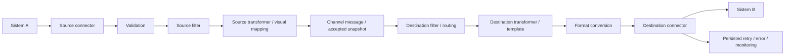

# Final UI simplification audit — 16 Oktober 2026

## Audit sebelum coding

Baseline: development, commit `a43c693`, working tree bersih; Node 24.18.1, npm 11.16.0, macOS arm64. Dokumen ini dibuat setelah pemeriksaan source dan sebelum perubahan implementasi untuk prompt final. Baseline coverage lulus 301 test / 26 suites; typecheck, lint, format dan build juga lulus. Coverage awal: statements 81.11%, branches 76.82%, functions 82.75%, lines 82.25%.

Actual usage di sini berarti jalur komponen, route, konfigurasi dan test yang benar-benar tersedia dalam repository. Tidak ada analytics frekuensi penggunaan dari pengguna; keputusan tidak mengklaim suatu fitur jarang dipakai berdasarkan statistik yang tidak tersedia.

| Area | Klasifikasi | Source / pemakaian aktual | Keputusan |
| --- | --- | --- | --- |
| Channel, Start/Stop, source/destination connectors | KEEP | ChannelForm, ChannelTable, channel.services, messageProcessor | Pertahankan engine, routing dan operasi |
| Wizard empat langkah | KEEP | ChannelForm: Source → Transformation → Destinations → Review | Pertahankan urutan dan dirty/discard guard |
| Endpoint source | KEEP | SourceEndpoint menampilkan endpoint backend; PUBLIC_BASE_URL dan INBOUND_PATH divalidasi backend | Tanpa hostname browser/hardcode production; copy/example tetap dihapus |
| Source API key | KEEP | rotateSourceCredential, ChannelForm, onboarding, encrypted DB | Sekali tampil, rotasi invalidasi key lama, tidak menambah exposure |
| Source validation | ADVANCED | channelDraft preset hanya JSON object; backend XML/HL7 sudah syntax-checked | Basic untuk format yang didukung; custom schema hanya setelah dipilih; profile existing dipertahankan |
| Source filter | ADVANCED | FilterEditor accept/reject/custom; filterScript dijalankan QuickJS | Tambahkan builder Field / Operator / Value tanpa eval; validasi dipisahkan dari keputusan routing |
| Source transformer | ADVANCED | processingScript juga menyimpan mapping visual | Tampilkan status dan Configure; satu stage engine, bukan dua transformasi fiktif |
| Mapping / preview | KEEP | TransformationEditor, fieldMapping compiler, preview-transformation | Required/default/preview tetap; custom script tidak ditimpa tanpa pilihan eksplisit |
| Source response | LEGACY | responseScript masih dibaca, dieksekusi dan diekspor | Standard response untuk channel baru; hanya notice kecil untuk channel legacy |
| Destination filter / transformer | ADVANCED | DestinationEditor saat ini menggabungkan keduanya dalam Message processing | Pisahkan menjadi Destination filter dan Destination transformer |
| Destination response editor | REMOVE dari UI baru / LEGACY di backend | Editor Response processing masih tersedia saat membuat channel | Hapus editornya; pertahankan responseScript existing, runtime dan import/export |
| Retry / timeout / multi destination | KEEP / ADVANCED | Delivery settings, Add Destination, worker, circuit/lease/snapshot | Pertahankan, unit seconds dan kontrol lanjutan tetap tersedia |
| Review | KEEP / SIMPLIFY | Flow visual, Source, Transformation dan retry/timeout sudah ada | Tambahkan Source processing: Validation / Filter / Transformer dari konfigurasi nyata |
| Change summary | REMOVE dari flow biasa | UI memberi summary otomatis, backend tetap menyimpan audit/revision | Pertahankan otomatis; field administrasi opsional tetap dapat tersedia |
| Messages / redaction / resend | KEEP | LogDetailModal, monitor queries, raw permission/audit, attempt history | Label tahap sudah benar; pertahankan payload/snapshot/permission dan konfirmasi resend |
| Delivery duration / attempts | KEEP / COMPLETE | HTTP status sudah tersimpan; latency hanya histogram process, bukan record attempt | Tambah nullable metadata durasi aktual; jumlah attempt dari history tersimpan, tidak ditebak dari retryCount |
| Dashboard | SIMPLIFY | Empat kartu, health, Needs attention, Channel activity dan banner umum | Running / Stopped / Messages today / Successful / Failed / Retrying / Recent failures; pakai data SQL, tanpa chart dummy |
| Settings | KEEP / ADVANCED | Account, Users, Audit, sessions/alerts/runtime JSON | Users/Roles/Audit/System information; sessions/alerts/diagnostics dilipat sebagai operational tools |
| Raw JSON runtime settings / helper berulang | REMOVE dari tampilan utama | RuntimeSettingsPanel menampilkan JSON; helper lama sudah sebagian dihapus | Ringkasan informasi berlabel, detail hanya bila memberi nilai operasional |

## Before / after flow

Engine before dan after tetap:



Main UI before: Source dengan filter/script sebelum validation; Transformation dengan mapping; Destinations dengan Message processing / Delivery / Response; Review tanpa ringkasan Source processing. Overview memiliki kartu dan panel operasional yang berulang. Settings mencampur account, kontrol operasi dan runtime JSON.

Main UI after: Source menampilkan nama / connector / format / key / endpoint; Advanced hanya Validation → Source Filter → Source Transformer. Transformation tetap mapping tunggal dengan preview. Destinations default satu, dengan Advanced Filter → Transformer → Delivery. Review merangkum source processing, mapping, destination dan delivery. Overview fokus enam angka nyata dan recent failures. Settings memisahkan Users / Roles / Audit / System information, dengan kontrol operasi melalui disclosure.

## Compatibility dan implementasi

- Semua script/profile/response legacy tetap disimpan dan diproses; tidak drop column, tidak menghapus channel/payload/revision.
- Builder filter menghasilkan script boolean canonical dalam filterScript existing; script custom hanya dikenali bila metadata dan isi compiler utuh. Input tidak menjadi JavaScript mentah. Kondisi tidak valid menghalangi Save dan preview.
- Basic syntax validation memakai metadata profile opsional; profile JSON-object legacy tidak diam-diam diganti. Required mapping tetap diperiksa setelah source filter agar pesan yang sengaja difilter tidak salah menjadi validation error.
- Main mapping dan Advanced source transformer adalah dua tampilan dari processingScript yang sama. Multi destination mempertahankan transformer/filter masing-masing.
- HTTP success envelope legacy dipertahankan; alias messageId/status dapat ditambah secara kompatibel. Source/destination response script lama tetap berlaku.
- Metadata latency memerlukan migration additive 007; record lama tetap unknown. Startup/deployment/restore guards dan smoke tests harus konsisten sebelum migrasi development. Tidak ada reset atau operasi production.
- Acceptance menggunakan data sintetis yang diminta: RM-000123 / Siti Aminah / F / 1993-08-17, dibandingkan dengan XML aktual yang diterima loopback HTTP destination dan metadata Messages. Browser fixture bukan bukti pengiriman network; native SQL/runtime test menjadi bukti tersendiri.

## Hasil akhir

Implementasi mempertahankan pipeline Mirth-style dan wizard Source → Transformation → Destinations → Review. Nama channel, connector, format, API key dan endpoint tetap langsung terlihat. Validation, filter dan transformer masuk disclosure; destination memiliki kelompok filter, transformer dan delivery terpisah. Mapping visual tetap menjadi tampilan utama, dengan status validation/filter/transformation dan `Network delivery: NOT SENT` pada preview.

| Area | Hasil | Compatibility |
| --- | --- | --- |
| Source validation | No additional / Basic / Custom; editor schema hanya setelah Custom dipilih | Basic JSON/XML/HL7 melalui metadata opsional; profile JSON-object legacy tidak ditimpa |
| Source/destination filter | Builder Field / Operator / Value, accept/skip preset dan custom Advanced | Disimpan dalam filterScript existing, dieksekusi pada sandbox yang sama; bukan eval dari input pengguna |
| Source transformer | Status dan Configure, main mapping tetap satu stage processingScript | Custom script existing tetap custom; tidak dibuat stage transformasi tambahan |
| Response scripts | Tidak ada editor response pada flow baru | Script source/destination legacy tetap disimpan, dieksekusi dan dapat import/export; UI hanya memberi notice |
| Review dan audit | Source processing, flow dan delivery; summary otomatis berdasarkan area berubah | Audit area mencatat proposal draft dalam transaksi yang sama; running revision tetap berubah melalui publish |
| Messages | Inbound / Source processed / Outbound / Delivery result, status HTTP, duration dan attempts | Raw tetap permission-controlled dan diaudit; durasi/count yang tidak diketahui ditampilkan Not recorded |
| Overview | Running, Stopped, Messages today, Successful, Failed, Retrying dan Recent failures | Query data nyata; sukses/gagal menghitung inbound, retry menghitung delivery pending, tanpa chart dummy |
| Settings | System information, Users, Roles, Audit | Sessions/alerts/diagnostics dipertahankan dalam operational disclosure dan mengikuti permission |

## Screenshot UI baru

Seluruh screenshot berasal dari browser test dengan fixture sintetis. Angka fixture menguji tampilan, bukan pengukuran traffic production.

| Tampilan | Screenshot |
| --- | --- |
| Source dan Advanced | [Source](screenshots/usability/lite-source.png) |
| Mapping dan preview XML | [Transformation](screenshots/usability/lite-transformation.png) |
| Destination dan kelompok Advanced | [Destinations](screenshots/usability/lite-destinations.png) |
| Flow dan Source processing | [Review](screenshots/usability/lite-review.png) |
| Enam metrik dan Recent failures | [Overview](screenshots/usability/lite-overview.png) |
| Informasi sistem dan operational tools | [Settings](screenshots/usability/lite-settings.png) |

## Regression, E2E dan bukti command

| Command / pemeriksaan | Hasil akhir aktual | Batas bukti |
| --- | --- | --- |
| `npm run test:coverage` | PASS — 332 tests, 28 suites | Unit/API memakai synthetic fixtures; socket loopback memerlukan akses di luar sandbox |
| `npm run typecheck` | PASS | Client dan server |
| `npm run lint` | PASS | Tidak ada lint error |
| `npm run format:check` | PASS | Seluruh target script formatter repository |
| `npm run build` | PASS | Production client dan compiled server; build client diulang setelah penyempurnaan label preview |
| `npm run test:e2e` | PASS — 53 tests | Browser dengan synthetic API fixtures, keyboard/mobile, permission dan accessibility; bukan browser yang terhubung ke production |
| `npm run test:sql` dengan environment disposable terisolasi | PASS — 19 tests | PostgreSQL 18.4 loopback; schema mirth_test_* baru dihapus setelah suite |
| CLI `npm run db:migrate` dua kali | PASS | Database disposable; versions tepat 1–7, initial revision existing channel dan additive columns |
| `npm run test:runtime` dengan `ENV_FILE=/dev/null` dan disposable TEST_DATABASE_URL | PASS | Compiled startup, health/readiness, metrics access control dan SIGTERM saat accepted delivery aktif |
| `npm run docs:check` | PASS — 46 paths / 50 operations | OpenAPI tetap JSON-valid YAML |
| `npm run secrets:scan` | PASS — findings kosong | Targeted current-source scanner; bukan konfirmasi rotasi seluruh historical credential |
| `git diff --check` | PASS | Tidak ada whitespace error |
| Pemeriksaan local Markdown links | PASS — 52 links | Termasuk screenshot dan anchor manual upgrade/verifikasi |
| Development migration preflight lalu `npm run db:migrate` | PASS | MiniMirthDev/public, additive 007; bukan reset dan bukan production |
| Compiled development startup, GET /health, GET /ready, SIGTERM | PASS — HTTP 200 / 200, exit 0 | Port loopback sementara 19092, tanpa payload; proses uji sudah dihentikan |
| Fresh `npm ci` dan dependency audit | NOT RERUN | Tidak ada dependency/package-lock berubah; hasil install/audit sebelumnya tidak diklaim sebagai run baru |
| Docker, remote GitHub CI, hospital UAT, load/HA/security/DR qualification | NOT TESTED dalam perubahan ini | Memerlukan environment dan acceptance deployment |
| Native schema-7 pg_dump/pg_restore drill | NOT TESTED | Client pg_dump/pg_restore tidak tersedia; source tests backup tetap tercakup, rehearsal schema-5 terdokumentasi terpisah |

Coverage akhir: **statements 81.90%, branches 78.61%, functions 83.63%, lines 82.96%**; seluruh kategori meningkat terhadap baseline. Tidak ada gate yang diturunkan.

SQL acceptance mengirim fixture RM-000123 / Siti Aminah / F / 1993-08-17 melalui HTTP source ke HTTP receiver loopback aktual. Test membandingkan XML `<Patient>` dengan empat field yang diminta, response SUCCESS, alias messageId/status, HTTP 200, duration non-negatif, attempt count 1, serta inbound/source-processed JSON dan outbound XML dari monitor. Pesan ORM valid yang ditolak source filter tidak menghasilkan pengiriman. Suite juga menguji routing/multi destination, response legacy, credential rotation, draft/publish/rollback dan repeat migration. Browser fixture tidak digunakan sebagai bukti network delivery.

Review akhir menemukan hasil processing negatif yang sudah dipersist masih mengembalikan HTTP 502 tanpa code/message tingkat atas. Response kini menambahkan `MESSAGE_PROCESSING_FAILED`, pesan aman, requestId dan details kosong; `result` lengkap termasuk custom response legacy tetap sama. Lima regression case memeriksa FAILED/PARTIAL/IN-ERROR dan bahwa FILTERED 200 / QUEUED 202 tetap kompatibel. Targeted API 23/23 lulus, lalu full coverage, build dan quality checks dijalankan ulang. Native SQL/runtime berhasil sebelum perubahan envelope terakhir; transport/persistence tidak berubah, dan pemeriksaan startup development diulang pada artifact final.

Kegagalan yang ditemukan dan diperbaiki:

| Percobaan | Error / root cause | Perbaikan dan hasil akhir |
| --- | --- | --- |
| Targeted `npx vitest run` untuk usability API / monitor worker | EPERM ketika membuka listener loopback | Jalankan ulang dengan akses loopback; targeted dan full suites PASS |
| `npx vitest run server/test/profile-validation.test.ts` | AJV strict schema menolak required field tanpa properties pada fixture | Lengkapi fixture JSON Schema; test dan full coverage PASS |
| `npx playwright test client/e2e/usability.spec.ts` | Empat assertion baru memakai locator bersaing / nama kontrol tidak sesuai setelah disclosure berubah | Perbaiki locator terhadap UI aktual; targeted 31 dan final 53 browser tests PASS |
| Screenshot Overview awal | Screenshot diambil sebelum request Recent failures selesai | Tunggu row hasil fixture sebelum capture; final 53 browser tests PASS |
| Development startup smoke pertama (`node --import tsx --input-type=module`) | Guard memeriksa process.env.PG_SCHEMA yang tidak diisi; default schema public ada pada config | Gunakan config.database.schema yang tervalidasi; startup/health/ready/shutdown PASS |
| `sed` diagnostic reads pada server/src/config.ts dan server/src/middleware/error.middleware.ts | No such file or directory | Cari ulang dengan rg; baca path aktual config/env.ts dan middleware/errorHandler.ts |

Disposable PostgreSQL khusus sesi ini dan kedua database sintetisnya sudah dihentikan/dihapus setelah pengujian. Backend pengguna dan cluster lain tidak dihentikan.

## Database dan deploy development

Migration `007_delivery_timing.sql` menambah `MessageDestinationLog.request_duration_ms` nullable integer dengan CHECK >= 0. Timing diukur sekitar transport call; script response dan admission/circuit wait tidak dihitung sebagai request duration. Record lama tetap NULL. Attempt count memakai complete retained history, tidak ditebak dari retryCount; history legacy/campuran yang tidak cukup informatif tetap unknown.

Preflight dan migrator transactional/advisory lock sudah dijalankan terhadap development MiniMirthDev. Versions sekarang tepat 1–7; counts sebelum/sesudah sama: Users 1, Channels 1, Destinations 1, Messages 2, MessageDestinationLog 1. Tidak ada reset, drop column, pengiriman payload uji ke development atau perubahan production. File .env dan keyring tidak diubah. Startup development diuji dengan MLLP dimatikan pada proses uji sementara; pengujian listener/transport terpisah ada pada regression/runtime suite.

Untuk restart development yang sudah dimigrasikan:

```sh
npm run build
npm run start
```

Untuk environment lain, siapkan backup/keyring dan jalankan `npm run db:migrate -- --dry-run`, kemudian `npm run db:migrate` sebelum start, mengikuti [operational controls](OPERATIONAL_CONTROLS.md) dan [backup/restore](BACKUP_RESTORE_RUNBOOK.md). Jangan menjalankan reset untuk upgrade ini.

Rollback mempertahankan schema, version rows, encrypted keyring, audit dan message history. Rollback/publish revision yang kompatibel sebelum menurunkan binary: binary lama belum memiliki normalisasi XML untuk canonical simple-condition baru. Mengganti artifact ke baseline a43c693 tanpa meninjau channel yang memakai konfigurasi baru tidak dijamin kompatibel. Jangan melakukan down migration atau menghapus data untuk rollback.

## Legacy yang dipertahankan dan batas produk

Source filter, source transformer, source response, destination filter/transformer/response, validationProfile, idempotency configuration, template, delivery policy, routing dan multiple destinations tetap dibaca backend. Profile/script legacy tidak dikonversi diam-diam oleh UI. Existing channel menjadi acuan draft, accepted work tetap menggunakan snapshot dan start/stop/resend/retry/error monitoring dipertahankan. Import/export tetap mengikuti redaction/credential policy existing; arbitrary trusted script dapat mengandung informasi sensitif sehingga kebijakan export tetap perlu review.

Manual diperbarui di [MIRTH_LITE_UI.md](MIRTH_LITE_UI.md). Batas production tetap tercatat pada [readiness matrix](PRODUCTION_READINESS_MATRIX.md): perubahan ini selesai sebagai implementasi source dan verifikasi lokal/development, **bukan sertifikasi production-ready**. Credential-owner rotation, certificate custody, production backup/restore/DR drill, hospital profiles/UAT dan load/security review masih memerlukan verifikasi runtime.

## Daftar file berubah

Daftar berikut mencakup perubahan implementasi, test, migration, manual dan screenshot untuk permintaan final simplification.

```text
CHANGELOG.md
README.md
client/e2e/ui.spec.ts
client/e2e/usability.spec.ts
client/src/features/channels/ChannelForm.tsx
client/src/features/channels/DestinationEditor.tsx
client/src/features/channels/DryRunPreview.tsx
client/src/features/channels/FilterEditor.tsx
client/src/features/channels/TransformationEditor.tsx
client/src/features/channels/channelDraft.ts
client/src/features/monitor/LogDetailModal.tsx
client/src/features/overview/OverviewPage.tsx
client/src/features/settings/RuntimeSettingsPanel.tsx
client/src/features/settings/SettingsPage.tsx
client/src/index.css
client/src/services/monitor.api.ts
client/src/types/monitor.ts
client/test/channel-usability.test.ts
docs/ARCHITECTURE.md
docs/BACKUP_RESTORE_RUNBOOK.md
docs/ERROR_CODE_CATALOG.md
docs/MIRTH_LITE_UI.md
docs/OPERATIONAL_CONTROLS.md
docs/PRODUCTION_READINESS_MATRIX.md
docs/UI_SIMPLIFICATION_AUDIT.md
docs/openapi.yaml
docs/screenshots/usability/lite-destinations.png
docs/screenshots/usability/lite-overview.png
docs/screenshots/usability/lite-review.png
docs/screenshots/usability/lite-settings.png
docs/screenshots/usability/lite-source.png
docs/screenshots/usability/lite-transformation.png
scripts/runtime-smoke.mjs
server/migrations/007_delivery_timing.sql
server/src/scripts/development-reset-core.ts
server/src/scripts/migrate.ts
server/src/scripts/verify-development-reset.ts
server/src/server.ts
server/src/services/channel.services.ts
server/src/services/engine/delivery.ts
server/src/services/engine/repository.ts
server/src/services/message.services.ts
server/src/services/monitor/mapping.ts
server/src/services/monitor/repository.ts
server/src/services/profileValidation.services.ts
server/src/services/restoreVerification.services.ts
server/src/services/revision.services.ts
server/src/services/script.services.ts
server/src/utils/channelChanges.ts
server/src/utils/simpleCondition.ts
server/src/utils/validator.ts
server/test/channel-changes.test.ts
server/test/channel-db.test.ts
server/test/engine.test.ts
server/test/monitor-worker.test.ts
server/test/profile-validation.test.ts
server/test/simple-condition.test.ts
server/test/sql.integration.ts
server/test/startup.test.ts
server/test/usability-api.test.ts
```
